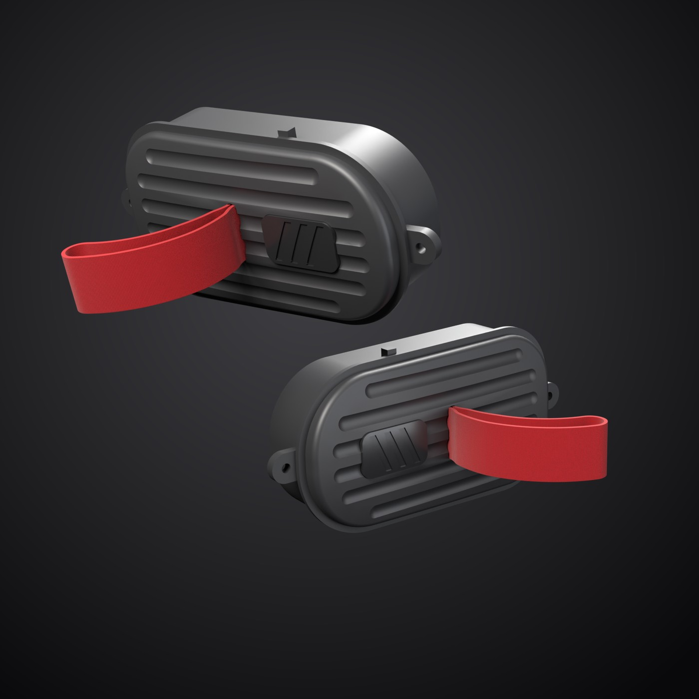
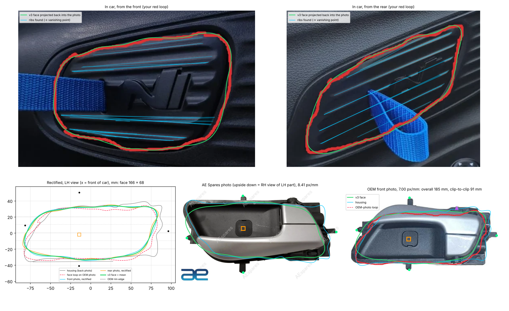

# Door strap module for the Hyundai i20 N (BC3, 2021+), front doors - v3

An open, parametric design for a motorsport-style **webbing pull strap that replaces the
interior door-release handle**. It reuses the car's original release cable, latch,
door-card screw and clip points. The same functional idea as the Scuderia21 LAB "Door Strap
Hyundai i20N" (PF-PL-AU-0028), redesigned from scratch as editable CAD.



**v3 takes the face outline from your two in-car photos of a fitted strap plate** and the
mounting interface from photos of the OEM inner handle ([`ref/`](ref)):

- **Face:** the red outlines on the in-car photos. The plate's ribs are straight and
  parallel, so their vanishing point in each photo gives the perspective. Both outlines are
  projected flat; the two views agree to 1.8 mm rms. Their average is placed on the OEM
  handle, its lower edge 2 mm inside the OEM rim.
- **Grooves:** five grooves at a 10.0 mm pitch, taken from the rib spacing measured on the
  flattened photos.
- **Housing:** the red loop on the photo of the back of the OEM handle (unchanged from v2).
- **Clips, door-card screw and pivot:** the OEM front photo plus the AE Spares photo. That
  photo shows the same handle upside down; flipped, it lines up with the front photo within
  ~2 mm at five points, so the two are averaged.



Top: the v3 face (green) projected back into your photos lands on your red outlines. Bottom:
both flattened outlines, then the result on the two OEM photos. Code:
[`cad/oem_trace.py`](cad/oem_trace.py).

> **Status: design study, not fit-tested on a car.**
> 1. **Scale:** photos carry no ruler. The trace uses 7.0 px/mm, which makes the OEM handle
>    **185 mm overall** (rear end of the frame to the tip of the front clip) and **91 mm**
>    clip tip to clip tip. Four standard parts agree at that scale: clip heads ~7 mm, pivot
>    pin ~3 mm, screw cap ~17 mm, spring ~9–10 mm. **Measure your handle and run
>    `python cad/oem_trace.py --overall <mm>`** (or `--height <mm>`). Everything traced rescales.
> 2. **Face proportions** depend on the phone's focal length, which the in-car photos don't
>    record. 1350 px (about a 32 mm-equivalent lens) is used because it gives the best match
>    to the visible face on the OEM handle; 1100–1400 px changes the face by under 4 %. If you
>    can measure the opening in your door card, run `oem_trace.py --face-length <mm>`.
> 3. Hidden details: clip depth, screw-seat depth and the cable end-fitting can't be seen in
>    the photos. Check them against the OEM part (see [Critical measurements](#8-critical-measurements)).
> 4. Print the 15-minute **fit gauge** before the real parts.

---

## 1. Research summary

**Scuderia21 LAB, Door Strap Hyundai i20N, from the official listing**
([shop.scuderia21.com](https://shop.scuderia21.com/en/products/hyundai-i20n-door-strap))

| Item | Listing says |
|---|---|
| Fitment | Hyundai i20 N, 2021 to present |
| Function | Replaces the interior door-release handle with a strap. Keeps the original opening **and locking** mechanisms |
| Install | Plug & play, no modification to the car or the original handle. About 10 min |
| Body | "Tough ABS-like resin", UV-resistant paint. **PET-CF** parts carry the loads. Stainless pins and washers |
| Variants | 18 colours. Front pair **€128** (PF-PL-AU-0028 = red). Set of 4 **€236**. Race use only |

**The OEM handle (your photos, plus searches)**
- The handle module snaps into the back of the door card with **four T-head clips**: top,
  bottom, front and rear. The lever pivots on a vertical stainless pin at the **front end**
  (die-cast lever, torsion spring).
- The **square cap** in the handle cup covers the **single Posidriv door-card screw**. The
  i20 N forum says one screw behind a small hatch below the handle, plus clips, holds the card
  ([n-cars.net](https://n-cars.net/forums/goto/post?id=174687)).
  So the replacement **must keep that screw reachable**. Here the badge is a magnetic cover over it.
- The BC3 owner's manual says one pull of the front inner handle unlocks **and** opens the
  door, and locking uses the central switch
  ([manual p.150](https://www.manualslib.com/manual/2053931/Hyundai-Bc3.html)). So there is
  one release cable.
- **Part numbers.** The name "HANDLE ASSY-DOOR INSIDE,RH, INT;RBL" belongs to
  **82620-C7000RDR**, listed for the 2nd-gen i20 Elite/Active
  ([mechdeals](https://mechdeals.com/product-detail/hyundai-i20-handle-assy-door-inside-rh-int-rbl-19587)).
  The BC3 i20 front handles are **82610-Q0xxx (LH) / 82620-Q0xxx (RH)**, for example
  [82620Q0000](https://ecooparts.com/en/used-auto-part/hyundai/i20-iii/42928196_-82620q0000-hyundai-i20-iii-bc3-bi3-10-t-gdi.html).
  The photos match the BC3 handle's interface: the clips, pin and blocks line up with the
  Scuderia21 part once mirrored. The AE Spares listing photo is the same handle as the
  front photo (five features agree within ~2 mm after flipping it).
- No dimensioned drawing of this handle is public. Parts sites show only exploded catalogue
  diagrams, which is why the photo trace plus one calibration measurement is used.

---

## 2. How it works


1. The **housing** sits in the door-card aperture where the OEM handle sat. Its face follows
   your in-car outline, its body the traced OEM housing, and it snaps in with OEM-position clips. The door-card
   screw passes through its **screw boss**, so the screw clamps the module, the card and the
   door together, exactly like the OEM cup does.
2. A sewn **20 mm webbing loop** passes through a 21.4 × 6 mm slot and wraps a Ø4 stainless
   **strap pin** in the lever cheeks.
3. The **bell-crank lever** (PET-CF) pivots at the **OEM pivot position** on a Ø4 × 60
   stainless pin with M4 thrust washers. Pulling the strap turns it **40°**. The 17 mm cable
   arm pulls the **OEM release cable 11.6 mm** while the strap travels 20.5 mm (force ratio 1.76 : 1).
4. The latch's own return spring pulls the lever back to a stop moulded into the housing. The
   same stop limits full travel.
5. The sheath fitting sits in an **adjustable slider** at the pivot end (6.2 mm range, M3
   clamp), so you can set zero cable preload at rest.

| Strap pulled (mm) | 0 | 5.2 | 10.4 | 15.5 | 20.5 |
|---|---|---|---|---|---|
| Lever angle (°) | 0 | 10 | 20 | 30 | 40 |
| Cable pulled (mm) | 0 | 2.9 | 5.8 | 8.8 | 11.6 |

**Checked in CAD (v3):** the lever was swept from rest to full pull in 2.5° steps. It has zero
intersecting volume with the housing, slider, cable and both pins. The badge, magnets,
door-card screw, washers and slider also have zero overlap. All 8 print STLs are watertight.
The v3 face sits higher at the pivot end, so the lever hub was shortened to ±20.5 mm to keep
a solid lower pivot boss.

---

## 3. Specifications (at the default photo scale)

| | |
|---|---|
| Fits | i20 N (BC3) 2021+, front doors, LH and RH (mirror). OEM photos are LH |
| Visible face | 164.0 × 67.0 mm (in-car outline, flattened). Crown R160 vertical / R1500 horizontal. 5 grooves, pitch 10.0 mm |
| Housing outline | 170.8 × 72.1 mm. Depth 40 mm behind the face |
| Clips | 4 OEM-position T-head clips: clip tip to clip tip 177.6 mm (front/rear) and 91.4 mm (top/bottom) |
| Overall incl. clips | 179.1 × 91.4 × 40 mm |
| Door-card screw | Ø6 through, Ø12.5 counterbore, head seat 34 mm deep. Covered by a 32 × 22 mm magnetic badge |
| Strap | 20 mm polyester webbing, cut 255 mm. Loop sticks out ~61 mm at rest, ~81 mm at full pull |
| Travel | Lever 40°, cable 11.6 mm, strap 20.5 mm. Cable free length 22.0 mm nominal (18.9–25.1) |
| Mass per door | Housing 96 g (resin), lever 11 g, slider 4 g, badge 3 g |

Drawings: [`renders/drawing_housing.pdf`](renders/drawing_housing.pdf), [`renders/drawing_lever.png`](renders/drawing_lever.png).

---

## 4. Bill of materials (per door)

| Qty | Part | Spec |
|---|---|---|
| 1 | Housing LH or RH | `stl/housing_LH.stl` / `housing_RH.stl` |
| 1 | Lever LH or RH | `stl/lever_LH.stl` / `lever_RH.stl` |
| 1 | Cable slider (same part both sides) | `stl/cable_slider_x2.stl` |
| 1 | Badge / screw cover | `stl/badge_insert_x2.stl`. Swap in your own logo |
| 4 | Disc magnets | Ø6 × 2 mm N52. Two in the badge, two in the pocket, opposite poles facing |
| 1 | Pivot pin | Ø4 × 60 mm stainless (ISO 2338 4×60, or 4 mm 304 rod) |
| 1 | Strap pin | Ø4 × 30 mm stainless (ISO 2338 4×30) |
| 2 | Thrust washers | M4 ISO 7089 A2 (4.3 × 9 × 0.8) |
| 1 | Clamp screw + insert | M3 × 16 socket head ISO 4762 A2, M3 × 5.7 heat-set insert |
| 1 | Webbing | 20 mm polyester, ~1.6 mm thick, **255 mm** (228 mm loop + 25 mm box-X stitched overlap) |
| | Reused from the car | Door-card screw, release cable, card clips |

## 5. Printing

| Part | Process | Notes |
|---|---|---|
| Housing | **SLA tough/ABS-like resin**, or ASA / PET-CF FDM | Exported face up. Supports inside and under the clips and pads |
| Lever | **PET-CF / PA-CF**, hub vertical as exported, 5 walls, 60–100 % infill | Arms are loaded in-plane with the layers |
| Slider, badge | As exported | Press the magnets in with a drop of CA |
| Fit gauge | PLA, about 15 min | Deck, clip pads and clips. Test it in the door card |

Holes are nominal: Ø4.0 press fit for the pins, Ø4.2 for the hub. Avoid PLA for the real parts,
because a parked car gets hot.

## 6. Assembly

1. Sew the 20 mm webbing into a loop (25 mm overlap, box-X stitch, heat-sealed ends).
2. Put the loop between the lever cheeks and press in the strap pin. Feed the loop out
   through the face slot, then drop the lever in.
3. Grease the washers and fit one at each end of the hub. Press the pivot pin in from the top.
4. Heat-set the M3 insert and fit the slider loosely with the M3 × 16.
5. Glue the magnets into the badge and the pocket, opposite poles facing.

## 7. Installation (about 15 min per door)

1. Lift the cap on the OEM handle and remove the Posidriv screw. Unclip the card, lift it off
   the window ledge and unplug the switches.
2. Unhook the release cable from the OEM handle and unclip the handle from the back of the
   card. Keep it, because the swap is reversible.
3. Clip the module into the card in the same place.
4. Put the nipple into the lever cradle, the inner cable into its slot and the sheath fitting
   into the slider.
5. Slide the anchor until the cable is just taut with the lever on its stop, back off about
   0.5 mm and tighten. **No preload at rest.**
6. Bench test 20 pulls. Then close the door and confirm full latching, the outside handle and
   central locking.
7. Refit the card: window ledge first, then clips. Refit the **door-card screw through the
   module's screw boss**, then snap the badge over it.

## 8. Critical measurements

| # | Measure on the OEM handle | Where it goes |
|---|---|---|
| 1 | **Overall length** (rear end of the frame to the front clip tip) or clip-to-clip height | `oem_trace.py --overall` / `--height` (rescales everything traced) |
| 1b | Length of the handle opening in the door card | `oem_trace.py --face-length` (face only) |
| 2 | Clip depth from the face and clip shape | `CLIP_Y`, `CLIP_T`, `CLIP_HEAD_L` |
| 3 | Depth of the screw-head seat in the cup, screw Ø | `SCREW_SEAT_Y`, `SCREW_HOLE_D` |
| 4 | Cable end-fitting length and width, sheath Ø, inner Ø, nipple | `FITTING`, `SHEATH_D`, `CABLE_D`, `NIPPLE_D/L` |
| 5 | Where and in which direction the cable leaves the OEM housing | `CHANNEL_X`, `CABLE_Y`, `CABLE_Z` |
| 6 | Nipple travel at latch release, and at the OEM end stop | `HOOK_R` |
| 7 | Free depth behind the trim, glass fully down | `DEPTH` |

## 9. Safety

The interior release is a safety part. Never leave the cable preloaded. Check full latching
and that the strap returns to its stop every time. Treat this as track/competition use and
check local road rules.

## 10. Branding / IP

This is an independent design that implements the same function. It has no Hyundai "N" logo
(a trademark), and the badge is a generic, replaceable insert. If you sell parts, check
registered designs and leave out Hyundai, N and Scuderia21 branding.

## 11. Files

```
ref/                  your photos with the red outlines: OEM handle front/back (LH),
                      in-car front close-up + rear oblique, AE Spares OEM photo
cad/oem_trace.py      photo trace -> cad/oem_trace.json (face, housing, grooves, clips,
                      screw, pivot; mm) + renders/oem_trace_overlay.png
cad/door_strap.py     parametric model (CadQuery) - reads oem_trace.json
cad/export.py         builds everything -> step/, stl/, web/, build_report.json
cad/drawing.py        HLR drawings + kinematics chart -> renders/
cad/strap.py, cad/door_mockup.py   webbing mesh, illustrative trim (renders only)
render/               Blender/Cycles scenes + compositing
step/  stl/  web/  renders/
```

Rebuild after measuring:

```bash
pip install cadquery trimesh manifold3d matplotlib scikit-image shapely
python cad/oem_trace.py --overall 185          # add --face-length <mm> if measured
python cad/export.py
python cad/drawing.py renders
```

## Sources

- Scuderia21 LAB i20N door strap listing: <https://shop.scuderia21.com/en/products/hyundai-i20n-door-strap>
- Scuderia21 LAB GR Yaris door strap (sister product): <https://shop.scuderia21.com/en/products/gr-yaris-door-strap>
- n-cars.net, i20 N door panel removal: <https://n-cars.net/forums/goto/post?id=174687>
- Hyundai BC3 owner's manual, door locks (p.150): <https://www.manualslib.com/manual/2053931/Hyundai-Bc3.html>
- mechdeals, "Handle Assy-Door Inside, RH, INT;RBL" = 82620C7000RDR: <https://mechdeals.com/product-detail/hyundai-i20-handle-assy-door-inside-rh-int-rbl-19587>
- ecooparts, i20 III (BC3) interior front-right handle 82620Q0000: <https://ecooparts.com/en/used-auto-part/hyundai/i20-iii/42928196_-82620q0000-hyundai-i20-iii-bc3-bi3-10-t-gdi.html>
- AE Spares listing photo of the inner handle (your image, `ref/oem_handle_aespares.webp`)
