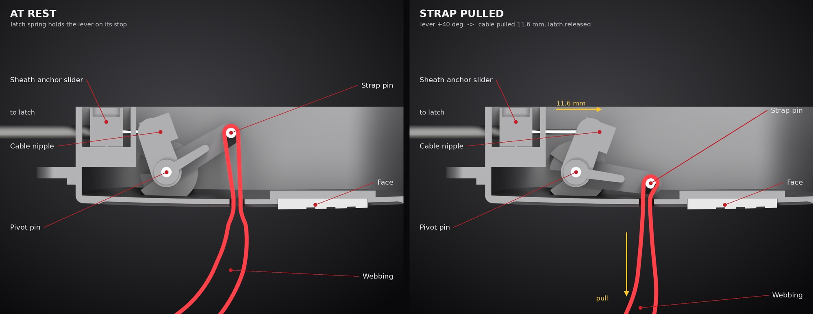
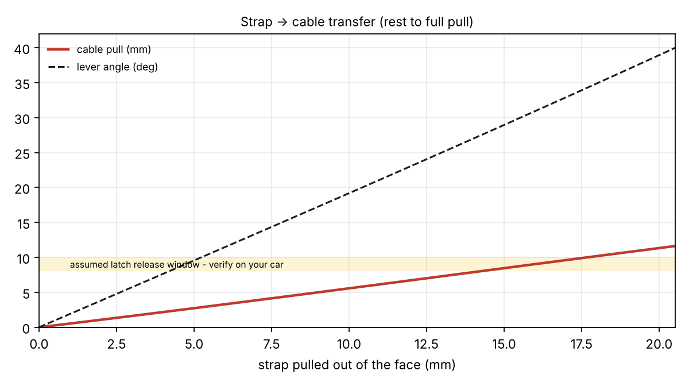

# Door strap module for the Hyundai i20 N (BC3, 2021+), front doors

An open, parametric design for a motorsport-style **webbing pull strap that replaces the
interior door-release handle**. It reuses the car's original release cable, latch and
door-card screws. The same functional idea as the Scuderia21 LAB "Door Strap Hyundai i20N"
(PF-PL-AU-0028), redesigned from scratch as editable CAD.


> **Status: design study, not fit-tested on a car.** The vehicle interface dimensions are
> estimated from photographs, because Hyundai publishes no data for the inner handle module.
> They are: trim aperture shape, screw-ear positions, cable end-fitting, cable entry, free
> length and release travel. All of them sit in one parameter block at the top of
> `cad/door_strap.py`. Measure your OEM handle and print the 15-minute **fit gauge** before
> you print the real parts. See [Critical measurements](#critical-measurements).

---

## 1. Research summary: the reference product and the car

**Scuderia21 LAB, Door Strap Hyundai i20N, from the official listing**
([shop.scuderia21.com](https://shop.scuderia21.com/en/products/hyundai-i20n-door-strap))

| Item | Listing says |
|---|---|
| Fitment | Hyundai i20 N, 2021 to present |
| Function | Replaces the interior door-release handle with a strap. Keeps full operation of the original opening **and locking** mechanisms |
| Install | Plug & play, no modification to the car or to the original handle (refittable). About 10 min |
| Body | "Tough ABS-like resin", moulded, UV-resistant paint |
| Mechanism | **PET-CF** (carbon-fibre PET) parts carry the loads. The resin body carries no load |
| Hardware | Stainless-steel pins and washers |
| Variants | 18 strap colours. Pair, front only: **€128** (SKU PF-PL-AU-0028 = red). Set of 4, front + rear: **€236** |
| Use | "Race use only". Buyer must check road legality |

The product photos show these features. A black, crowned face fills the handle pocket
of the door card. Its horizontal ribs continue the trim's ribbed pattern, and it carries a raised
badge. A 25 mm webbing loop comes out of a slot near the middle of the face. Behind the face
there are locating studs, mounting blocks and stainless pivot pins. The sister GR Yaris
product shows the internal architecture: an internal lever that the strap pulls, sitting on a
stainless pin and hooked to the OEM cable.

**i20 N (BC3) door facts**
- The front door card is held by **one Posidriv screw** behind a small square hatch just
  below the handle, plus push clips. The card hangs on a lip at the window line, and lifts off
  after the wiring and the **door-handle linkage** are unclipped
  ([n-cars.net i20 N forum](https://n-cars.net/forums/goto/post?id=174687)). So the
  handle module is fixed to the back of the door card, and its cable is what you disconnect.
- BC3 owner's manual: pulling the **front** inner handle unlocks **and** opens the door in one
  pull. Locking is done with the central door-lock switch
  ([manual p.150](https://www.manualslib.com/manual/2053931/Hyundai-Bc3.html)).
  So one release cable is enough, and the strap keeps the one-pull behaviour.

**Not public, so estimated here:** the OEM inner-handle dimensions, screw positions, cable
end-fitting geometry, cable entry point and release travel.

---

## 2. How this design works



1. The **housing** sits in the door-card aperture exactly where the OEM handle module was.
   Its crowned, ribbed face continues the trim. A flange sits behind the trim rim, and two ears
   take the OEM screws.
2. A sewn **25 mm webbing loop** passes through a 26.4 × 6 mm slot in the face. It wraps a
   Ø4 mm stainless **strap pin** held between the two cheeks of the lever.
3. The **bell-crank lever** (PET-CF) pivots on a vertical Ø4 × 70 mm stainless pin, with M4
   thrust washers. Pulling the strap rotates it **40°**. Its 17 mm cable arm pulls the
   **OEM release cable 11.6 mm** while the strap moves 20.5 mm (force ratio 1.76 : 1).
4. The **latch's own return spring** pulls the cable back. A stop finger on the hub rests
   against a stop ring moulded into the housing. The same ring also limits full travel, so the
   cable and latch are never over-pulled.
5. The cable's sheath fitting sits in an **adjustable slider** (±3.1 mm, M3 clamp into a
   heat-set insert). That lets you set zero preload at rest: the lever on its stop and the
   latch fully home.

| Strap pulled (mm) | 0 | 5.2 | 10.4 | 15.5 | 20.5 |
|---|---|---|---|---|---|
| Lever angle (°) | 0 | 10 | 20 | 30 | 40 |
| Cable pulled (mm) | 0 | 2.9 | 5.8 | 8.8 | 11.6 |



**Checked in CAD:** the lever was swept from rest to full pull in 2.5° steps. It has
**zero intersecting volume** with the housing, slider, cable, nipple and both pins at every step.
All printable STL files are watertight.

---

## 3. Specifications

| | |
|---|---|
| Fits | i20 N (BC3) 2021+, front doors. LH part, and RH as its mirror image (interface to be verified) |
| Visible face | 140 × 78 (rear) / 72 (front) mm, crown R160 (vertical) / R1500 (horizontal) |
| Face detail | 6 wave grooves R5.5 × 1.2 deep at 11.5 pitch. Badge pocket 36 × 22 mm |
| Overall incl. ears | 171 × 85.5 × 40 mm (depth behind the face apex) |
| Strap | 25 mm polyester webbing. Loop sticks out about 61 mm at rest, 81 mm at full pull |
| Travel | Lever 40°, cable 11.6 mm, strap 20.5 mm |
| Cable anchor | Seat-to-nipple free length 22.0 mm nominal, adjustable 18.9 to 25.1 mm |
| Mass per door | Housing 86 g (resin, 1.15 g/cm³), lever 12.5 g, slider 3.7 g, badge 3.3 g (PET-CF, 1.30) |
| Materials | Housing: tough ABS-like SLA resin, or ASA / PET-CF. Lever and slider: PET-CF or PA-CF. Pins and washers: A2/A4 stainless |

Full dimensions: [`renders/drawing_housing.pdf`](renders/drawing_housing.pdf) and
[`renders/drawing_lever.png`](renders/drawing_lever.png).

---

## 4. Bill of materials (per door)

| Qty | Part | Spec |
|---|---|---|
| 1 | Housing LH or RH | `stl/housing_LH.stl` / `housing_RH.stl` |
| 1 | Lever LH or RH | `stl/lever_LH.stl` / `lever_RH.stl` |
| 1 | Cable slider (same part both sides) | `stl/cable_slider_x2.stl` |
| 1 | Badge insert (optional; put your own logo on it) | `stl/badge_insert_x2.stl` |
| 1 | Pivot pin | Ø4 × 70 mm stainless (ISO 2338 4×70 A1, or 4 mm 304 rod cut to 70 mm) |
| 1 | Strap pin | Ø4 × 35 mm stainless (ISO 2338 4×35) |
| 2 | Thrust washers | M4 ISO 7089 A2 (4.3 × 9 × 0.8) |
| 1 | Clamp screw | M3 × 16 socket head ISO 4762 A2 |
| 1 | Heat-set insert | M3 × 5.7, goes into the Ø4.0 hole in the channel floor |
| 1 | Webbing | 25 mm polyester, about 1.6 mm thick, **cut 255 mm** (228 mm loop + 25 mm overlap) |
| | Thread | Bonded polyester V-69 or V-92, box-X stitch over the 25 mm overlap |
| | Reused from the car | Door-card screws and clips, the release cable |

---

## 5. Printing

| Part | Process | Notes |
|---|---|---|
| Housing | **SLA tough or ABS-like resin**, 50 µm, face up, supports on the back. Post-cure, then UV-stable satin black paint | FDM option: ASA or PET-CF, 0.12–0.16 mm layers, 4 walls, face up, tree supports inside. The exported orientation is face up |
| Lever | **PET-CF or PA-CF** FDM (hardened nozzle), hub vertical as exported, 5 walls, 60–100 % infill, tree supports under the arms | Strongest orientation: arms are loaded in-plane with the layers |
| Slider | PET-CF, as exported (pocket up) | |
| Badge | Any; as exported | Placeholder stripe motif. Swap in your own artwork |
| Fit gauge | PLA, about 15 min | Flange, ears and peg slice. Checks the aperture and screw bosses |

- Holes are nominal: Ø4.0 in the housing and cheeks (press fit for the pins), Ø4.2 in the
  lever hub (running fit). Drill or ream to suit your printer.
- **Avoid PLA for the real parts.** A parked car's interior gets very hot. Use ASA, PA-CF or
  PET-CF, or a resin with a suitably high heat-deflection temperature.

## 6. Assembly

1. Sew the webbing into a closed loop: 25 mm overlap, box-X stitch, heat-sealed ends.
2. Hold the loop between the lever cheeks and press the **strap pin** through cheek, loop, cheek.
3. Feed the free part of the loop out through the face slot from inside, and drop the lever
   into the housing.
4. Grease the washers and put one on each end of the hub. Press the **pivot pin** in from the
   top, through the top boss, washer, hub and washer, into the blind bottom boss.
5. Heat-set the M3 insert into the channel floor. Fit the slider with the M3 × 16 screw, left loose.
6. Glue the badge in with CA or epoxy.

## 7. Installation (about 15 min per door)

1. Pop the square hatch below the handle and remove the Posidriv screw. Unclip the card
   with a trim tool, lift it off the window ledge and unplug the switch connectors.
2. Unhook the release cable from the OEM handle (sheath clip first, then the nipple). Remove
   the handle module from the back of the card and keep it, because the swap is fully reversible.
3. **Measure the OEM handle** (next section) and update the parameters if needed. Print the fit gauge first.
4. Put the module into the aperture from behind and fit the OEM screws into the ears.
5. Drop the cable nipple into the lever's cradle (open towards the back). Lay the inner
   cable in the slot, and seat the sheath fitting in the slider pocket.
6. **Set the slider:** pull it rearwards until the inner cable is just taut while the lever
   rests on its stop, back it off about 0.5 mm, then tighten the M3. **There must be no cable
   preload at rest.**
7. **Bench test with the card hanging:** pull the strap and check that the latch releases with
   travel to spare. Release it and check that the lever snaps back to its stop. Do this 20 times.
   Then close the door and check it latches fully. Check the outside handle and central locking.
8. Refit the card: hang it on the window ledge, press the clips home, refit the screw.

## 8. Critical measurements

Take these from the OEM handle and update `cad/door_strap.py`, then run `python cad/export.py`.

| # | Measure on the OEM handle | Parameters |
|---|---|---|
| 1 | Visible face outline: length, rear and front heights, corner radii | `FACE_L`, `FACE_H_REAR`, `FACE_H_FRONT`, `R_REAR`, `R_FRONT` |
| 2 | Face crown, and the depth from the face to the trim rim | `CROWN_RX`, `CROWN_RZ`, `FLANGE_Y0` |
| 3 | Screw and clip positions, plus the boss contact plane | `EARS`, `EAR_Y`, `EAR_HOLE_D`, `PEGS` |
| 4 | Cable sheath end-fitting length and width, sheath Ø, inner Ø, nipple Ø × length | `FITTING`, `SHEATH_D`, `CABLE_D`, `NIPPLE_D`, `NIPPLE_L` |
| 5 | Where and in which direction the cable leaves the handle | `CHANNEL_X`, `CABLE_Y`, `CABLE_Z` |
| 6 | Seat-to-nipple free length at rest | slider nominal / `CHANNEL_X` |
| 7 | Nipple travel at latch release, and at the OEM handle's end stop | `HOOK_R` (travel = 2·`HOOK_R`·sin(`LEVER_ROT`/2)) |
| 8 | Free depth behind the trim. **Check window-glass clearance with the glass fully down** | `DEPTH` |

## 9. Safety

The interior door release is a safety part: occupants must be able to get out quickly.
- Never leave the cable preloaded. A part-pulled latch may not lock fully closed.
- After fitting, check that the door latches into the fully-closed position, the strap returns
  to its stop every time, and the release works without effort from the seated position.
- Like the reference product, treat this as **track/competition use**. Check road legality and
  type-approval rules where you live before using it on the road.

## 10. Branding / IP

This is an independent design that implements the same function. It deliberately does not copy
the reference product's exact styling. It does **not** carry the Hyundai "N" logo, which is a
Hyundai trademark: the badge is a generic, replaceable insert. If you plan to sell parts, check
for registered designs or patents. Don't use Hyundai, "N" or Scuderia21 branding without
permission.

## 11. Files

```
cad/door_strap.py     parametric model (CadQuery) - all parameters at the top
cad/export.py         builds everything -> step/, stl/, web/, build_report.json
cad/drawing.py        HLR technical drawings + kinematics chart -> renders/
cad/strap.py          webbing mesh (renders / viewer only)
cad/door_mockup.py    illustrative door-trim pocket (render only, not the real card)
render/render.py      Blender/Cycles scenes (hero, front, back, exploded, cut, installed)
step/                 parts + coloured LH/RH assemblies (STEP AP214)
stl/                  print-ready, oriented, watertight
web/door_strap_LH.glb 3-D model for viewers
renders/              images and drawings
```

Rebuild:

```bash
pip install cadquery trimesh manifold3d matplotlib
python cad/export.py
python cad/drawing.py renders
```

## Sources

- Scuderia21 LAB, Door Strap Hyundai i20N, official listing, specs and photos: <https://shop.scuderia21.com/en/products/hyundai-i20n-door-strap>
- Scuderia21 LAB, GR Yaris Door Strap (sister product, mechanism reference): <https://shop.scuderia21.com/en/products/gr-yaris-door-strap>
- n-cars.net, i20 N "Interior - Door panel removal": <https://n-cars.net/forums/goto/post?id=174687>
- Hyundai BC3 owner's manual, door locks (p.150): <https://www.manualslib.com/manual/2053931/Hyundai-Bc3.html>
