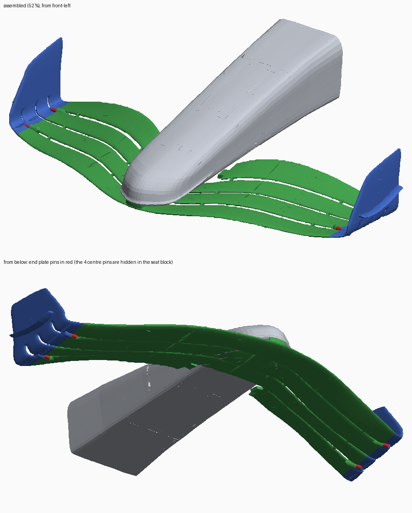
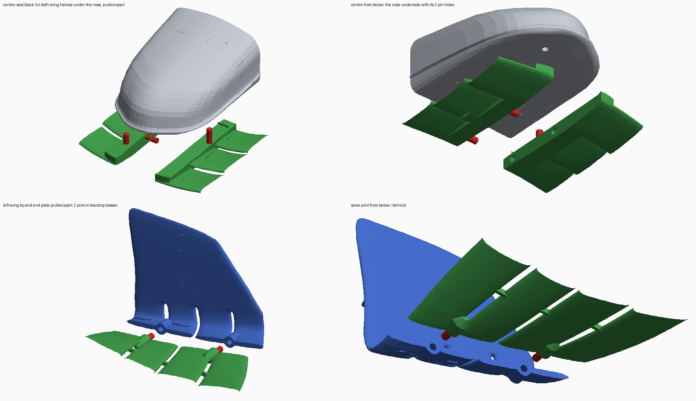
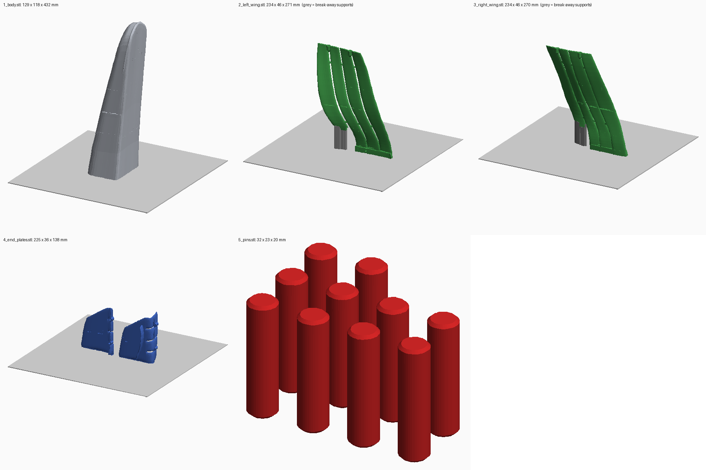

# F1 front wing: pinned print set for a 420 × 420 × 450 mm printer

Your split model (`f1+wing+with+rings+removed+FINAL_stls`: 43 printable parts plus 6 rings)
was reassembled digitally and merged into four pieces, plus a set of pins. **Everything is
at 52 %**, so every file fits a **420 × 420 × 450 mm** build volume. The files are already
turned the way they should be printed.

| # | File (`stl/`) | On the bed | How it prints |
|---|---|---|---|
| 1 | `1_body.stl` | 129 × 118 × **432** mm | standing on its rear opening, tip up |
| 2 | `2_left_wing.stl` | 234 × 46 × 271 mm | **standing up** on the centre-line face |
| 3 | `3_right_wing.stl` | 234 × 46 × 270 mm | **standing up** on the centre-line face |
| 4 | `4_end_plates.stl` | 225 × 36 × 138 mm (both plates) | **standing up** on their rear edges |
| 5 | `5_pins.stl` | 10 pins, Ø 5 × 20 mm | standing |

Original parts in each piece: body = obj_3 (tip), 2, 39, 40, 1. Left wing = obj_10, 36, 35, 9,
32, 31, 7, 23, 24, 6, 26, 25 + left halves of obj_20, 4, 5. Right wing = obj_27, 28, 13, 29, 30, 14,
33, 34, 43, 37\*, 38, 42 + right halves of obj_20, 4, 5. End plates: left = obj_11 + 12,
right = obj_16 + 41.

\* obj_37 was never uploaded. It was rebuilt as the mirror image of its twin, obj_25.

Left and right are as the driver sees them. Every file was re-loaded the way a slicer loads
it: watertight, no non-manifold edges.



## How the pieces fit together

All joints use **5 mm pins, 20 mm long**, in **5.2 mm holes about 10 mm deep in each piece**.
The holes were cut with the pieces in their assembled positions, so the two halves of every
hole are exactly in line. 8 pins are needed. `5_pins.stl` has 10 (2 spare). 5 mm steel or
wooden dowels cut to 20 mm work too.

| Joint | Pins | Hole depth in each piece |
|---|---|---|
| left wing ↔ right wing (centre line) | 2 | 10.3 mm + 10.3 mm |
| body ↔ wing (one pin in each wing half) | 2 | 9.6–9.7 mm in the wing (1 mm floor left under it) + 10.8–10.9 mm in the body |
| left wing ↔ left end plate | 2 | 10.3 mm + 10.3 mm |
| right wing ↔ right end plate | 2 | 10.3 mm + 10.3 mm |



* **Body on the wings:** the original parts have no joint between the nose and the wing, so
  nothing held the nose in place. The nose now has a fixed place: its tip is flush with the
  leading edge of the main plane, centred on the car's centre line, with its flat underside
  resting on the wing. Under the nose, a **seat block** fills the slots between the wing
  elements (27 mm wide, split down the centre with the wing). Its top is the exact shape of
  the nose's underside, so the nose sits in it without rocking. The two body pins go into this
  block, one in each wing half. They are 49 mm apart along the car, so the nose cannot twist.
  Inside the nose, each pin hole sits in a round boss with a 45° underside, so the nose still
  prints without supports.
* **Left and right wings:** two pins through the seat block, across the centre line.
* **End plates:** at 52 % the wing elements are only about 4 mm thick where they meet the end
  plate, too thin for a 5 mm pin. Each pin therefore sits in a small **teardrop-shaped boss**
  that bridges the slot between two elements (main plane / 2nd element, and 3rd element / top
  flap). The joint was also moved about 4.5 mm inboard to one flat cut through all four
  elements. Before, the elements ended at different points, and only one pin could have had a
  full-depth hole.

The holes are 5.2 mm so a 5 mm pin goes in snugly on most printers. If a pin is too tight,
run a 5.2 mm drill through the hole by hand. If it is loose, add a drop of glue.

**Assembly order:** pins into the right wing's centre holes → push the left wing on → pins into
both end plate joints → end plates on → pins into the two seat-block holes → put the body on top.
Glue each joint if you want it permanent.

## Printing



Use **no supports** in the slicer. Everything needed is built in.

* **Wings (files 2 and 3):** they stand up, with the span vertical. The aerofoils then print as
  plain stacked layers. The surface that needs support drops by about 97 % compared with lying
  flat. The seat block and the centre of the elements form the flat base (about 11 cm × 1.2 cm).
  Use a **10 mm brim**. The wing is 270 mm tall and leans back, so its weight sits about 7 mm
  behind its footprint, and the brim covers that. The only part that starts in mid-air is the
  inner end of the top flap. Each wing file includes 3 small **break-away towers** under it
  (grey in the picture). They stop 0.3 mm short of the wing, so you can snap them off after
  printing.
* **End plates (file 4):** they stand on their rear edge. The plate and its element stubs then
  grow straight up, with less than a tenth of the overhang of lying flat. The rear edge is
  slightly bent, so each plate is tilted about 4°. A strip of up to 2.6 mm fills the gap
  underneath, so the plate stands flat on the bed. Use a brim. The thin trailing edges of the
  element stubs lean out a little more steeply than 45°. That prints fine for an edge this thin,
  at worst slightly rough.
* **Body (file 1):** it stands on its rear opening, tip up. The uneven rear rim is trimmed
  flat (1.7 mm). Use a brim. The inside of the very tip is a small dome that the printer has
  to bridge.
* **Pins (file 5):** they print standing. Printed pins are fine for a display model. For a
  stronger joint, use steel or wooden 5 mm dowels.
* Wall thickness at 52 %: body ≈ 3.2 mm, wing elements ≈ 3–4.8 mm, end plates ≈ 2.4–4.7 mm.
* The small extras that are not part of these files (obj_8, 19, 15, 17, 18, 21, 22 and the 6
  `Ring_F1-006`) are unchanged. Print them from your original files **at 52 %** so they match.

## What changed compared with the original parts

* **Joints filled:** the tabbed joints had 0.1–0.4 mm fit clearance. Those gaps were filled, so
  each piece prints as one solid with no seam gaps.
* **Wing split in two** on the car's centre line, through centre pieces obj_4, 5 and 20.
* **Webs:** the four wing elements never touched each other. Each wing half has 6 small webs
  (15 cm and 44 cm from the centre at full size) that tie its elements into one rigid piece.
* **obj_37 rebuilt** as the mirror image of obj_25. It fits obj_38 with 99.2 % cross-section
  overlap and a 0.4° surface kink.
* **Seat block, pin bosses, end plate joint moved, end plate base strip, break-away towers:**
  as described above.

## Other printers / scales

To make the same pinned set for another printer, run (from the pipeline's working folder):

```
python3 tools/print_ready.py --scale 0.40 --bed 256 256 256 --out <folder>
python3 tools/make_previews.py --stl <folder> --out <folder>
```

The pins and holes stay 5 mm at any scale. Below about 45 % the end plate bosses get large
compared with the wing, so check the preview. `stl/full_size/` holds the plain pieces at 100 %
(your original size) without any joints, for reference.

## How it was made (`tools/`)

The parts had been exported in print orientation, laid out on slicer plates, so they were
first put back together:

1. **Cut faces:** every flat, sharp-edged face that crosses a part is a joint candidate
   (`faces.py`, `ends.py`).
2. **Matching:** the ends of each part are compared in 2D against mirror-image ends of the
   other parts, including tab/notch fit. Each candidate is then scored by whether the skin
   surface continues across the cut (`run_endmatch.py`, `stub_links2.py`).
3. **Exact alignment:** each joint is refined by ICP on the boundary both sides share
   (`refine_joints.py`). A global least-squares fit then closes the loops through the end
   plates (`solve_poses.py`; worst joint off by 0.03 mm).
4. **Merging:** boolean union with manifold3d, clearance slits filled and healed (`merge.py`,
   `finalize.py`, `export_all.py`). The wing halves, webs and obj_37 come from
   `build_left_right.py`.
5. **Print set:** `print_ready.py` places the nose, builds the seat block, cuts every pin hole
   in the assembled position, adds the bosses, moves the end plate joint, turns each piece to
   its print orientation, adds the break-away towers and the end plate base strip, checks
   that the pieces don't overlap and that every pin clears, and exports. `make_previews.py`
   draws the pictures.

Run order, from an empty working folder, with `F1_PARTS_DIR` pointing at the original STLs:
`match_all.py`, `run_endmatch.py`, `assemble.py`, `refine_joints.py`, `stub_links2.py`,
`solve_poses.py`, `make_bridges.py`, `export_all.py`, `build_left_right.py`, `print_ready.py`,
`make_previews.py`. Requires `trimesh`, `manifold3d`, `shapely`, `scipy`, `numpy`, `Pillow`.
