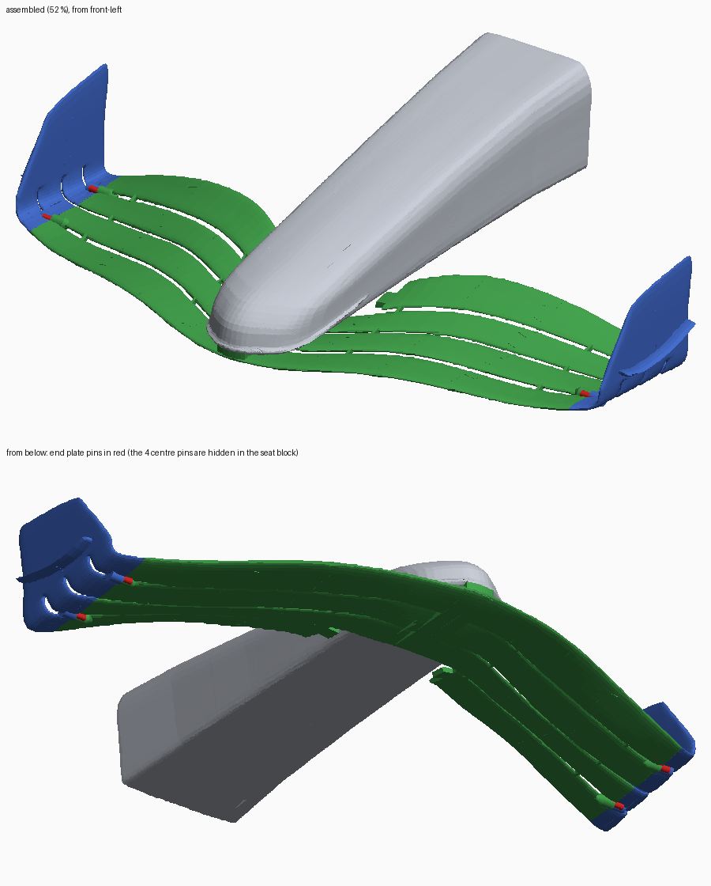
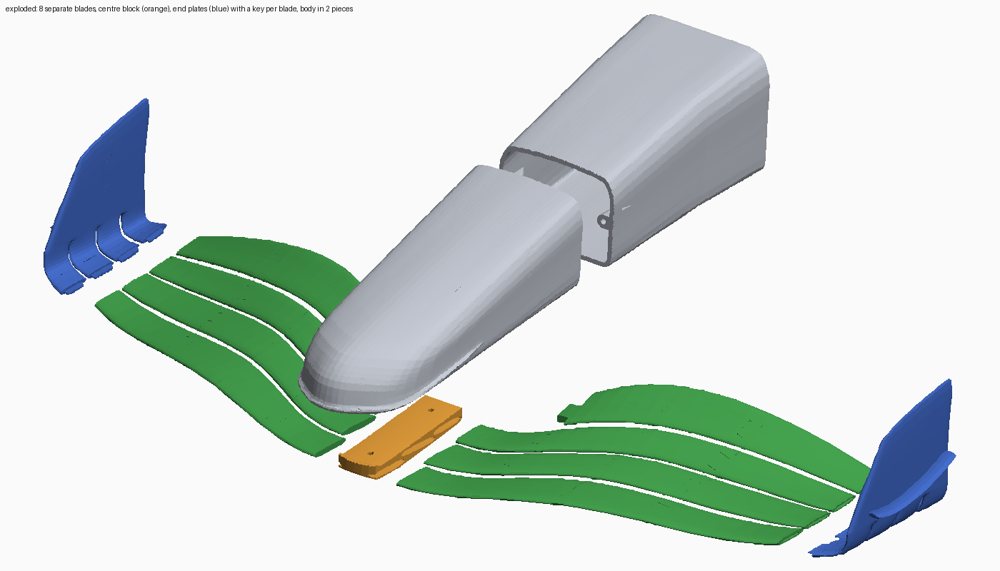
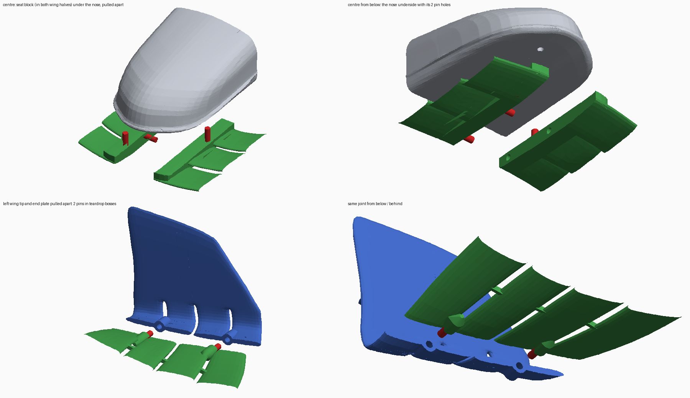
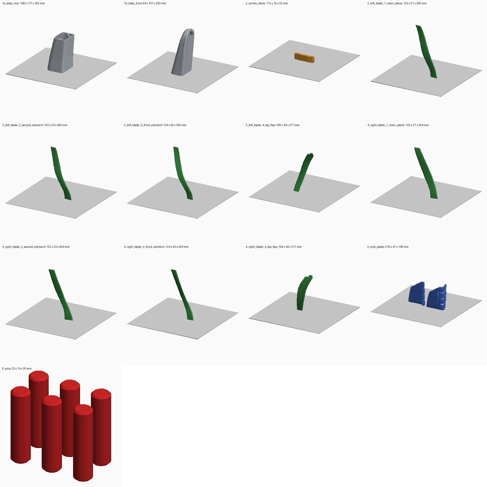

# F1 front wing: print set for a 420 × 420 × 450 mm printer

Your split model (`f1+wing+with+rings+removed+FINAL_stls`: 43 printable parts plus 6 rings)
was reassembled digitally and rebuilt as a set of clean, single-solid pieces that fit
together with pins, sockets and keys. **Everything is at 52 %**, so every file fits a
**420 × 420 × 450 mm** build volume. The files are already turned the way they should be
printed, and **none of them needs supports**.



| File (`stl/`) | On the bed (mm) | How it prints |
|---|---|---|
| `1a_body_rear.stl` | 108 × 118 × 182 | standing on its rear opening |
| `1b_body_front.stl` | 94 × 101 × 250 | standing on the cut face, tip up |
| `2_centre_block.stl` | 112 × 15 × 32 | standing on one socket face |
| `3_left_blade_1_main_plane.stl` | 132 × 21 × 265 | standing on its inner end |
| `3_left_blade_2_second_element.stl` | 132 × 23 × 265 | standing on its inner end |
| `3_left_blade_3_third_element.stl` | 124 × 30 × 265 | standing on its inner end |
| `3_left_blade_4_top_flap.stl` | 106 × 44 × 217 | standing on its outer end |
| `4_right_blade_…` (same 4) | same as left | same as left |
| `5_end_plates.stl` | 219 × 41 × 138 (both) | standing on their rear edges |
| `6_pins.stl` | 6 pins, Ø 5 × 20 (4 needed, 2 spare) | standing |

Original parts in each piece: body = obj_3 (tip), 2, 39, 40, 1. Main plane = obj_10, 36, 35,
20, 27, 28, 13; 2nd element = obj_9, 32, 31, 4, 29, 30, 14; 3rd element = obj_7, 23, 24, 5, 33,
34, 43 (each split on the centre line into a left and a right blade). Top flap left = obj_6,
26, 25; right = obj_37\*, 38, 42. End plates: left = obj_11 + 12, right = obj_16 + 41. The
centre block is new.

\* obj_37 was never uploaded. It was rebuilt as the mirror image of its twin, obj_25.

Left and right are as the driver sees them. Every file was re-loaded the way a slicer loads
it: watertight, no non-manifold edges, no hidden walls inside.



## How the pieces fit together

| Joint | How | Fit |
|---|---|---|
| body rear ↔ body front | 2 pins in bosses inside the side walls | 5.2 mm holes, 10 mm deep each side |
| body ↔ centre block | 2 pins on the centre line, 76 mm apart | 10.2–10.3 mm deep each side |
| 3 inner blades per side ↔ centre block | the blade end slides 10 mm into a socket | 0.15 mm clearance |
| 4 blade tips per side ↔ end plate | a 5 mm key on the end plate slides into a slot in the blade tip | 0.15 mm clearance |



* **Body:** one seamless shell, cut in two square to its length 182 mm above the rear face
  (where you marked it). The halves are joined by two 5 mm pins. They sit in round bosses
  inside the side walls, because the 3.25 mm wall is too thin to drill into.
* **Centre block:** it sits under the body. Its top is the exact shape of the body's
  underside, and two pins locate the body on it. The inner ends of the main plane, 2nd and 3rd
  element (left and right) slide into its six sockets, so all six blades line up exactly.
* **End plates:** the blades are only about 4 mm thick at their tips at 52 %, too thin for
  5 mm pins. Each end plate stub therefore has a thin key (tongue) that slides into a slot
  inside its blade tip. The blades sweep back towards the tip, so the four keys of an end plate
  all point the same way, following the sweep. **Slide each end plate on at that angle,
  about 18° back and slightly down from straight along the span.** The key holds the top
  flap; it is not attached anywhere else (as in the original design).
* The holes are 5.2 mm, so a 5 mm pin goes in snugly. If a pin is too tight, run a 5.2 mm drill
  through by hand. Steel or wooden 5 mm dowels cut to 20 mm work instead of the printed pins.

**Assembly order:**

1. Put 2 pins into the rear body half and push the front half on.
2. Push the inner ends of the six full-width blades into the centre block.
3. Fit the top flap's tip onto its key on the end plate. Then slide the end plate onto the
   other three blade tips at the sweep angle. Do the same on the other side.
4. Put 2 pins into the top of the centre block and set the body on it.

Glue each joint if you want it permanent.

## Printing



Turn **supports off**. Nothing needs them:

* **Body halves:** they print tip up. The hollow inside the tip has a 45° pointed roof (it used
  to be flat, and a slicer would have run a support column up through the whole nose to
  reach it). Only the ends of the pin holes are short bridges. Use a brim.
* **Blades:** each stands on one end, so the aerofoil prints as plain stacked layers. They are
  tall (up to 265 mm) and thin. They also lean with the wing's sweep, so their weight sits
  25–30 mm beyond the footprint. Use a **10 mm brim** and a slow speed for the upper half. The
  top flap stands on its outer end, so its inner end (with the small tab) is at the top.
* **Centre block:** it stands on one socket face. The ends of the sockets and pin holes are
  short bridges (5 mm).
* **End plates:** they stand on their rear edge. The edge is slightly bent, so each plate is
  tilted about 4°. A strip of up to 2.6 mm fills the gap underneath, so the plate stands
  flat. The keys are cut back at 45° underneath. Use a brim.
* Wall thickness at 52 %: body 3.25 mm, blades about 3–5 mm, end plates 2.4–4.7 mm.
* The small extras that are not part of these files (obj_8, 19, 15, 17, 18, 21, 22 and the 6
  `Ring_F1-006`) are unchanged. Print them from your original files **at 52 %** so they match.

## What changed compared with the original parts

* **No seams inside any piece:** where two original parts only touched, the merge had left
  hairline gaps (0.0001–0.005 mm) right through the walls. That is why the first body print
  broke apart at the joints. The parts are now pushed 0.05 mm into each other before merging,
  so they truly fuse.
* **Body rebuilt as one seamless shell**, lofted through 472 cross-sections of the original
  nose. The new surface follows the original to within 0.05 mm over 95 % of it, and the tabs
  and joint lines of its five original parts are gone. It is cut in two for printing, with a
  pinned joint, and the inside of the tip has a self-supporting roof.
* **Blades are separate pieces again**, as in the original design, with no webs between them.
  The three full-width elements are split on the centre line, and the new centre block holds
  their inner ends.
* **End plate joint moved** about 4.5 mm inboard to one flat cut through all four blades, with
  a key per blade.
* **obj_37 rebuilt** as the mirror image of obj_25. It fits obj_38 with 99.2 % cross-section
  overlap and a 0.4° surface kink.

## Other printers / scales

To make the set for another printer, run (from the pipeline's working folder):

```
python3 tools/print_ready.py --scale 0.40 --bed 256 256 256 --out <folder>
python3 tools/make_previews.py --stl <folder> --out <folder>
```

Pins, holes, sockets and keys keep their size at any scale. Check the keys in the preview
below about 45 %, where the blade tips get very thin. `--cut` sets where the body is split
(mm above its rear face). `stl/full_size/` holds the plain pieces at 100 % (your original
size), without any joints, for reference.

## How it was made (`tools/`)

The parts had been exported in print orientation, laid out on slicer plates, so they were
first put back together:

1. **Cut faces:** every flat, sharp-edged face that crosses a part is a joint candidate
   (`faces.py`, `ends.py`).
2. **Matching:** the ends of each part are compared in 2D against mirror-image ends of the
   other parts, including tab/notch fit. Each candidate is then scored by whether the skin
   surface continues across the cut (`run_endmatch.py`, `stub_links2.py`).
3. **Exact alignment:** each joint is refined by ICP on the boundary both sides share
   (`refine_joints.py`). A global least-squares fit then closes the loops through the end
   plates (`solve_poses.py`; worst joint off by 0.03 mm).
4. **Merging:** boolean union with manifold3d (`merge.py`, `finalize.py`, `export_all.py`).
   `merge_fused` first pushes the faces that touch at each joint 0.05 mm into each other.
   `fuse_microgaps` then seals any hairline double wall that is left. `build_left_right.py`
   builds the 8 blades and obj_37.
5. **Print set:** `print_ready.py` does the rest:
   * places the body and rebuilds it as one lofted shell (`seamless_nose`);
   * builds the centre block (`build_center_block`), the end plate keys (`end_plate_keys`) and
     the body joint (`split_nose`), and cuts every pin hole in the assembled position;
   * turns each piece to its print orientation;
   * checks that the pieces don't overlap and that every pin clears, then exports.

   `make_previews.py` draws the pictures.

Run order, from an empty working folder, with `F1_PARTS_DIR` pointing at the original STLs:
`match_all.py`, `run_endmatch.py`, `assemble.py`, `refine_joints.py`, `stub_links2.py`,
`solve_poses.py`, `make_bridges.py`, `export_all.py`, `build_left_right.py`, `print_ready.py`,
`make_previews.py`. Requires `trimesh`, `manifold3d`, `shapely`, `scipy`, `numpy`, `Pillow`.
