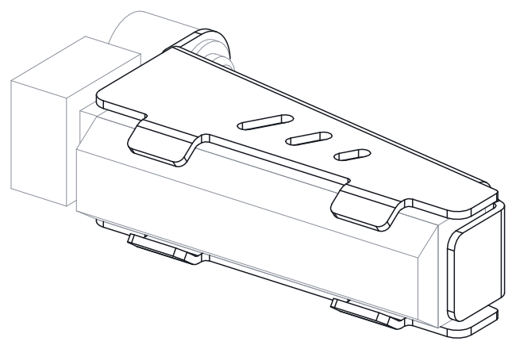
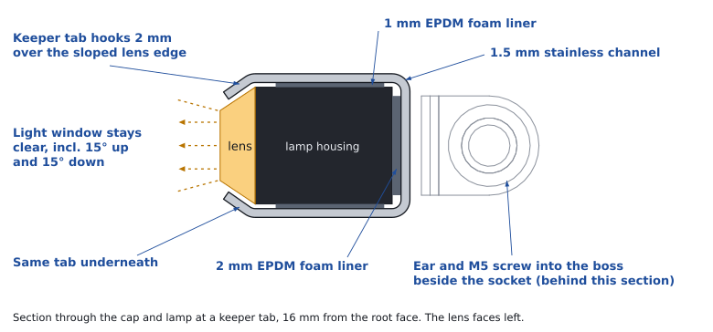
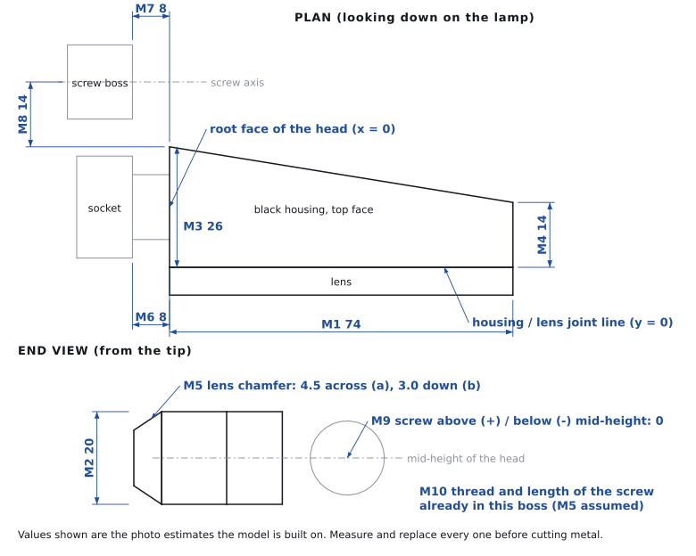
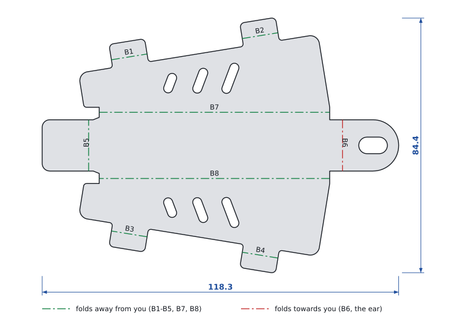

# 390 Adventure indicator cap

A bent stainless sleeve that slides over a loose or broken indicator head on a 2025+ KTM 390 Adventure, grips it through a foam liner and bolts to the screw boss beside the lamp socket. The original lamp keeps working, so you don't have to buy a new indicator. The same part fits the left and right lamps. Front and rear use the same lamp, so only the fixing ear may need to differ between them.

Drawing **IC-390A-01 rev A**. Status: **fit-check stage**.

> **Rev A is built on lamp and mount sizes scaled from product photos, not measured on a bike.**
> Take the ten measurements below and make the card fit check before you cut any metal.



| | |
|---|---|
| Material | 1.5 mm stainless 304 (option: 2.0 mm aluminium 5052-H32) |
| Mass | 68.6 g stainless, 31 g aluminium |
| Formed size | 85.5 × 53.9 × 24.6 mm |
| Flat blank | 118.3 × 84.4 mm, 8 bends, 563 mm of cut |
| Fixing | 1 × M5 into the existing boss beside the socket, slotted ±2 mm |
| Left / right | same part, turned over |

Interactive 3D review page: [`docs/design-review.html`](docs/design-review.html). Open it in a browser; it needs internet access to load three.js.

## How it holds the lamp

The stock head sits on a flexible rubber stalk. When the stalk tears or its mount cracks, the head droops or hangs on its wires. The cap takes the stalk out of the load path: the cap holds the head, and one screw holds the cap.



- **Grips four faces, leaves the lens open.** Top, bottom, back and tip are steel. The lit face of the lens is never covered.
- **Foam does the gripping.** Self-adhesive EPDM: 1 mm on the plates, 2 mm on the back wall, 3 mm at the tip, squeezed by a fifth to a third. It takes up the lamp's size spread and vibration and keeps steel off the plastic.
- **Tabs stop it sliding off.** Four keeper tabs hook 2 mm over the sloped strip above and below the lens. They touch only that strip.
- **One screw takes the load.** The ear sits on the boss beside the socket and reuses its screw.
- **Same part on both sides.** The cap is symmetric top to bottom. Front and rear use the same lamp, so the channel is identical; only the ear changes if their screws sit in different places.

## Measure first



| Ref | What | Model value (mm) | How to measure |
|---|---|---|---|
| M1 | Head length | 74 | Root face of the head (where the stalk enters) to the tip, along the black housing |
| M2 | Head height | 20 | Top face to bottom face of the head |
| M3 | Housing depth at the root | 26 | Lens/housing joint line to the back face, at the root end |
| M4 | Housing depth at the tip | 14 | The same, at the tip |
| M5 | Lens edge chamfer | 4.5 × 3.0 | The sloped strip above the lit face: how far it runs back (a) and drops (b) |
| M6 | Stalk length | 8 | Root face of the head to the face of the socket (clearance only) |
| M7 | Boss face position | 8 | Along the lamp, from the head's root face back to the face the ear will sit on |
| M8 | Screw distance behind the lamp | 14 | Back face of the head (at the root) to the screw centre, square to the lamp |
| M9 | Screw height | 0 | Screw centre above (+) or below (−) mid-height of the head |
| M10 | Screw | M5 | Thread and length of the screw already in that boss |

M1 to M5 set the channel; M7 to M9 place the ear. Put your numbers in [`cad/params.py`](cad/params.py) and rebuild. If the front and rear screws give different M7 to M9, make two versions; they share the same blank apart from the ear. The build refuses, with a reason, if the ear can't reach the screw you entered.

## Make it

1. Update `cad/params.py` and run `python3 build.py`. All 16 checks must pass.
2. Print [`out/template_1to1.pdf`](out/template_1to1.pdf) at 100 %, check the 100 mm bar, glue it to 1 mm card, cut, fold and try it on the lamp.
3. Laser cut [`out/cap_blank.dxf`](out/cap_blank.dxf), layer `CUT` only, in 1.5 mm stainless 304. Deburr.
4. Bend B1 to B8 in order. B7 and B8 form a channel 21.6 mm inside: use a gooseneck punch, or bend over a 21.6 mm form block in a vice.
5. Finish: bead blast and black textured powder coat to match the lamp body, or leave it brushed.



| Bend | Feature | Direction (outside face up) | Angle | Length | Allowance |
|---|---|---|---|---|---|
| B1–B4 | Keeper tabs | away from you | 35.0° | 12.0 | 1.30 |
| B5 | Tip wall | away from you | 80.8° | 17.0 | 3.00 |
| B6 | Ear | towards you | 80.8° | 17.0 | 3.00 |
| B7, B8 | Top and bottom plates | away from you | 90.0° | 76.5 | 3.35 |

Bend allowance = angle × (R + K·t), inside radius 1.5 mm, K 0.42. If your bend shop works to a different K-factor, change it in `params.py` and rebuild: the inside sizes stay the same and the blank adjusts.

### Parts per lamp

| Qty | Item |
|---|---|
| 1 | Cap, laser cut and bent |
| 1 | EPDM closed-cell foam tape, self-adhesive, 1 mm (plates and tabs) |
| 1 | EPDM foam tape, 2 mm (back wall) |
| 1 | EPDM foam tape, 3 mm (tip wall) |
| 1 | Stainless button-head screw M5, the original length plus 3 mm |
| 1 | Stainless washer M5, 12 to 15 mm outside diameter |

## Fit it

1. If the head has torn off its stalk, repair the wiring first and check that it flashes.
2. Stick the foam strips inside the cap, not on the lamp.
3. Hold the head in its normal position and slide the cap on from the tip until the ear meets the boss. The tabs drop over the sloped edge of the lens.
4. Fit the screw and washer through the ear slot. Snug it, about 2 N·m for a screw into plastic. No threadlocker in plastic; it can crack the boss.
5. Push the lamp tip in every direction: it should not move. Check from in front of and behind the bike that the whole lens lights.

## Files

| Path | What |
|---|---|
| `cad/params.py` | Every dimension and design choice. Edit this. |
| `cad/build.py` | Rebuilds the part, runs the checks, writes `out/` |
| `cad/model.py`, `cad/sheetmetal.py` | Cap geometry; a small fold/unfold sheet-metal kernel on CadQuery |
| `cad/drawing.py`, `cad/figures.py`, `cad/page.py` | Drawings, figures and the review page |
| `out/cap_blank.dxf` | Laser profile (layer `CUT`), bend lines, notes |
| `out/cap_formed.step`, `out/cap_blank.step` | Formed part and flat blank |
| `out/cap_formed.stl` | Formed part as a mesh in mm: 4,420 triangles, closed and manifold. Print it as a fit gauge; 1.5 mm walls are too thin for a working plastic cap. Preview: `out/cap_formed_stl_preview.png` |
| `out/drawing_formed.pdf`, `out/drawing_blank.pdf` | A3 drawings |
| `out/template_1to1.pdf` | A4 card template at 1:1 |
| `out/alu/` | The same set for 2.0 mm aluminium |
| `out/summary.json` | Every derived number and check result |

### Rebuild

```bash
pip install cadquery ezdxf shapely
```

```bash
cd hardware/ktm-indicator-cap/cad
```

```bash
python3 build.py && python3 build.py --alu && python3 drawing.py && python3 figures.py && python3 page.py
```

PDFs come from the SVGs with `node svg2pdf.js ../out/drawing_formed.svg ../out/drawing_blank.svg ../out/template_1to1.svg` (needs Playwright).

### What the checks cover

`build.py` checks the part against the lamp model on every rebuild: no overlap with the lamp, stalk, socket or boss; the liner gaps; tab clearance and hook depth; that it slides on from the tip without touching; that nothing sits in front of the lens; top/bottom symmetry; and sheet-metal rules for flange length, slot width, hole-to-bend distance and corner radii. These prove the part matches the numbers it was built from. Whether those numbers match your bike is what the measurements and the card check settle.

## References

Bikers Billet sell [front](https://www.bikersbillet.com/product/bikers-billet-ktm-adventure-390-front-indicator-bracket/) and [rear](https://www.bikersbillet.com/product/bikers-billet-ktm-adventure-390-rear-indicator-bracket/) brackets for the 2025 390 Adventure that do the same job, and a rider's [install reel](https://www.instagram.com/reel/DfbhKkZozDg/) shows the black rear version on the bike. This design keeps the idea and changes the details: a foam liner instead of steel on plastic, tabs that touch only the lens edge, a slotted ear with adjustment, and one symmetric part for both sides.

Independent design. Not a KTM part; not affiliated with KTM or Bikers Billet.
