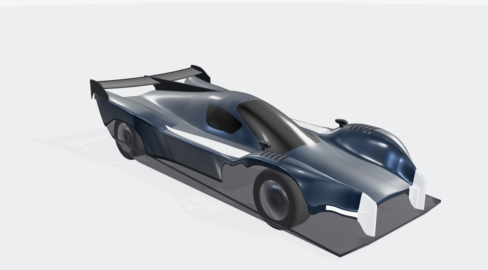
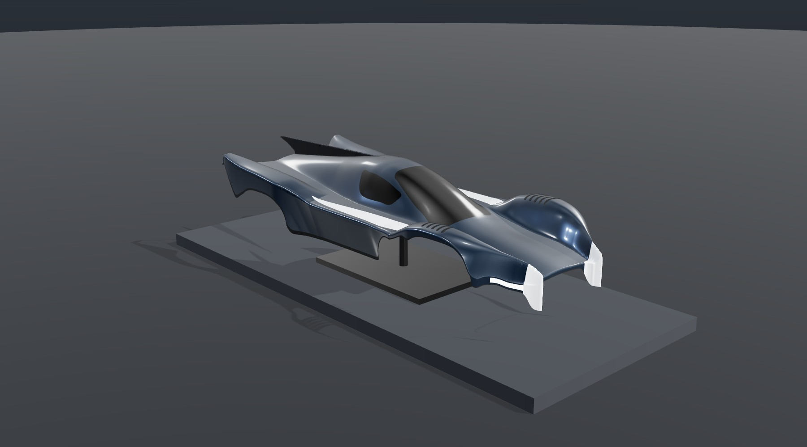
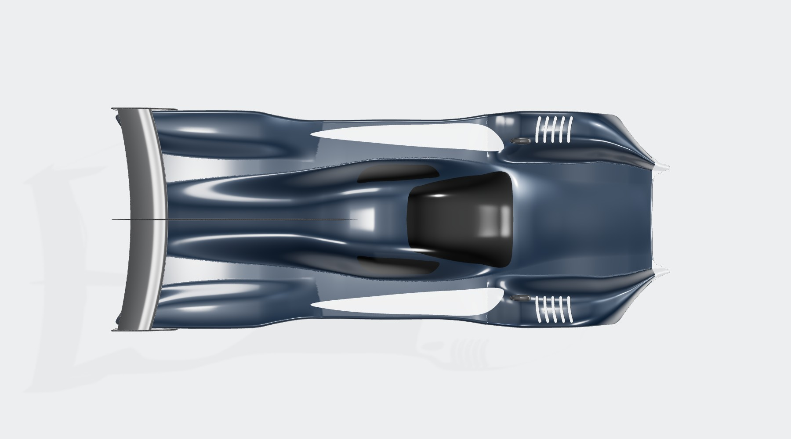
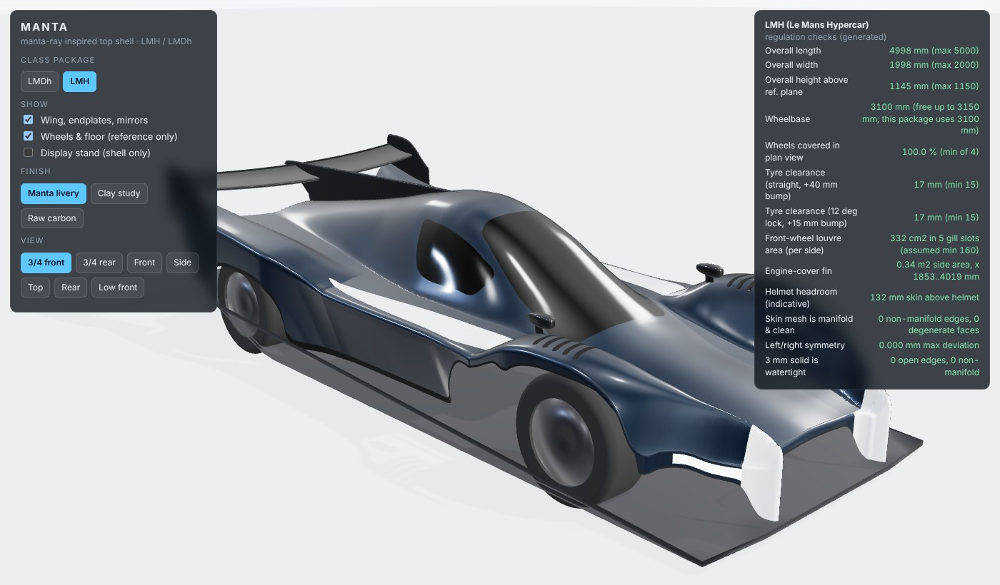

# MANTA: a manta-ray inspired top shell for LMH and LMDh

A complete, parametric design of the **top shell only** (the one-piece upper
bodywork: nose, fenders, canopy, sidepod tops, rear deck and engine-cover fin)
for a Le Mans prototype, packaged twice from one design language:

| | **LMDh** (Le Mans Daytona h) | **LMH** (Le Mans Hypercar) |
|---|---|---|
| Rule box (L x W x H) | 5100 x 2000 x 1060 mm | 5000 x 2000 x 1150 mm |
| MANTA shell + aero | **5097 x 1998 x 1056 mm** | **4998 x 1998 x 1145 mm** |
| Wheelbase | 3148 mm (common LMDh) | 3100 mm (max 3150) |
| Tyres | 29/71-18 F, 34/71-18 R | 29/71-18 F, 34/71-18 R |
| Automated checks | 13 / 13 pass | 13 / 13 pass |



| Display piece (shell only) | Plan view |
|---|---|
|  |  |

Dimensioned drawing sheets: [LMDh](renders/lmdh_drawing.png) and [LMH](renders/lmh_drawing.png).
The two packages compared: [side silhouettes](renders/lmdh_vs_lmh_side.png).
Design rationale, regulation table and engineering notes: **[DESIGN.md](DESIGN.md)**.

## The manta in one paragraph

Two white **cephalic-fin horns** frame a full-width **mouth** intake. Each front
fender carries **five gill-slit louvres**, which are also the mandatory openings
above the wheels. A thin **pectoral leading edge** carries a light blade and runs
back as one continuous wing edge that overhangs the wheel-well exits.
**Shoulder chevrons** echo a manta's dorsal markings, and the **dorsal canopy
hump** rises into an **engine-cover fin and tail**. The body ends in a
**crescent trailing edge** between swept pectoral-fin tips. An optional
**crescent wing** bridges those tips.

## What's in here

```
manta-top-shell/
  manta/            the generator (Python): rules, design, mesh, checks, exporters
  scripts/          generate.py (exports), make_figures.py (renders + drawings)
  tests/            pytest regression suite (rule envelopes, clearances, watertightness)
  viewer/           interactive three.js viewer (offline, three.js vendored)
  exports/lmdh|lmh/ ready-to-use files, see below
  renders/          images and drawing sheets
```

### Files per class (`exports/<class>/`)

| File | Use | Units / axes |
|---|---|---|
| `manta_<class>.glb` | View anywhere (Blender, Windows 3D Viewer, any glTF viewer, this repo's viewer). Shell + optional aero + reference wheels/floor as separate nodes | m, Y-up, glTF convention |
| `manta_<class>_top_shell_surface.stl` | **The top shell**: zero-thickness outer skin + engine-cover fin, for CAD reference / CFD surface meshing | mm, x rear, y right, z up |
| `manta_<class>_aero_appendages.stl` | Optional crescent rear wing, endplates and mirrors | mm |
| `manta_<class>_display_1to5.stl` | Printable **1:5 display model** of the shell (watertight, 2.5 mm walls at print scale, about 1020 x 400 x 200 mm) | mm at 1:5 |
| `report.json` | Measured dimensions, all check results, metrics, sources | |

Generated on demand (not committed, about 60 MB): `*_top_shell.obj` (with materials)
and `*_top_shell_solid_3mm.stl` (full-scale 3 mm closed skin for manufacturing).

Design coordinates: origin at the front-axle line, on the car centre plane, on
the **reference plane** (the flat underside of the car); x rearward, y to the
right, z up, millimetres. Heights in all rule checks are above the reference plane.

## View it

```bash
cd manta-top-shell
```

```bash
python3 -m http.server 8000
```

Then open http://localhost:8000/viewer/ . You can switch LMDh/LMH, three finishes
(manta livery, clay, raw carbon), toggle the wing and mirrors, the reference
wheels and floor, and a **display-stand mode** that shows the shell on its own.
The panel on the right lists the live regulation checks for the selected class.
`viewer/index-cdn.html` is the same viewer loading three.js from jsDelivr instead of
the vendored bundle, for hosting the folder online (for example on GitHub Pages).



## Regenerate / modify

```bash
pip install -r requirements.txt
```

```bash
python scripts/generate.py
```

```bash
python -m pytest -q
```

```bash
python scripts/make_figures.py
```

`generate.py` takes about 30 s for both classes and prints the regulation checks.
Options include `--variants lmh`, `--h3 8` for a finer mesh, and
`--print-scale 10 --print-wall 2` for another display scale. `make_figures.py`
needs Node.js with Playwright + Chromium; it renders headless through the viewer.

Every shape is a short table of control points in `manta/design.py` (centre-line
height, fender crest lines, plan outline with skirt edge heights, gill slots,
glazing, fin, wing). Edit a number, regenerate, and the tests tell you if a rule
box, a tyre clearance or the watertightness broke.

## Status and caveats

* Concept design. It has not been CFD-tested, wind-tunnel-tested or homologated. Real
  LMH/LMDh aero must also land inside the ACO/IMSA performance window (BoP).
* The rule figures were cross-checked against published car data because the
  FIA rule-book PDFs could not be downloaded from the build environment.
  Re-verify against the current FIA Technical Regulations, Art. 3 (see DESIGN.md).
* For LMDh the survival cell, roll structure and windscreen come from the licensed
  chassis supplier. The canopy here is styling intent to be fitted to those hard points.
* The wheels, tyres and floor in the renders are reference geometry only. They are not part of the design.
