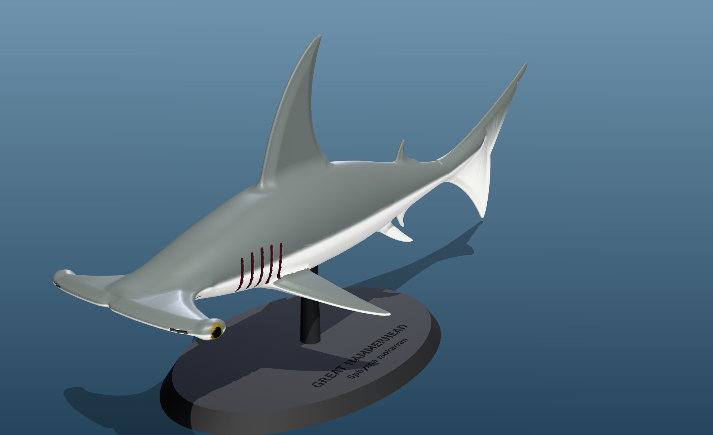
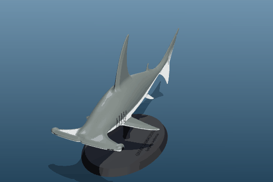
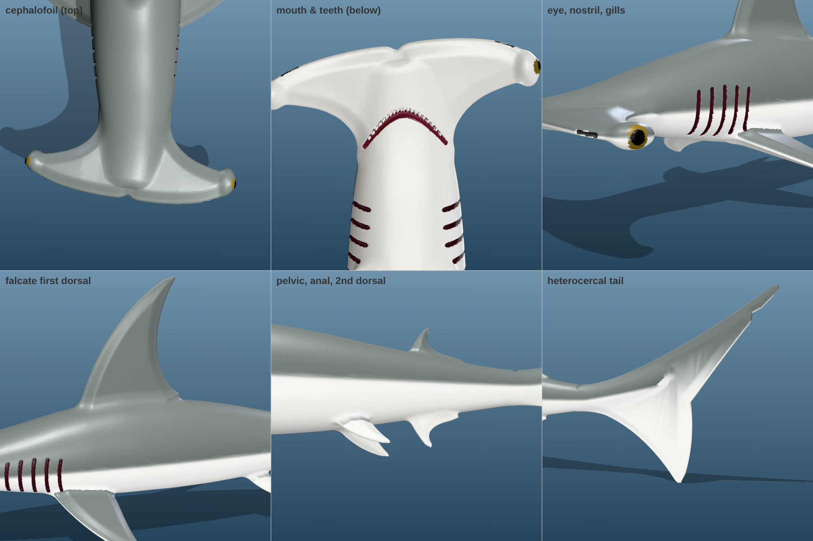
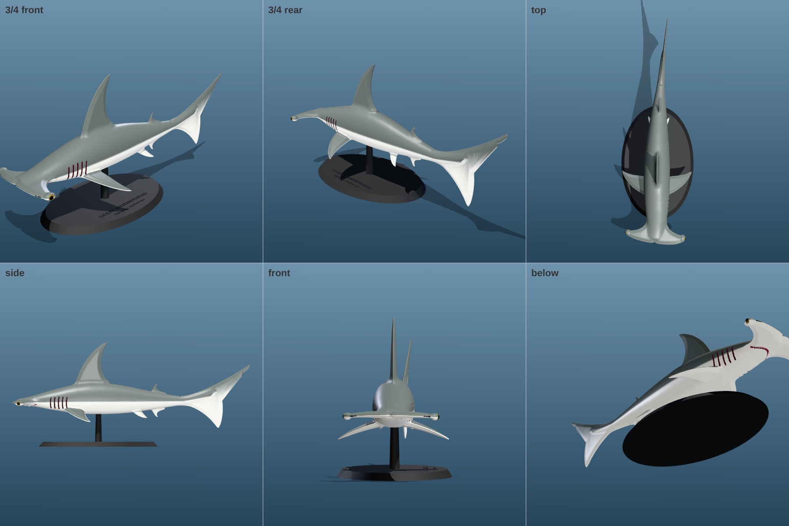
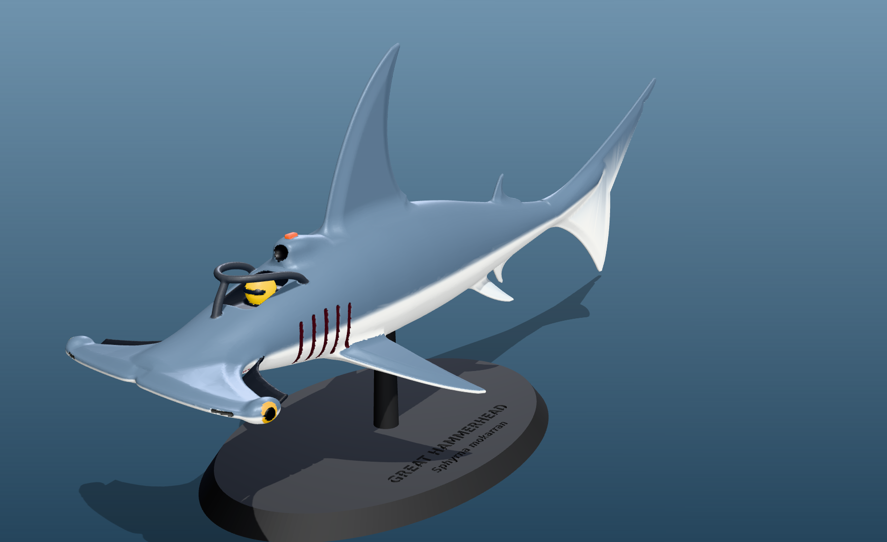
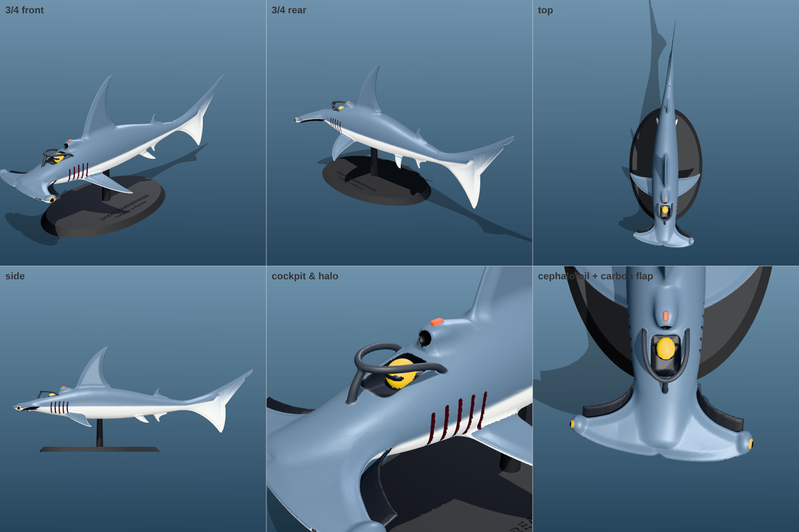

# Great Hammerhead Shark – 3D-printable model (+ F1 edition)



A sculpted, anatomically faithful **great hammerhead** (*Sphyrna mokarran*),
designed from the reference STLs (`F1Shark`, `Hai_1 Part_2 A/B`, `obj_1`),
plus an **F1 edition** of the same shark that carries the race-car cues from
those references. Every file is a single watertight solid, ready to slice.



## Files – `output/`

| File | What it is | Size (mm) |
|---|---|---|
| `hammerhead_shark.stl` | The shark. Single watertight solid with a socket in the belly for the stand. | 239 × 73 × 86 |
| `hammerhead_shark_f1.stl` | Same shark with F1 cues: cockpit, halo, driver helmet, airbox + T-cam, carbon front-wing flaps under the head. | 239 × 73 × 86 |
| `display_stand.stl` | Oval plinth engraved *GREAT HAMMERHEAD / Sphyrna mokarran*, post and locating peg (fits both sharks). | 120 × 76 × 38 |
| `hammerhead_shark_on_stand.stl` | Shark fused to the stand, for a one-piece print. | 239 × 76 × 105 |
| `*_display.glb` | Full-colour previews (shark + stand). Open them in any glTF viewer, Windows 3D Viewer or Blender. | |

All STLs were checked: watertight, consistent winding, one body, no degenerate faces.

## Anatomy that is modelled



* **Cephalofoil**: about 25 % of total length wide, with a nearly straight front margin and a central notch. The eyes sit at the lobe tips, with nostrils on the front margin.
* **Mouth**: an underslung crescent mouth with a row of teeth.
* **Gills**: five gill slits; the last two sit over the pectoral fin origin.
* **First dorsal**: very tall and **falcate** (sickle-shaped), about 18 % of total length.
* **Second dorsal**: has a long free rear tip.
* **Other fins**: falcate pectoral fins, pelvic fins, and a deeply notched anal fin.
* **Heterocercal caudal fin**: a long upper lobe with a terminal lobe and subterminal notch, plus the precaudal pit at the base of the tail.
* **Pose and colour**: a natural swimming curve (the tail swings 12 mm), and countershading in the colour previews (grey back, white belly).



## F1 edition



The same animal, with the reference models' Formula 1 ideas grafted on:

* a cockpit with a seated, helmeted driver
* a titanium-style halo
* a roll-hoop airbox with a T-camera
* slotted carbon front-wing flaps tucked under the cephalofoil

The gill slits double as sidepod inlets and the dorsal fin as the engine-cover "shark fin".



## How the reference STLs were used

* **`Hai_1 Part_2 A` + `B`** are the two halves of one model. Their cut faces match with 97 % overlap. Reassembled, they make a 381 mm hammerhead racer, which set the head and fin proportions and the long tail.
* **`obj_1`** (an F1/shark hybrid) gave the cues for the F1 edition: cockpit, halo, driver and front wing.
* **`F1Shark`** is a printable body kit with square locating pegs, which inspired the peg-and-socket display stand.

## Printing

* **Scale**: 240 mm long, about 1:15 of a 3.5 m adult. The thinnest fin edges are about 1 mm, which suits a 0.4 mm nozzle. Below about 70 % scale, use resin or a 0.2 mm nozzle.
* **FDM orientation**: upright, as displayed. Use tree/organic supports under the head, pectoral fins, belly and lower tail lobe; the dorsal and caudal fins print without support. 0.12–0.16 mm layers bring out the gills, eyes and mouth.
* **Resin**: hollow the model to 2 mm walls; the belly socket doubles as a drain hole. Tilt it 30–45° with supports on the belly side. The teeth (about 1 mm) come out best in resin.
* **Stand**: prints flat with no supports. The 3.8 mm peg slides into the 4.2 mm, 5.6 mm-deep socket in the belly. Add a drop of glue if you like.
* **One-piece option**: print `hammerhead_shark_on_stand.stl` upright with supports.

## Rebuild or customise

```bash
pip install -r requirements.txt
python3 build.py                 # both styles at 0.2 mm voxels (about 1–2 min); writes output/
python3 build.py --style pure    # only the anatomical shark
python3 build.py --bend 0        # straight pose
python3 build.py --res 0.5       # quick draft
```

* `design.py` holds the anatomy: body loft stations, the head planform (`HEAD_LE`, `HEAD_TIP`, `HEAD_TE`), and every fin outline and thickness.
* `sdf.py` is a small signed-distance sculpting kernel. It provides superellipse lofts, fin plates with tapered thickness, smooth unions for fleshy fin bases, and engraved grooves. It samples the half grid in parallel, mirrors it, and meshes it with marching cubes.
* `build.py` does the rest:
  * applies the swimming curve
  * validates and simplifies the mesh with manifold3d
  * places the stand under the centre of mass and engraves the nameplate
  * paints the previews and exports the STL and GLB files
