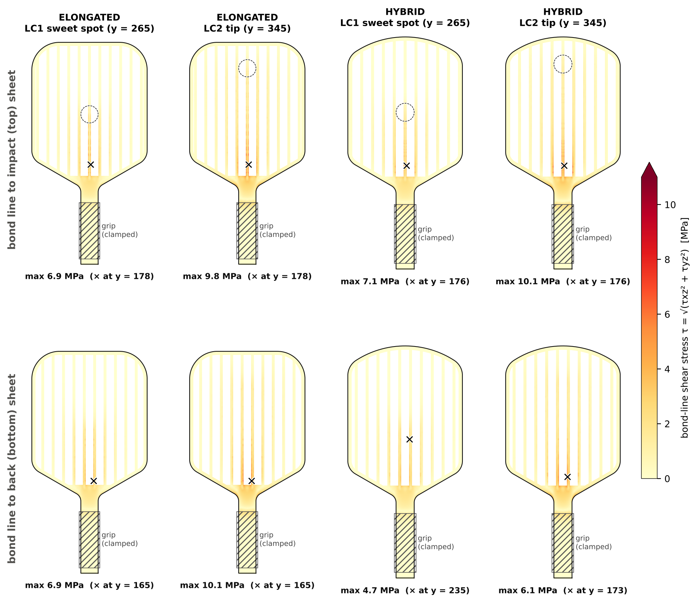

# Pickleball paddle designs – Elongated & Hybrid (REV B)

Two 39 cm paddles traced from your hand-made templates and sketches. Each is a carbon-fibre /
wave-rib sandwich with a screw-locked grip. The repo holds the engineering drawings, full-size
templates, DXF cut profiles, the 3-D model (STEP / STL), photoreal renders and a finite-element
stress analysis.


## Specification

| | **Elongated** (PB-EL-001) | **Hybrid** (PB-HY-001) |
|---|---|---|
| Overall length (incl. butt cap) | 390 mm | 390 mm |
| Blade (face) length | 260 mm | 260 mm |
| Handle | 130 mm incl. butt cap, body 30 × 16 mm | same |
| Blade width | **200 mm** | **190 mm** |
| Thickness | 16 mm: 4 mm carbon + 8 mm wave-rib core + 4 mm carbon | same |
| Head shape | Square head, **R48** tip corners | Domed head, **R150** crown + **R30** shoulders (dome rise 49.1 mm) |
| Blade → handle | R25 shoulder → 30° straight taper → R15 throat fillet | same |
| Straight sides | y = 202.2 … 342.0 mm from the butt | y = 199.3 … 340.9 mm from the butt |
| Body profile area | 491 cm² | 459 cm² |
| Grip | 35.5 × 21.5 mm, circumference 107.6 mm (4¼ in), M4 screw-locked butt cap | same |
| Mass (3D model) | 832 g, balance point 239 mm from the butt | 785 g, 234 mm |
| USA Pickleball L + W ≤ 609.6 mm (24 in) | 590 mm ✔ (19.6 mm margin) | 580 mm ✔ (29.6 mm margin) |
| USA Pickleball L ≤ 431.8 mm (17 in) | 390 mm ✔ | 390 mm ✔ |

Every profile is lines and tangent arcs, symmetric about the centre line. An edge guard counts
towards the USA Pickleball limits, so keep it within the margins above.

## Construction

| | |
|---|---|
|  |  |
|  |  |

- **Face sheets.** Two identical 4 mm woven carbon/epoxy plates, cut to the body profile
  (`*_profile.dxf`, template sheet 2). Outer edges R0.8.
- **Rib core, 8 mm, 3D-printed in PA-CF and printed flat** (sheet 3 of each drawing):
  - A closed 6 mm perimeter frame covers the whole side, as marked on your sketch.
  - Inside it is the sinusoidal wave rib from your sketch: pitch 18 mm, wall 1.6 mm, centre-line
    amplitude 4 mm. The flutes run along the paddle. The crests are cut flat where they meet the
    sheets, which gives 4.25 mm wide bond lands on both faces. The wave walls connect the two faces.
  - The core is solid from the butt to y = 150 mm (handle and throat). Each flute starts with a
    45° run-out, which prints without support.
- **Grip** (shared drawing `PB-GR-001`): 1.8 mm TPU sleeve bonded to the handle, a replaceable
  0.75 mm PU wrap and a TPU throat collar.
- **Butt cap.** Locked by an ISO 7380 M4 × 12 button-head screw. The screw goes into an M4 brass
  heat-set insert (Ø5.6 × 8.1) in the butt of the core: bore Ø5.6 × 10 plus Ø4.5 × 16 clearance.

## Stress analysis

[`output/fea/paddle_stress_report.pdf`](output/fea/paddle_stress_report.pdf) is the full report:
model, materials, load cases, contour plots, the design iteration, mass and recommendations.

- **Method.** Linear static analysis in CalculiX: a half model with ≈0.9 M degrees of freedom and
  quadratic tetrahedra, the grip clamped, and a 500 N ball impact on a Ø30 mm patch. The impact
  is applied once at the sweet spot (y = 265 mm) and once at the tip (y = 345 mm). Modal analysis
  uses the same support.

| Tip impact, 500 N (worst case) | Elongated | Hybrid | Allowable |
|---|---|---|---|
| Deflection (sweet spot / tip) | 2.25 / 3.85 mm | 2.24 / 3.84 mm | – |
| Carbon face sheets, fibre stress | 141 MPa (RF 3.6) | 137 MPa (RF 3.7) | 500–600 MPa |
| Printed core, von Mises | 17.5 MPa (RF 2.6) | 17.6 MPa (RF 2.6) | 45 MPa |
| Bond line, peel | 4.8 MPa (RF 1.03) | 4.9 MPa (RF 1.03) | 5 MPa |
| Bond line, shear: 99th percentile in the hot band | 5.4 MPa (RF 1.49) | 5.5 MPa (RF 1.45) | 8 MPa |
| Bond line, shear: local peak | 10.1 MPa (RF 0.80) | 10.1 MPa (RF 0.79) | 8 MPa |
| First bending mode (grip held) | 105 Hz | 112 Hz | – |



What the results mean:

1. **The carbon and the core have large margins.** The face-sheet stress concentrates in the
   throat. That is why the R15 throat fillet matters.
2. **The adhesive bond between the core and the sheets is the critical item.** The first core
   design had square flute ends, and the bond peeled there at 15.2 MPa (RF 0.33). The 45° run-out
   and wider lands bring peel down to 4.9 MPa.
3. **Bond shear still peaks locally.** It reaches 10.1 MPa on the centre lands just above the solid
   zone, where the blade's shear funnels into the 30 mm throat. Across that band the value is
   about 5.5 MPa. Use a structural epoxy rated for nylon, abrade and prime both surfaces, leave a
   fillet along every land edge, and confirm the bond strength with lap-shear coupons. If needed,
   thicken the centre walls or extend the solid zone (see §7 of the report).
4. **Weight.** The paddles weigh 832 g and 785 g, about 3.5 × a typical 210–240 g paddle. The two
   4 mm carbon sheets alone account for 73 %. A playable paddle would need about 0.5–1 mm sheets on
   a lighter, thicker core. As drawn it is very strong, but suited to a prototype or a training paddle.

## Output files

| File | What it is |
|---|---|
| [`output/paddle_drawing_set.pdf`](output/paddle_drawing_set.pdf) | All 7 drawing sheets in one PDF |
| `output/<design>/*_sheet1_general_arrangement.(pdf/svg/png)` | **General arrangement**, A3, 1:2, first angle: front view with the grip, side view with the 4/8/4 lay-up, section A–A through the wave core, section B–B through the grip, isometric view, notes |
| `output/<design>/*_sheet2_template_1to1.(pdf/svg/png)` | **Full-size body template**, A3 portrait, 1:1: tangent points, arc centres, coordinate table, core-frame and solid-zone reference lines, scale-check bars |
| `output/<design>/*_sheet3_rib_core.(pdf/svg/png)` | **Rib core**: plan view 1:2 with lands and flute run-outs, section C–C across the wave 2:1, section D–D through the run-out 2:1, print and bonding notes |
| `output/grip/PB-GR-001_grip_and_butt_cap.(pdf/svg/png)` | **Grip and butt-cap assembly** (both paddles): handle view, section E–E across the grip, section F–F through the screw, insert and bores, bill of materials, grip specification |
| `output/<design>/*_profile.dxf` | 1:1 cut profile of the face sheets (mm) for CNC / laser: closed polyline with true arcs |
| `output/cad/<design>_assembly.step` | 3-D assembly: sheets, core, sleeve, wrap, collar, butt cap, screw, insert (named solids) |
| `output/cad/<design>_rib_core.step` / `.stl`, `output/cad/<design>_<part>.stl` | Printable core and every other part, in mm |
| `output/render/paddles_3d_*.png` | Photoreal renders: hero, cutaway, exploded (each design), handle close-up |
| `output/render/paddles_2d_render.(png/svg)` | 2-D presentation render (face and 3/4 views) |
| `output/fea/paddle_stress_report.pdf`, `output/fea/fea_*.png` | Stress report and its figures |
| `analysis/fea/*.json`, `analysis/mass_properties.json` | Raw results: peak stresses with locations, reserve factors, bond profile, frequencies, masses |
| [`reference/cad_outline_vs_your_templates.jpg`](reference/cad_outline_vs_your_templates.jpg) | The CAD outline overlaid on your template photos |

**Printing the template.** Print the sheet-2 PDF on A3 at **100 % / "Actual size"**, with no
fit-to-page. Check the 100 mm and 50 mm bars before cutting.

## How the shapes were derived

The specified dimensions (390 overall, 260 blade, 130 × 30 handle, 200 / 190 wide, 16 thick) are
exact. The radii and the taper angle were measured from your photos. The elongated values come from
the white template, segmented and scaled to 200 × 390. The hybrid values come from the pen sketch,
rectified to the 190 × 260 blade.

| Feature | Measured (left / right) | Used |
|---|---|---|
| Elongated tip corners | R47.6 / R47.8 | R48 |
| Hybrid crown | ≈R150 | R150 |
| Hybrid crown shoulders | R26.6 / R27.4 | R30 |
| Bottom shoulder radius | R21.7 / R26.0 (EL), R25.0 / R27.3 (HY) | R25 |
| Taper angle | 29.1° / 30.2° (EL), 28.2° / 30.6° (HY) | 30° |
| Throat | EL: hidden under tape, almost sharp; HY: ≈R15 | R15 |

The CAD outline matches your elongated template's corners and sides to within about 1 mm, and your
hybrid sketch to about 1 mm RMS everywhere. On the **elongated**, the bottom taper sits about 5 mm
higher than the paper template. That is because the CAD keeps the straight handle at exactly 130 mm
and adds the same R15 throat fillet as the hybrid. Your template's throat is almost a sharp corner,
which concentrates stress, and your pencil arcs show you were already considering R12–R25 there. If
you want the taper exactly where the template is, set `throat_r` to about 6 mm.

## Regenerating / changing the design

```bash
pip install -r requirements.txt
python -m playwright install chromium     # one-off, for PDF/PNG export
python build.py                           # drawings, templates, DXF, 2-D render
python tools/export_cad.py                # STEP / STL + analysis/mass_properties.json
python tools/render_3d.py                 # photoreal renders (Blender 4.x with Cycles on PATH)
# stress analysis (gmsh + CalculiX; a static case needs about 11 GB RAM and 10 min on 4 cores)
python tools/run_fea_case.py elongated WORK/static_elongated
python tools/run_fea_case.py hybrid    WORK/static_hybrid
python tools/run_fea_case.py elongated WORK/modal_elongated --modes 6 --mesh 3.0 5.0
python tools/run_fea_case.py hybrid    WORK/modal_hybrid    --modes 6 --mesh 3.0 5.0
python tools/run_fea_case.py elongated WORK/baseline_elongated --set rib_amp=3.6 runout_len=0   # optional
python tools/fea_report.py --work WORK
```

The inputs live in `paddle/geometry.py`:

- **Outlines** (`ELONGATED`, `HYBRID`): length, width, handle, butt cap, corner and dome radii,
  shoulder radius, taper angle and throat radius.
- **`Construction`**: sheet and core thickness, frame width, wave pitch, wall and amplitude,
  solid zone, run-out, insert, and grip and butt-cap sizes.

Every drawing, the 3-D model, the renders and the analysis are recomputed from those inputs.
`geometry.check()` asserts that each outline is closed, tangent-continuous and exactly the
specified size.

## Revisions

- **A.** Outlines, general arrangement, full-size templates, DXF, 2-D render.
- **B.** Carbon / wave-rib sandwich construction, closed core frame, grip and screw-locked butt
  cap. Adds the rib-core and grip drawings, 3-D model, photoreal renders and the FEA stress
  analysis. The body now starts 4 mm above the butt-cap base, so the overall length stays 390 mm.
