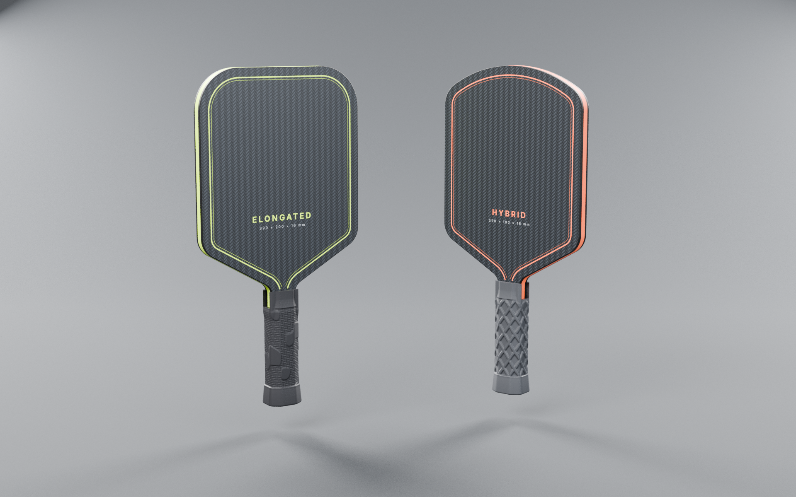
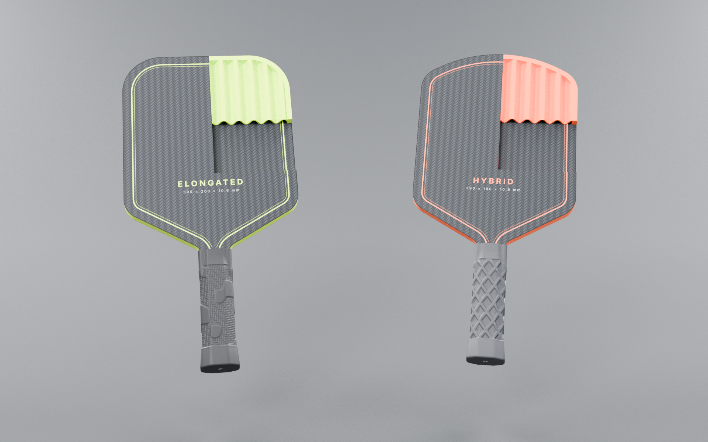
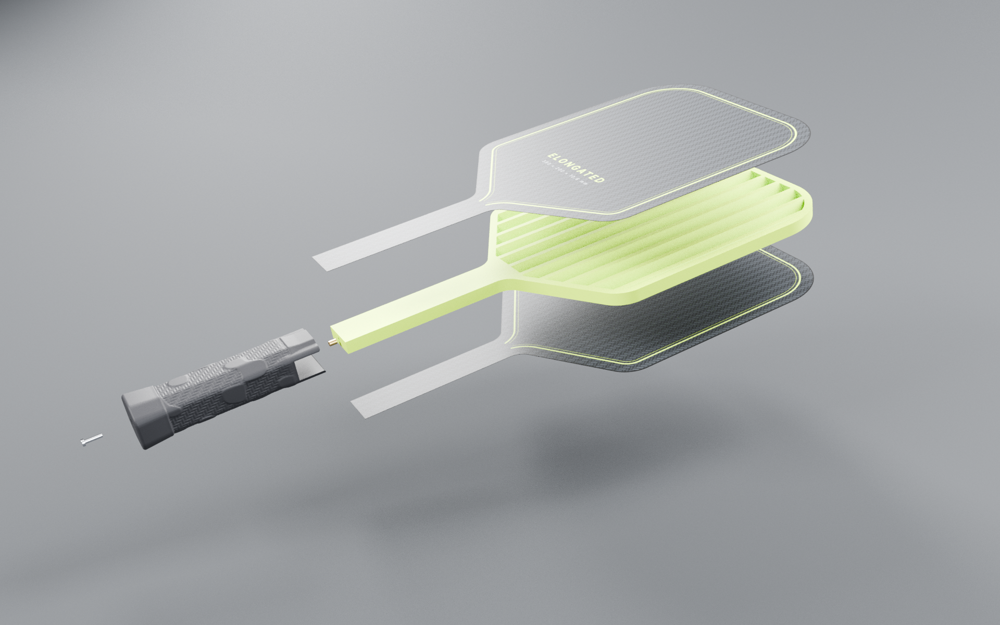
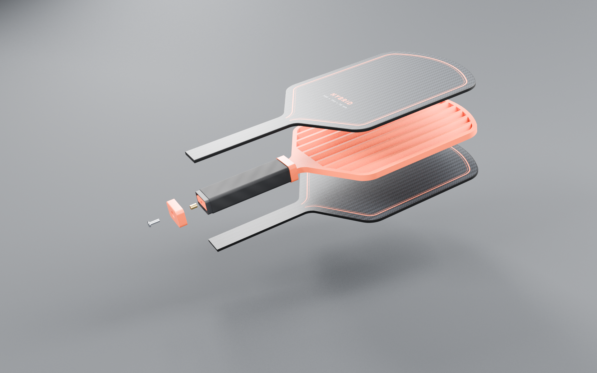
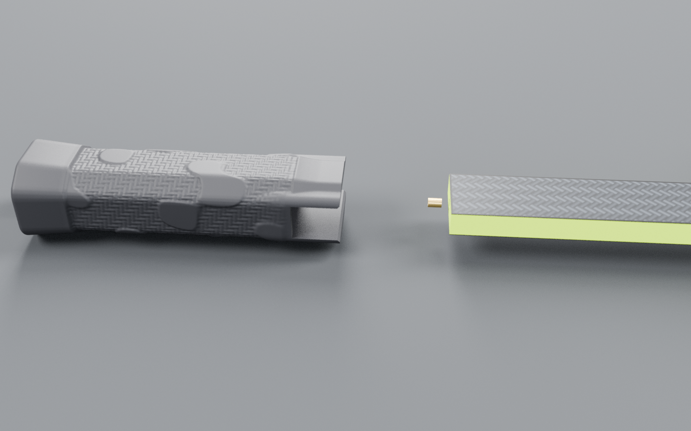
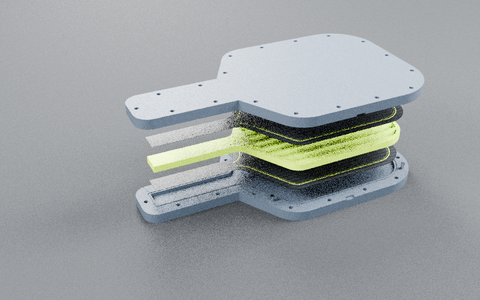
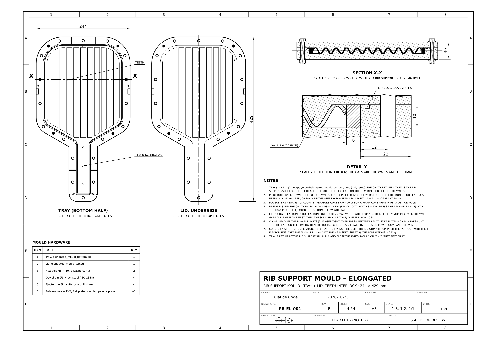
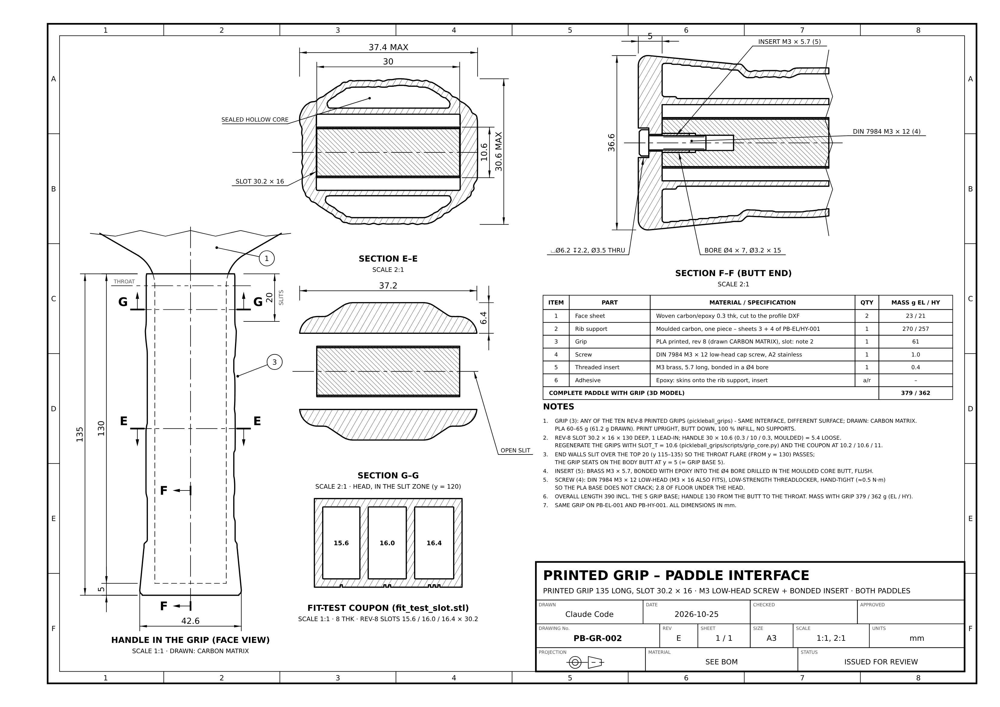

# Pickleball paddle designs – Elongated & Hybrid (REV E)

Two 39 cm paddles traced from your hand-made templates and sketches. Each is a carbon-fibre /
wave-rib sandwich: two 0.3 mm carbon skins bonded to a 10 mm rib support. The rib support is
moulded in carbon fibre, in one piece, in a two-half mould. Each mould half carries the wave as a
row of teeth, and the two rows interlock. Your rev-8 printed grip goes on the handle and is locked
by a screw in the butt. The repo holds:

- the engineering drawings, full-size templates and DXF cut profiles;
- the rib-support mould (STL + STEP) and a trial-print rib support;
- the 3-D model (STEP / STL / 3MF) and photoreal renders;
- the strength checks.



> **Before you build: two open issues.**
> - **Weight.** The moulded carbon rib support weighs 270 g (Elongated), so the paddle comes to
>   379 g with the grip. Most paddles weigh 210–240 g. See [Weight](#weight) for where the mass is
>   and what reduces it.
> - **Strength.** The moulded core is about 6 times stiffer than the printed PA-CF one, so the
>   0.3 mm skins now pass a sweet-spot hit. A tip hit at the 500 N design load still fails
>   (lowest reserve factor 0.55, skin buckling between the lands). 0.6 mm skins pass every
>   check. See [Strength](#strength).
>
> Every file here is parametric, so a different lay-up or wall thickness is a quick rebuild.

## Specification

| | **Elongated** (PB-EL-001) | **Hybrid** (PB-HY-001) |
|---|---|---|
| Overall length (incl. the grip base) | 390 mm | 390 mm |
| Blade (face) length | 260 mm | 260 mm |
| Handle | 130 mm incl. the 5 mm grip base, body 30 × 10.6 mm | same |
| Blade width | **200 mm** | **190 mm** |
| Thickness | **10.6 mm: 0.3 mm carbon + 10 mm wave-rib core + 0.3 mm carbon**. The mould sets the core height | same |
| Head shape | Square head, **R48** tip corners | Domed head, **R150** crown + **R30** shoulders (dome rise 49.1 mm) |
| Blade → handle | R25 shoulder → 30° straight taper → R15 throat fillet | same |
| Straight sides | y = 202.2 … 342.0 mm from the butt | y = 199.3 … 340.9 mm from the butt |
| Body profile area | 491 cm² | 459 cm² |
| Grip | Printed PLA grip (rev 8), DIN 7984 M3 screw lock. **Its 16.0 mm slot must be regenerated for the 10.6 mm handle**, see [Printed grip](#printed-grip) | same |
| Mass with the grip (3D model) | 379 g, balance point 202 mm from the butt | 362 g, 197 mm |
| USA Pickleball L + W ≤ 609.6 mm (24 in) | 590 mm ✔ (19.6 mm margin) | 580 mm ✔ (29.6 mm margin) |
| USA Pickleball L ≤ 431.8 mm (17 in) | 390 mm ✔ | 390 mm ✔ |

Every profile is lines and tangent arcs, symmetric about the centre line. An edge guard counts
towards the USA Pickleball limits, so keep it within the margins above.

## Construction

| | |
|---|---|
|  |  |
|  |  |

- **Skins.** Two identical 0.3 mm woven carbon/epoxy skins, cut to the body profile
  (`*_profile.dxf`, template sheet 2). They are bonded to the moulded rib support:
  1. Abrade (P120) and degrease both faces.
  2. Bond with epoxy, pressing flat between platens or in a vacuum bag.
  3. Trim flush with the core edge.
- **Rib support (the core), 10 mm, carbon fibre / epoxy moulded in one piece** in the wave mould
  (sheets 3 and 4 of each drawing):
  - A closed 6 mm perimeter frame covers the whole side, as marked on your sketch.
  - Inside it is the sinusoidal wave rib from your sketch: pitch 18 mm, wall 1.6 mm, centre-line
    amplitude 5.2 mm. The flutes run along the paddle. The crests are cut flat where they meet the
    skins, which gives 4.28 mm wide bond lands on both faces. The wave walls connect the two faces.
  - The core is solid from its butt to y = 150 mm (handle and throat). Each flute starts with a
    45° ramp, 10 mm long. The ramp is longest at the flute's open face, so the mould teeth pull
    straight out.
- **Grip.** Your printed rev-8 grip slides over the handle. Its 5 mm solid base is the butt of the
  paddle, so the skins and the rib support start at y = 5 mm and the overall length stays 390 mm.
- **Screw lock.** A DIN 7984 M3 × 12 low-head screw goes up through the grip base into an M3 × 5.7
  brass insert. The insert is bonded with epoxy into a Ø4.0 × 7 bore drilled in the moulded butt,
  with a Ø3.2 × 15 clearance bore beyond it. A heat-set insert won't work in a thermoset.

## Rib support mould

| | |
|---|---|
|  |  |

`python tools/export_mould.py` writes two parts per paddle to [`output/mould/`](output/mould):

- `<design>_mould_bottom`, the tray;
- `<design>_mould_top`, the lid.

Each comes as `.stl` (in print orientation) and `.step` (for machining). Sheet 4 of each drawing
covers the mould.

- **How it works.** The cavity between the two halves is the rib support.
  - The tray has a 10 mm deep pocket in the shape of the paddle. The bottom flutes stand in it as
    teeth.
  - The lid is a flat plate with the top flutes hanging from it as teeth.
  - When the lid closes, its teeth slide between the tray's teeth. The 1.6 mm gaps between the
    teeth form the wave walls. The 6 mm band around the pocket edge forms the frame, and the
    toothless handle end forms the solid zone.
  - The lid seats on the tray rim. That hard stop sets the 10 mm height.
- **Release.** Each flute is widest at its open face, so the teeth have natural draft and pull
  straight out. The 45° ramps at the flute starts lean the same way. The CAD check finds zero
  overlap between tray, lid and part.
- **One piece each half:**

  | | Tray | Lid | Moulded part |
  |---|---|---|---|
  | Elongated | 244 × 429 × 20 mm, 1.39 kg PLA solid | 244 × 429 × 19.4 mm (10 mm plate + teeth), 1.09 kg | 180 cm³, ≈ 271 g |
  | Hybrid | 234 × 429 × 20 mm, 1.32 kg | 234 × 429 × 19.4 mm, 1.04 kg | 171 cm³, ≈ 257 g |

  Both need a bed of at least 440 mm (500 × 500 class), or you can machine the STEP from
  aluminium. Print each half back down, teeth up: at least 5 walls and 40 % infill, with
  0.12–0.16 mm layers for the teeth.
- **Features:**
  - a 2 mm pinch-off land, then a 2 × 1.5 mm resin overflow groove in the tray rim, with 6 vents;
  - 18 × M6 bolts (50 mm long);
  - 4 × Ø6 × 16 steel dowel pins;
  - 2 pry notches;
  - 4 × Ø4.2 ejector holes through the tray floor.
- **Moulding steps** (full list on sheet 4):
  1. Sand the cavity faces (P400 → P800), seal them with an epoxy coat, then apply wax ×3 + PVA.
     Press the dowel pins into the tray, and tape over the ejector holes from below.
  2. Fill with forged carbon. Chop carbon tow to 10–25 mm and wet it with epoxy (≈ 40 % fibre by
     volume). Pack the wall gaps and the frame first, then the solid handle zone. Overfill by about
     10 %.
  3. Close the lid over the dowels and fit the bolts finger-tight. Press between two flat, stiff
     platens, or in a press, until the lid seats on the rim. Then tighten the bolts. Excess resin
     leaves through the groove and the vents.
  4. Cure for 24 h at room temperature. Split the mould at the pry notches, lift the lid straight up,
     and push the part out with the ejector pins.
  5. Trim the flash, drill the insert bore and bond the insert.
- **Woven fabric option.** You can also drape woven carbon over the tray teeth and let the lid press
  it into the wave; the frame and handle zone still take chopped fill. The tooth gap is `rib_t`:
  1.6 mm takes about 6–7 plies of 200 g/m² fabric.
- **Temperature.** PLA softens near 55 °C, so use a room-temperature-cure epoxy. For a warm cure,
  print the mould in PETG, ASA or PA-CF.
- **Trial first.** Print the trial rib support (below) in PLA and close the empty mould on it. It
  must seat fully.

## Trial rib support STL

`python tools/export_rib_support.py` writes one STL per paddle to
[`output/rib_support/`](output/rib_support). It is the whole rib support in one piece, lying flat
in its print orientation (z = 0 … 10 mm), centred on x = y = 0, in mm. It is a single closed body.
Uses:
- print it in PLA to check that the mould closes;
- print it in PA-CF as a printed alternative to the moulded part. With 0.3 mm skins that is the
  REV D build, which fails the strength check (see [Strength](#strength)).

| File | Size (mm) | Mass, PA-CF (PETG / PLA) | Printer bed |
|---|---|---|---|
| `elongated_rib_support.stl` | 200 × 385 × 10 | 211 g (227 / 221 g) | ≥ 391 × 206 mm (400 mm class) |
| `hybrid_rib_support.stl` | 190 × 385 × 10 | 201 g (217 / 212 g) | ≥ 391 × 196 mm (400 mm class) |

Print it at 100 % infill (the 1.6 mm walls are 4 perimeters of a 0.4 mm nozzle), 0.2 mm layers and
no supports. The checks (closed mesh, bodies, volume, bed fit) are in `rib_support_report.json`.

## Weight

| Elongated | Mass |
|---|---|
| Rib support, moulded carbon (1.5 g/cm³) | **270 g** |
| – solid handle and throat zone, to y = 150 | 69 g |
| – 6 mm frame | 63 g |
| – wave walls and ramps (23 % of the blade volume) | 138 g |
| Skins, 2 × 0.3 mm | 46 g |
| Grip (CARBON MATRIX, PLA) | 61 g |
| Screw + insert | 1.4 g |
| **Paddle** | **379 g** (Hybrid 362 g) |

Most paddles weigh 210–240 g. The moulded core is heavy because its walls, frame and handle are
solid carbon. Here is what each change does (Elongated, same hand check; strength in the next
section):

| Change | Rib support | Paddle | Strength |
|---|---|---|---|
| As built: 0.3 skins, wall 1.6 | 270 g | 379 g | fails a tip hit |
| 0.6 mm skins, wall 1.6 | 270 g | 424 g | passes |
| 0.6 mm skins, wall 0.8 (woven fabric) | 204 g | 358 g | passes |

A 0.8 mm wall is too thin to fill with chopped fibre. It needs woven fabric draped in the mould,
about 3–4 plies. Getting down to a normal paddle weight takes more than parameter changes, because
the frame and handle zone alone weigh 132 g. Options:
- a lighter handle zone (hollow, or a foam insert);
- a narrower frame;
- a printed grip with a lighter infill.

## Printed grip



The grip is your rev-8 printed grip (`pickleball_grips/` on branch `claude/kind-volta-vs8ck6`, commit
`c594433`). All ten designs share the same interface. Drawing
[`PB-GR-002`](output/grip/PB-GR-002_printed_grip_interface.pdf) shows how it fits:

- 135 mm long, with a solid 5 mm base, a 30.2 mm wide slot 130 mm deep with a 1 mm lead-in, and
  head walls at least 3.5 mm thick.
- Both end walls are slit over the top 20 mm, so the throat flare (from y = 130) can pass.
- The M3 screw goes through a Ø3.5 hole with a Ø6.2 × 2.2 counterbore, leaving 2.8 mm of PLA under
  the head. Tighten it by hand (about 0.5 N·m) with a low-strength threadlocker.

**The rev-8 slot no longer fits.** It is 16.0 mm thick, but the handle has been 10.6 mm since
REV D, so the grip would sit 5.4 mm loose. Since the grips are not printed yet, regenerate them on
the grip branch:
- set `SLOT_T = 10.6` in `pickleball_grips/scripts/grip_core.py`;
- make a new fit-test coupon at 10.2 / 10.6 / 11.0 mm.

The drawings still show the rev-8 grip (CARBON MATRIX, 61 g), so its sections show the gap.

## Strength

The CalculiX model meshes the skins as solid tetrahedra, and that doesn't work for a 0.3 mm skin.
So the thin-skin lay-ups are checked by hand (`python tools/hand_check.py` →
`analysis/hand_check.json`). The method has three parts:
1. The paddle is treated as a cantilever from the grip clamp, with skins and core section by section.
2. The skin between two bond lands is treated as a clamped strip under the ball's contact pressure,
   including membrane stretching.
3. The skin is checked for buckling between the lands.

The same method run on REV C (4 / 8 / 4) is compared with REV C's FEA results. Skin stress is scaled
by the FEA/beam ratio (×1.42) and deflection by ×1.66. Core stress is quoted as plain beam bending.

The moulded core is taken as chopped carbon/epoxy with E = 25 GPa and a 120 MPa bending
allowable. That is conservative for a hand-packed part with some voids; pressed SMC-grade parts
reach 35–40 GPa and about 250 MPa.

| 500 N ball impact | REV C 4 / 8 / 4 (FEA) | REV D 0.3 / 10 / 0.3, printed PA-CF core | **REV E 0.3 / 10 / 0.3, moulded carbon core** | Allowable |
|---|---|---|---|---|
| Skin stress in the handle just above the grip, tip hit | 141 MPa (RF 3.6) | 1,310 MPa (RF 0.38) | **556 MPa (RF 0.90)** | 500 MPa (compression) |
| Same, sweet-spot hit | – | 846 MPa (RF 0.59) | **359 MPa (RF 1.39)** | 500 MPa |
| Core bending stress there, tip hit | 17.5 MPa (local peak) | 58 MPa (RF 0.77) | **154 MPa (RF 0.78)** | 45 MPa PA-CF, 120 MPa moulded |
| Same, sweet-spot hit | – | 38 MPa (RF 1.20) | **99 MPa (RF 1.21)** | as above |
| Skin between two lands, under the ball | ≈ 4 MPa | 556 MPa (RF 0.90) | **556 MPa (RF 0.90)** | 500 MPa |
| Skin buckling between lands (blade), tip hit | not critical | 264 MPa vs 95 MPa critical (RF 0.36) | **172 MPa vs 95 MPa (RF 0.55)** | – |
| Same, sweet-spot hit | – | 150 MPa (RF 0.63) | **98 MPa (RF 0.97)** | – |
| Tip deflection, tip hit | 3.85 mm | ≈ 57 mm | **≈ 28 mm** | – |

What this means:

1. **Stiffer core.** The moulded core carries much more of the bending than the printed one, so
   the handle skin stress drops from 1,310 to 556 MPa. A sweet-spot hit now passes on the handle
   skin and core.
2. **Tip hit.** It still fails: handle skin RF 0.90, core RF 0.78.
3. **Skin between the lands.** This doesn't depend on the core material. The lands are 18 mm
   apart, which leaves 13.7 mm of unsupported 0.3 mm skin. It bends under the ball (RF 0.90) and
   buckles in compression on a tip hit (RF 0.55).
4. **At a realistic 340 N peak hit** (500 N includes a 1.5 safety factor):
   - handle skin RF 1.32, core 1.14 and skin between the lands 1.21;
   - buckling between the lands still fails, at 0.81.

Lay-ups that fix it (Elongated, moulded core, the same method, wave amplitude 5.2 mm):

| Lay-up, wave | Skins + rib support | Handle skin RF (tip / sweet spot) | Core RF (tip) | Buckling RF (tip) | Skin-between-lands RF | Tip deflection | Paddle |
|---|---|---|---|---|---|---|---|
| 0.3 / 10 / 0.3, λ18, wall 1.6 (as built) | 46 + 270 g | 0.90 / 1.39 | 0.78 | 0.55 | 0.90 | 28 mm | 379 g |
| 0.3 / 10 / 0.3, λ12, wall 1.6 | 46 + 306 g | 0.90 / 1.39 | 0.78 | 1.45 | 1.76 | 28 mm | 415 g |
| **0.6 / 10 / 0.6, λ18, wall 1.6** | 91 + 270 g | 1.15 / 1.78 | 1.05 | 3.45 | 2.84 | 19 mm | 424 g |
| **0.6 / 10 / 0.6, λ18, wall 0.8** | 91 + 204 g | 1.15 / 1.78 | 1.05 | 2.69 | 2.40 | 20 mm | 358 g |
| 0.9 / 10 / 0.9, λ18, wall 1.6 | 137 + 270 g | 1.41 / 2.18 | 1.36 | 10.6 | 6.45 | 14 mm | 470 g |

- **0.6 mm skins (2 plies per side) pass every check** on the current wave. A finer wave alone
  fixes only the blade.
- **The 0.8 mm wall** with 0.6 mm skins is the lightest version that passes.
- **What a change involves.** `face_t`, `core_t`, `rib_pitch` and `rib_t` in `paddle/geometry.py`
  drive everything, including the mould pocket depth and the teeth.

The full FEA report, [`output/fea/paddle_stress_report.pdf`](output/fea/paddle_stress_report.pdf),
covers the REV C 4 / 8 / 4 lay-up. It stays as the reference the hand check is calibrated against.
To run the FEA on thin skins, the model's skins need shell or single-layer wedge elements.

## Output files

| File | What it is |
|---|---|
| [`output/paddle_drawing_set.pdf`](output/paddle_drawing_set.pdf) | All 9 drawing sheets in one PDF |
| `output/<design>/*_sheet1_general_arrangement.(pdf/svg/png)` | **General arrangement**, A3, 1:2, first angle: front view with the grip, side view with the 0.3/10/0.3 lay-up, section A–A through the wave core, section B–B through the grip, isometric view, notes |
| `output/<design>/*_sheet2_template_1to1.(pdf/svg/png)` | **Full-size body template**, A3 portrait, 1:1: tangent points, arc centres, coordinate table, core-frame and solid-zone reference lines, scale-check bars |
| `output/<design>/*_sheet3_rib_core.(pdf/svg/png)` | **Rib support**: plan view 1:2 with lands and flute ramps, section C–C across the wave 2:1, section D–D through the ramp 2:1, material and moulding notes |
| `output/<design>/*_sheet4_compression_mould.(pdf/svg/png)` | **Rib support mould**: tray and lid plans 1:3, section X–X through the closed mould 1:2, wall detail Y 2:1, hardware, moulding steps |
| `output/grip/PB-GR-002_printed_grip_interface.(pdf/svg/png)` | **Printed grip – paddle interface** (both paddles): handle in the grip, sections E–E and G–G across the grip, section F–F through the screw, insert and bores, the fit-test coupon, bill of materials, notes |
| `output/<design>/*_profile.dxf` | 1:1 cut profile of the skins (mm) for CNC / laser: closed polyline with true arcs |
| `output/mould/<design>_mould_bottom.stl` / `_mould_top.stl` (+ `.step`) | **Rib support mould**: tray and lid, in print orientation, plus `mould_report.json` |
| `output/rib_support/<design>_rib_support.stl` | **Trial rib support**, one piece, plus `rib_support_report.json` |
| `output/cad/<design>_assembly.step` | 3-D assembly: skins, rib support, screw and insert (named solids) |
| `output/cad/<design>_assembly.3mf` | The same assembly with the printed grip (a mesh, so it is not in the STEP) |
| `output/cad/<design>_rib_core.step` / `.stl`, `output/cad/<design>_<part>.stl` | The rib support and every other part, in mm |
| `output/render/paddles_3d_*.png` | Photoreal renders: hero, cutaway, exploded with the grip and screw (each design), handle close-up, the opened mould with the moulded rib support |
| `output/render/paddles_2d_render.(png/svg)` | 2-D presentation render (face and 3/4 views) |
| `analysis/hand_check.json`, `analysis/mass_properties.json` | Strength hand check (REV C calibration, REV D, REV E) and masses |
| `output/fea/paddle_stress_report.pdf`, `output/fea/fea_*.png`, `analysis/fea/*.json` | REV C FEA report, figures and raw results (4 / 8 / 4 lay-up) |
| `reference/grips/*.stl` | Copies of the CARBON MATRIX and VORTEX GRIP STLs and the fit-test coupon from the grip branch |
| [`reference/cad_outline_vs_your_templates.jpg`](reference/cad_outline_vs_your_templates.jpg) | The CAD outline overlaid on your template photos |

**Printing the template.** Print the sheet-2 PDF on A3 at **100 % / "Actual size"**, with no
fit-to-page. Check the 100 mm and 50 mm bars before cutting.

## How the shapes were derived

The specified dimensions (390 overall, 260 blade, 130 × 30 handle, 200 / 190 wide) are exact. The
radii and the taper angle were measured from your photos. The elongated values come from the white
template, segmented and scaled to 200 × 390. The hybrid values come from the pen sketch, rectified
to the 190 × 260 blade.

| Feature | Measured (left / right) | Used |
|---|---|---|
| Elongated tip corners | R47.6 / R47.8 | R48 |
| Hybrid crown | ≈R150 | R150 |
| Hybrid crown shoulders | R26.6 / R27.4 | R30 |
| Bottom shoulder radius | R21.7 / R26.0 (EL), R25.0 / R27.3 (HY) | R25 |
| Taper angle | 29.1° / 30.2° (EL), 28.2° / 30.6° (HY) | 30° |
| Throat | EL: hidden under tape, almost sharp; HY: ≈R15 | R15 |

The CAD outline matches your elongated template's corners and sides to within about 1 mm, and your
hybrid sketch to about 1 mm RMS everywhere. On the **elongated**, the bottom taper sits about 5 mm
higher than the paper template. That is because the CAD keeps the straight handle at exactly 130 mm
and adds the same R15 throat fillet as the hybrid. Your template's throat is almost a sharp corner,
which concentrates stress, and your pencil arcs show you were already considering R12–R25 there. If
you want the taper exactly where the template is, set `throat_r` to about 6 mm.

## Regenerating / changing the design

```bash
pip install -r requirements.txt
python -m playwright install chromium     # one-off, for PDF/PNG export
python tools/export_cad.py                # STEP / STL / 3MF + analysis/mass_properties.json
python tools/export_rib_support.py        # trial rib support, one piece
python tools/export_mould.py              # rib support mould: tray + lid (STL + STEP)
python tools/hand_check.py                # strength hand check -> analysis/hand_check.json
python build.py                           # drawings (incl. the mould sheets), templates, DXF, 2-D render
python tools/render_3d.py                 # photoreal renders (Blender 4.x with Cycles on PATH)
python tools/export_cad.py --grip 03_tessel_block   # the 3-D files with another of the ten grips
```

A grip STL that is not in `reference/grips/` is copied from the grip branch the first time it is
needed, so fetch that branch first (`git fetch origin claude/kind-volta-vs8ck6`).

The inputs live in `paddle/geometry.py` and `paddle/mould.py`:

- **Outlines** (`ELONGATED`, `HYBRID`): length, width, handle, grip base, thickness, corner and dome
  radii, shoulder radius, taper angle and throat radius.
- **`Construction`**: skin and core thickness, frame width, wave pitch, wall and amplitude, solid
  zone, ramp length and the insert bore.
- **`GripInterface`**: the printed grip's length, base, slot, slits, counterbore and screw.
- **`MouldSpec`**: floor, lid, flange, land, groove, vents, bolts, dowels, notches and ejectors.
  The pocket depth and the teeth follow the core height and the wave.

Every drawing, the 3-D model, the print files, the mould and the renders are recomputed from those
inputs. `geometry.check()` asserts three things: each outline is closed, it is tangent-continuous
and exactly the specified size, and the specified thickness matches the lay-up.

## Revisions

- **A.** Outlines, general arrangement, full-size templates, DXF, 2-D render.
- **B.** Carbon / wave-rib sandwich construction, closed core frame, grip and screw-locked butt
  cap. Adds the rib-core and grip drawings, 3-D model, photoreal renders and the FEA stress
  analysis. The body now starts 4 mm above the butt-cap base, so the overall length stays 390 mm.
- **C.** Print-ready rib-support STLs. Your rev-8 printed grip replaces the REV B sleeve, wrap,
  collar and butt cap. The body now starts on the grip's 5 mm base, and a DIN 7984 M3 × 12 screw
  into an M3 insert locks the grip. Grip-interface drawing PB-GR-002.
- **D.** Lay-up 0.3 / 10 / 0.3 (10.6 mm thick). The rib support is a single piece again (the
  two-piece dovetail version is gone). Adds a two-half skin-lamination mould and the strength hand
  check, with alternative lay-ups. The rev-8 grip slot (16.0) is flagged for regeneration at 10.6.
- **E.** The rib support is moulded in carbon fibre. The REV D skin mould is replaced by a
  rib-support mould: tray + lid, whose halves carry the wave as interlocking teeth (STL + STEP,
  sheet 4 redrawn, render). The flute ramps are reversed so the teeth release, and the M3 insert is
  bonded into a drilled bore. The printed rib support stays as a trial piece. The hand check is
  extended to the moulded core, and a weight breakdown is added (379 / 362 g).
