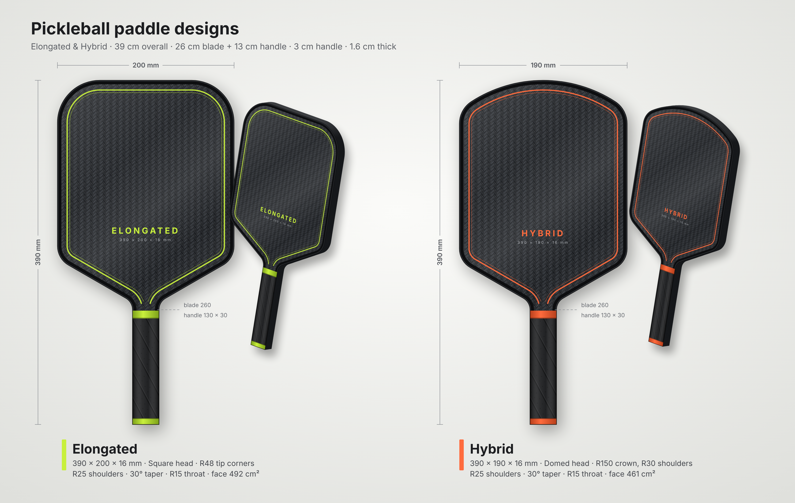

# Pickleball paddle designs – Elongated & Hybrid

CAD-accurate 2-D design, engineering drawings, full-size templates and a presentation
render for two 39 cm paddles, traced from your hand-made templates and sketches.



## Specification

| | **Elongated** (PB-EL-001) | **Hybrid** (PB-HY-001) |
|---|---|---|
| Overall length | 390 mm | 390 mm |
| Blade (face) length | 260 mm | 260 mm |
| Handle (straight section) | 130 × 30 mm | 130 × 30 mm |
| Blade width | **200 mm** | **190 mm** |
| Thickness | 16 mm (uniform) | 16 mm (uniform) |
| Head shape | Square head, **R48** tip corners | Domed head, **R150** crown + **R30** shoulders (dome rise 49.1 mm) |
| Blade → handle | R25 shoulder → 30° straight taper → R15 throat fillet | same |
| Straight sides | y = 202.2 … 342.0 mm from butt | y = 199.3 … 340.9 mm from butt |
| Profile area (incl. handle) | 492 cm² | 461 cm² |
| USA Pickleball L + W ≤ 609.6 mm (24 in) | 590 mm ✔ (19.6 mm margin) | 580 mm ✔ (29.6 mm margin) |
| USA Pickleball L ≤ 431.8 mm (17 in) | 390 mm ✔ | 390 mm ✔ |

Every profile is lines + tangent arcs, symmetric about the centre line. Edge guard and butt cap
count towards the USA Pickleball limits, so keep them within the margins above.

## Output files

| File | What it is |
|---|---|
| [`output/paddle_drawing_set.pdf`](output/paddle_drawing_set.pdf) | All 4 sheets in one PDF |
| `output/<design>/*_sheet1_general_arrangement.(pdf/svg/png)` | **Engineering drawing**, A3, 1:2, first-angle projection: front view, side view (16 mm), sections A–A / B–B, isometric view, notes, title block |
| `output/<design>/*_sheet2_template_1to1.(pdf/svg/png)` | **Full-size template**, A3 portrait, 1:1, with tangent points, arc centres, coordinate table and scale-check bars |
| `output/<design>/*_profile.dxf` | 1:1 cut profile (mm) for CNC / laser: one closed polyline with true arcs, plus centre and throat lines |
| `output/render/paddles_2d_render.(png/svg)` | **2-D presentation render** of both paddles: face and 3/4 views |
| [`reference/cad_outline_vs_your_templates.jpg`](reference/cad_outline_vs_your_templates.jpg) | The CAD outline overlaid on your template photos |

**Printing the template:** print the sheet-2 PDF on A3 at **100 % / "Actual size"** (no
fit-to-page) and check the 100 mm and 50 mm bars before cutting.

## How the shapes were derived

The specified dimensions (390 overall, 260 blade, 130 × 30 handle, 200 / 190 wide, 16 thick) are
exact. The radii and the taper angle were measured from your photos. The elongated values come from
the white template, segmented and scaled to 200 × 390. The hybrid values come from the pen sketch,
rectified to the 190 × 260 blade.

| Feature | Measured (left / right) | Used |
|---|---|---|
| Elongated tip corners | R47.6 / R47.8 | R48 |
| Hybrid crown | ≈R150 | R150 |
| Hybrid crown shoulders | R26.6 / R27.4 | R30 |
| Bottom shoulder radius | R21.7 / R26.0 (EL), R25.0 / R27.3 (HY) | R25 |
| Taper angle | 29.1° / 30.2° (EL), 28.2° / 30.6° (HY) | 30° |
| Throat | EL: hidden under tape, almost sharp; HY: ≈R15 | R15 |

The CAD outline matches your elongated template's corners and sides to within about 1 mm, and your
hybrid sketch to about 1 mm RMS everywhere. On the **elongated**, the bottom taper sits about 5 mm
higher than the paper template. That is because the CAD keeps the straight handle at exactly 130 mm
and adds the same R15 throat fillet as the hybrid. Your template's throat is almost a sharp corner,
which concentrates stress, and your pencil arcs show you were already considering R12–R25 there. If
you want the taper exactly where the template is, set `throat_r` to about 6 mm.

## Regenerating / changing the design

```bash
pip install -r requirements.txt
python -m playwright install chromium   # one-off, for PDF/PNG export
python build.py                          # or: python build.py --no-raster  (SVG + DXF only)
```

All design inputs live in `paddle/geometry.py` (`ELONGATED`, `HYBRID`): length, width, handle
size, thickness, corner / dome radii, shoulder radius, taper angle and throat radius. Every
tangent point, drawing, template, DXF and render is recomputed from them, and `geometry.check()`
asserts that the outline is closed, tangent-continuous and exactly the specified size.
