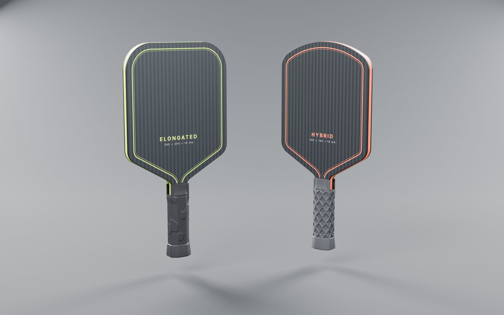
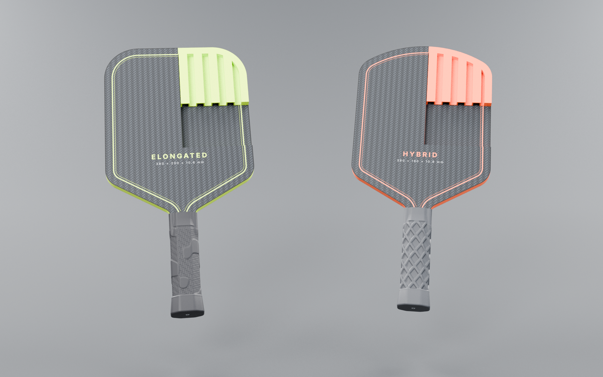
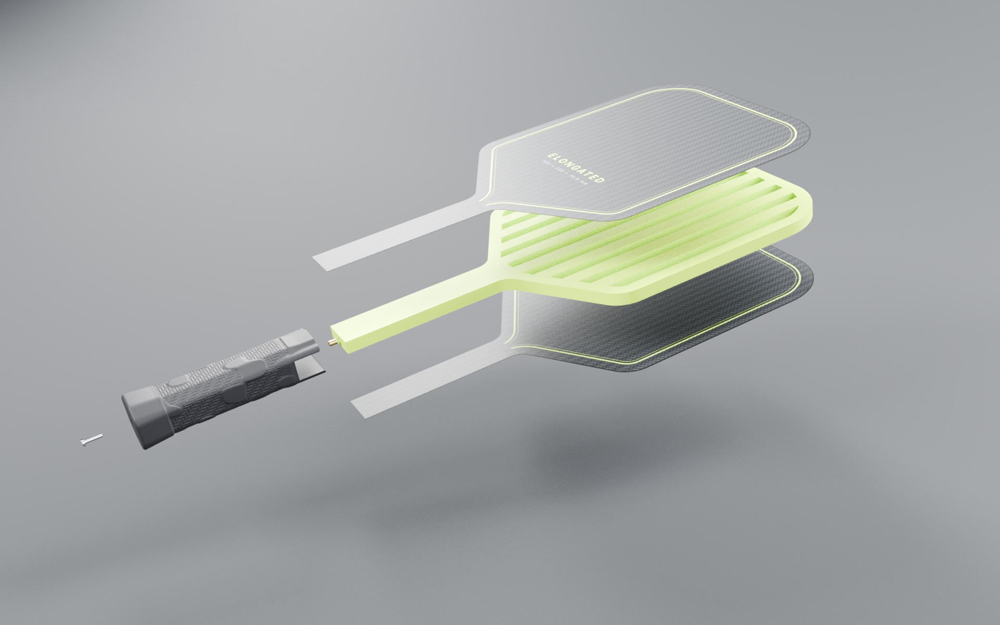
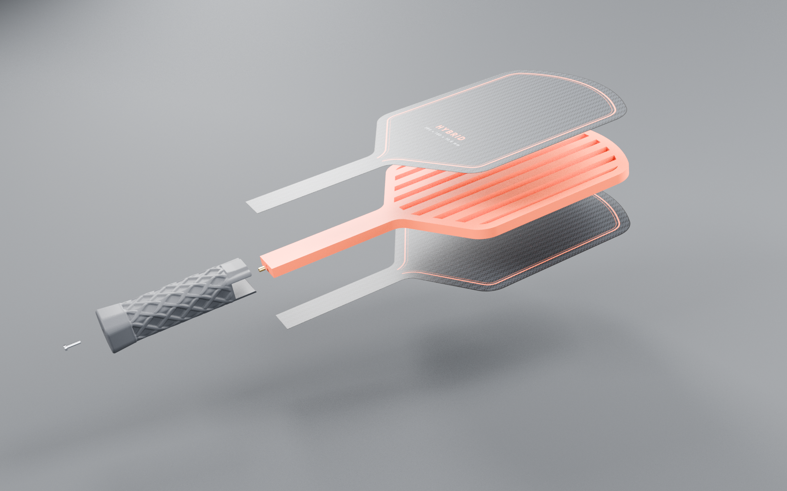
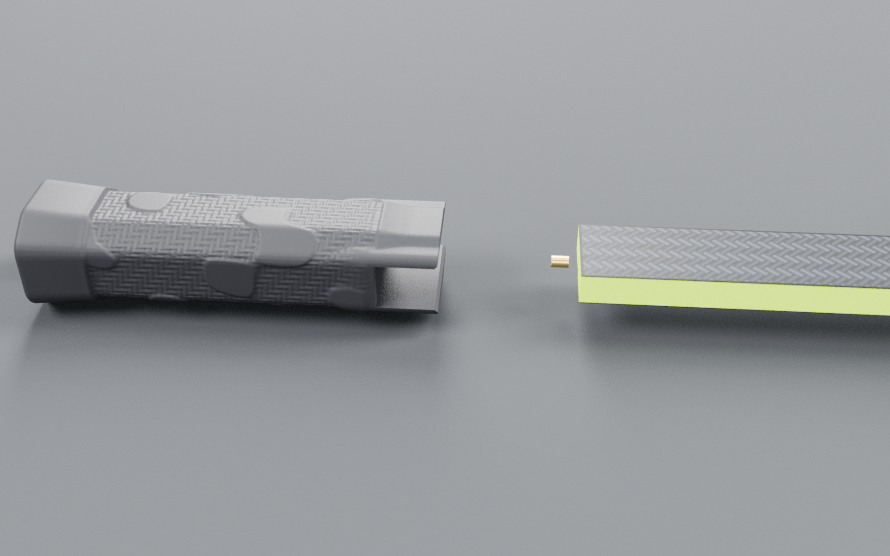
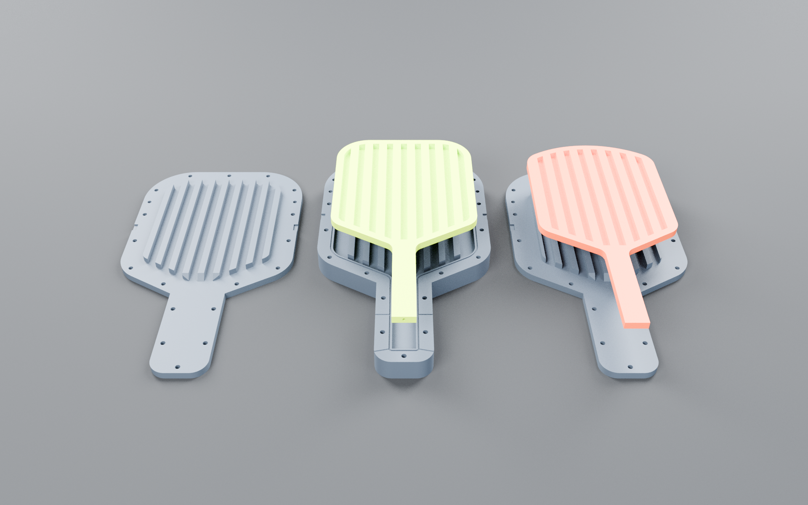
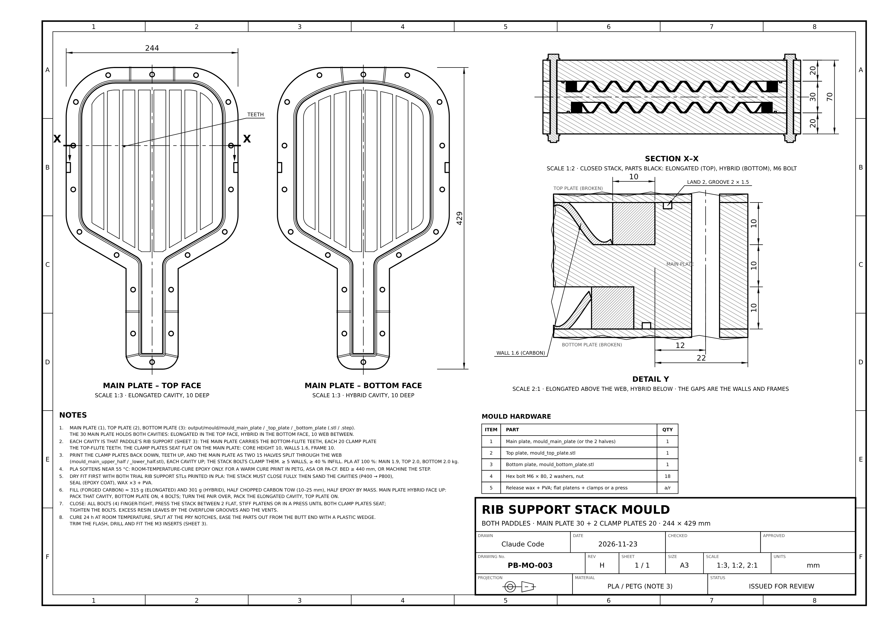
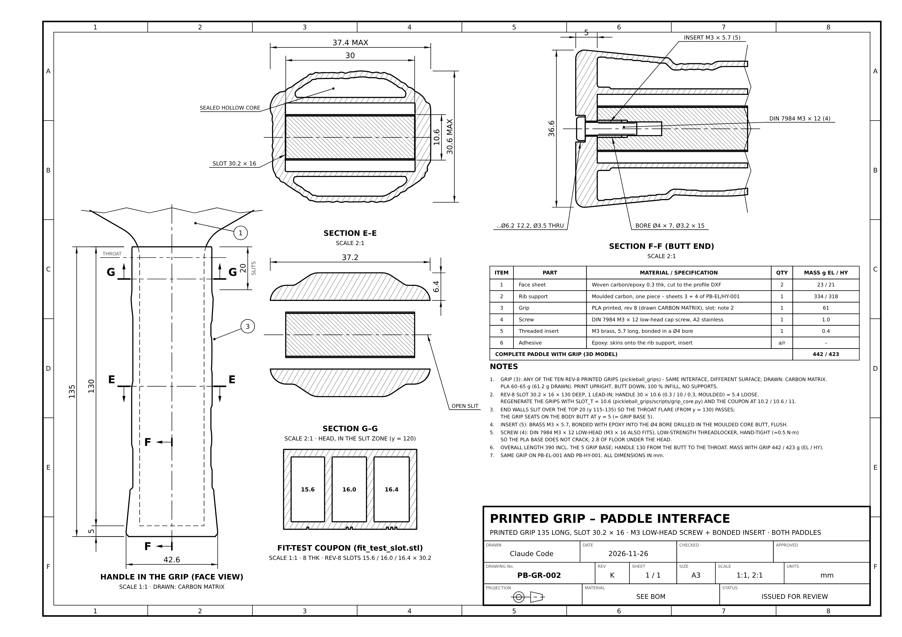

# Pickleball paddle designs – Elongated & Hybrid (REV K)

Two 39 cm paddles traced from your hand-made templates and sketches. Each is a carbon-fibre /
wave-rib sandwich: two 0.3 mm carbon skins bonded to a 10 mm rib support, with a 10 mm frame and
a square-wave rib, 8 waves across the blade. The rib support is moulded in carbon fibre, in one
piece. One stack mould makes both paddles' rib supports at once: a 30 mm main plate with the
Elongated cavity in its top face and the Hybrid cavity in its bottom face, between two 10 mm clamp
plates (18.4 mm with their teeth); closed, the stack is 50 mm. The plates carry the wave as rows
of square teeth that interlock. Your rev-8 printed grip goes on the handle and is locked by a
screw in the butt. The repo holds:

- the engineering drawings, full-size templates and DXF cut profiles;
- the rib-support mould (STL + STEP) and a trial-print rib support;
- the 3-D model (STEP / STL / 3MF) and photoreal renders;
- the strength checks.



> **Before you build: two open issues.**
> - **Weight.** The moulded carbon rib support weighs 334 g (Elongated), so the paddle comes to
>   442 g with the grip. Most paddles weigh 210–240 g. See [Weight](#weight) for where the mass is
>   and what reduces it.
> - **Strength.** The square-wave rib supports the 0.3 mm skins every 9.3 mm, so the blade now
>   passes the 500 N design hit. The solid handle zone still fails a tip hit (reserve factor 0.90
>   on the skin, 0.78 on the core); at a realistic 340 N hit everything passes. 0.6 mm skins pass
>   every check at 500 N. See [Strength](#strength).
>
> Every file here is parametric, so a different lay-up or wall thickness is a quick rebuild.

## Specification

| | **Elongated** (PB-EL-001) | **Hybrid** (PB-HY-001) |
|---|---|---|
| Overall length (incl. the grip base) | 390 mm | 390 mm |
| Blade (face) length | 260 mm | 260 mm |
| Handle | 130 mm incl. the 5 mm grip base, body 30 × 10.6 mm | same |
| Blade width | **200 mm** | **190 mm** |
| Thickness | **10.6 mm: 0.3 mm carbon + 10 mm wave-rib core + 0.3 mm carbon**. The mould sets the core height | same |
| Head shape | Square head, **R48** tip corners | Domed head, **R150** crown + **R30** shoulders (dome rise 49.1 mm) |
| Blade → handle | R25 shoulder → 30° straight taper → R15 throat fillet | same |
| Straight sides | y = 202.2 … 342.0 mm from the butt | y = 199.3 … 340.9 mm from the butt |
| Body profile area | 491 cm² | 459 cm² |
| Grip | Printed PLA grip (rev 8), DIN 7984 M3 screw lock. **Its 16.0 mm slot must be regenerated for the 10.6 mm handle**, see [Printed grip](#printed-grip) | same |
| Mass with the grip (3D model) | 442 g, balance point 213 mm from the butt | 423 g, 208 mm |
| USA Pickleball L + W ≤ 609.6 mm (24 in) | 590 mm ✔ (19.6 mm margin) | 580 mm ✔ (29.6 mm margin) |
| USA Pickleball L ≤ 431.8 mm (17 in) | 390 mm ✔ | 390 mm ✔ |

Every profile is lines and tangent arcs, symmetric about the centre line. An edge guard counts
towards the USA Pickleball limits, so keep it within the margins above.

## Construction

| | |
|---|---|
|  |  |
|  |  |

- **Skins.** Two identical 0.3 mm woven carbon/epoxy skins, cut to the body profile
  (`*_profile.dxf`, template sheet 2). They are bonded to the moulded rib support:
  1. Abrade (P120) and degrease both faces.
  2. Bond with epoxy, pressing flat between platens or in a vacuum bag.
  3. Trim flush with the core edge.
- **Rib support (the core), 10 mm, carbon fibre / epoxy moulded in one piece** in the stack mould
  (sheet 3 of each drawing; mould PB-MO-003):
  - A closed 10 mm perimeter frame covers the whole side, as marked on your sketch.
  - Inside it is a square-wave rib, 8 waves across the blade at a 21.2 mm pitch: flat 11.9 mm
    bond lands lying against each skin, joined by 1.6 mm webs square to the faces. The webs lean
    1.5° so that every flute (and every mould tooth) is slightly wider at its open face and
    releases. The flutes are 9.3 mm wide cells running along the paddle, open alternately to the
    top and the bottom face, and the crests sit symmetric about the centre line, 4 on each side.
    It replaces the sine-wave rib of REV B–J, whose sloping walls read as triangles in section.
  - The core is solid from its butt to y = 150 mm (handle and throat). Each flute starts with a
    45° ramp, 10 mm long. The ramp is longest at the flute's open face, so the mould teeth pull
    straight out.
- **Grip.** Your printed rev-8 grip slides over the handle. Its 5 mm solid base is the butt of the
  paddle, so the skins and the rib support start at y = 5 mm and the overall length stays 390 mm.
- **Screw lock.** A DIN 7984 M3 × 12 low-head screw goes up through the grip base into an M3 × 5.7
  brass insert. The insert is bonded with epoxy into a Ø4.0 × 7 bore drilled in the moulded butt,
  with a Ø3.2 × 15 clearance bore beyond it. A heat-set insert won't work in a thermoset.

## Rib support mould

| | |
|---|---|
|  |  |

One mould makes both rib supports. `python tools/export_mould.py` writes its plates to
[`output/mould/`](output/mould), and drawing
[`PB-MO-003`](output/mould/PB-MO-003_rib_support_stack_mould.pdf) covers it:

- `mould_main_plate` (`.stl` + `.step`), the 30 mm main plate in one piece;
- `mould_main_upper_half.stl` and `mould_main_lower_half.stl`, the same plate split for printing;
- `mould_top_plate` and `mould_bottom_plate` (`.stl` + `.step`), the two clamp plates.

The STL files are in print orientation and the STEP files are for machining.

- **How it works.** The stack is three plates, 50 mm in all when closed (10 + 30 + 10):

  | Plate | Thickness | What it holds |
  |---|---|---|
  | Top clamp plate | 10 mm, plus 8.4 mm teeth | the Elongated's top-flute teeth, on its underside |
  | Main plate, top 10 mm | 30 mm in all | the Elongated cavity: a 10 mm pocket with the bottom-flute teeth standing in it |
  | Main plate, middle 10 mm | | a solid web between the two cavities |
  | Main plate, bottom 10 mm | | the Hybrid cavity, the same way up from the bottom face |
  | Bottom clamp plate | 10 mm, plus 8.4 mm teeth | the Hybrid's top-flute teeth |

  - Closing the stack slides each clamp plate's square teeth between the main plate's. The 1.6 mm
    gaps between neighbouring teeth form the webs, the 1.6 mm gap between each tooth's tip and the
    opposite floor forms a land, the 10 mm band around each pocket edge forms the frame, and the
    toothless handle end forms the solid zone.
  - Each clamp plate seats flat on the main plate, so each cavity is exactly 10 mm deep and each
    rib support is 1 cm thick.
  - The Hybrid outline fits inside the Elongated one, so both cavities share one 244 × 429 mm
    plate and one ring of bolts.
  - The plates are located by the 18 through-bolts, and the wave teeth centre each clamp plate as
    it closes. There is no plug any more: with the pockets exactly 10 mm deep, the clamp plates
    close flat.
- **Release.** The webs lean 1.5°, so every flute, and so every tooth, is 0.44 mm wider at its open
  face than at its floor, and the teeth pull straight out. The 45° ramps at the flute starts lean
  the same way. The CAD check finds zero overlap between the plates and the parts, and each closed
  cavity matches its rib support exactly.
- **Sizes** (all 244 × 429 mm):

  | Plate | Thickness | PLA, solid |
  |---|---|---|
  | Main plate | 30 mm | 1.84 kg |
  | – upper half / lower half (for printing) | 15 mm each | 0.90 / 0.94 kg |
  | Top clamp plate | 10 mm + 8.4 mm teeth = 18.4 mm | 1.08 kg |
  | Bottom clamp plate | 10 mm + 8.4 mm teeth = 18.4 mm | 1.06 kg |

  The teeth sit inside the cavities when the stack is closed, so only the 10 mm plates add to
  the 50 mm.

  All need a bed of at least 440 mm (500 × 500 class), or you can machine the STEP from
  aluminium.
- **Printing.**
  - Print the clamp plates back down, teeth up.
  - The main plate has a cavity in each face, so one face would always print upside down on
    supports. Print it as the two 15 mm halves instead, split through the middle of the web, each
    with its cavity facing up. The stack bolts clamp the halves together, so they need no glue.
  - Use at least 5 walls and 40 % infill, with 0.12–0.16 mm layers for the teeth.
- **Features:**
  - around each pocket: a 2 mm land, then a 2 × 1.5 mm resin overflow groove, with 6 vents;
  - 18 × M6 bolts through all three plates (60 mm long);
  - 2 pry notches at each parting face.

  There are no dowel holes and no ejector holes.
- **Moulding steps** (full list on PB-MO-003):
  1. Dry fit. Print both trial rib supports (below) in PLA and close the stack on them: both
     clamp plates must seat fully.
  2. Sand the cavity faces (P400 → P800), seal them with an epoxy coat, then apply wax ×3 + PVA.
  3. Mix the forged carbon: about 368 g for the Elongated and 350 g for the Hybrid, each half
     chopped carbon tow (10–25 mm) and half epoxy by mass, which is about 40 % fibre by volume.
     That is the part plus 10 %.
  4. Fill the Hybrid side first. Lay the main plate Hybrid face up and pack its cavity: the wall
     gaps and the frame first, then the solid handle zone. Put the bottom plate on and fit 4 bolts.
  5. Turn the pair over and pack the Elongated cavity the same way. Put the top plate on.
  6. Fit all bolts finger-tight. Press the stack between two flat, stiff platens, or in a press,
     until both clamp plates seat. Then tighten the bolts. Excess resin leaves through the grooves
     and the vents.
  7. Cure for 24 h at room temperature. Split the stack at the pry notches and ease each part out
     from the butt end with a plastic wedge.
  8. Trim the flash, drill the insert bores and bond the inserts.

  With a clamp plate off, a cavity holds about 1.6 times its part's volume (there is no loading
  well now), so pack the charge firmly.
- **Woven fabric option.** You can also drape woven carbon over the main plate's teeth and let the
  clamp plate press it into the wave; the frame and handle zone still take chopped fill. The tooth
  gap is `rib_t`: 1.6 mm takes about 6–7 plies of 200 g/m² fabric.
- **Temperature.** PLA softens near 55 °C, so use a room-temperature-cure epoxy. For a warm cure,
  print the mould in PETG, ASA or PA-CF.

## Trial rib support STL

`python tools/export_rib_support.py` writes one STL per paddle to
[`output/rib_support/`](output/rib_support). It is the whole rib support in one piece, lying flat
in its print orientation (z = 0 … 10 mm), centred on x = y = 0, in mm. It is a single closed body.
Uses:
- print it in PLA to check that the mould closes;
- print it in PA-CF as a printed alternative to the moulded part. With 0.3 mm skins that is the
  REV D build, which fails the strength check (see [Strength](#strength)).

| File | Size (mm) | Mass, PA-CF (PETG / PLA) | Printer bed |
|---|---|---|---|
| `elongated_rib_support.stl` | 200 × 385 × 10 | 263 g (283 / 276 g) | ≥ 391 × 206 mm (400 mm class) |
| `hybrid_rib_support.stl` | 190 × 385 × 10 | 250 g (269 / 263 g) | ≥ 391 × 196 mm (400 mm class) |

Print it at 100 % infill (the 1.6 mm webs and lands are 4 perimeters of a 0.4 mm nozzle), 0.2 mm
layers and no supports. The checks (closed mesh, bodies, volume, bed fit) are in
`rib_support_report.json`.

## Weight

| Elongated | Mass |
|---|---|
| Rib support, moulded carbon (1.5 g/cm³) | **334 g** |
| – solid handle and throat zone, to y = 150 | 69 g |
| – 10 mm frame | 105 g |
| – square-wave webs, lands and ramps (29 % of the blade volume) | 160 g |
| Skins, 2 × 0.3 mm | 46 g |
| Grip (CARBON MATRIX, PLA) | 61 g |
| Screw + insert | 1.4 g |
| **Paddle** | **442 g** (Hybrid 423 g) |

The square wave weighs 48 g more than the sine wave of REV G: its webs run the full height and its
lands are 11.9 mm wide instead of 5.0 mm.

Most paddles weigh 210–240 g. The moulded core is heavy because its webs, lands, frame and handle
are solid carbon. Here is what each change does (Elongated, same hand check; strength in the next
section):

| Change | Rib support | Paddle | Strength |
|---|---|---|---|
| As built: 0.3 skins, webs 1.6 | 334 g | 442 g | blade passes; the handle fails a 500 N tip hit |
| 0.3 skins, webs 1.0 | 278 g | 386 g | blade passes; the handle fails a 500 N tip hit |
| 0.6 mm skins, webs 1.6 | 334 g | 488 g | passes |
| 0.6 mm skins, webs 1.0 | 278 g | 432 g | passes |

A 1.0 mm web is hard to fill with chopped fibre; woven fabric draped in the mould (4–5 plies) suits
it better. Getting down to a normal paddle weight takes more than parameter changes, because the
frame and handle zone alone weigh 174 g. Options:
- a lighter handle zone (hollow, or a foam insert);
- a narrower frame;
- a printed grip with a lighter infill.

## Printed grip



The grip is your rev-8 printed grip (`pickleball_grips/` on branch `claude/kind-volta-vs8ck6`, commit
`c594433`). All ten designs share the same interface. Drawing
[`PB-GR-002`](output/grip/PB-GR-002_printed_grip_interface.pdf) shows how it fits:

- 135 mm long, with a solid 5 mm base, a 30.2 mm wide slot 130 mm deep with a 1 mm lead-in, and
  head walls at least 3.5 mm thick.
- Both end walls are slit over the top 20 mm, so the throat flare (from y = 130) can pass.
- The M3 screw goes through a Ø3.5 hole with a Ø6.2 × 2.2 counterbore, leaving 2.8 mm of PLA under
  the head. Tighten it by hand (about 0.5 N·m) with a low-strength threadlocker.

**The rev-8 slot no longer fits.** It is 16.0 mm thick, but the handle has been 10.6 mm since
REV D, so the grip would sit 5.4 mm loose. Since the grips are not printed yet, regenerate them on
the grip branch:
- set `SLOT_T = 10.6` in `pickleball_grips/scripts/grip_core.py`;
- make a new fit-test coupon at 10.2 / 10.6 / 11.0 mm.

The drawings still show the rev-8 grip (CARBON MATRIX, 61 g), so its sections show the gap.

## Strength

The CalculiX model meshes the skins as solid tetrahedra, and that doesn't work for a 0.3 mm skin.
So the thin-skin lay-ups are checked by hand (`python tools/hand_check.py` →
`analysis/hand_check.json`). The method has three parts:
1. The paddle is treated as a cantilever from the grip clamp, with skins and core section by section.
2. The skin between two bond lands is treated as a clamped strip under the ball's contact pressure,
   including membrane stretching.
3. The skin is checked for buckling between the lands.

The same method run on REV C (4 / 8 / 4) is compared with REV C's FEA results. Skin stress is scaled
by the FEA/beam ratio (×1.42) and deflection by ×1.66. Core stress is quoted as plain beam bending.

The moulded core is taken as chopped carbon/epoxy with E = 25 GPa and a 120 MPa bending
allowable. That is conservative for a hand-packed part with some voids; pressed SMC-grade parts
reach 35–40 GPa and about 250 MPa.

| 500 N ball impact | REV C 4 / 8 / 4 (FEA) | REV G–J: sine wave λ22 | **REV K: square wave λ21.2** | Allowable |
|---|---|---|---|---|
| Skin stress in the handle just above the grip, tip hit | 141 MPa (RF 3.6) | 556 MPa (RF 0.90) | **556 MPa (RF 0.90)** | 500 MPa (compression) |
| Same, sweet-spot hit | – | 359 MPa (RF 1.39) | **359 MPa (RF 1.39)** | 500 MPa |
| Core bending stress there, tip hit | 17.5 MPa (local peak) | 154 MPa (RF 0.78) | **154 MPa (RF 0.78)** | 120 MPa moulded |
| Same, sweet-spot hit | – | 99 MPa (RF 1.21) | **99 MPa (RF 1.21)** | 120 MPa |
| Unsupported skin between two lands | 13.8 mm | 17.0 mm | **9.3 mm** | – |
| Skin between two lands, under the ball | ≈ 4 MPa | 674 MPa (RF 0.74) | **317 MPa (RF 1.58)** | 500 MPa |
| Skin buckling between lands (blade), tip hit | not critical | 163 MPa vs 62 MPa critical (RF 0.38) | **135 MPa vs 208 MPa (RF 1.54)** | – |
| Same, sweet-spot hit | – | 93 MPa (RF 0.66) | **77 MPa (RF 2.70)** | – |
| Tip deflection, tip hit | 3.85 mm | ≈ 28 mm | **≈ 26 mm** | – |

REV D (printed PA-CF core), REV E (11 waves) and REV F are in `analysis/hand_check.json` for
reference. All are 0.3 / 10 / 0.3 with the moulded core except REV C and D.

What this means:

1. **The blade.** The square wave's lands are 21.2 mm apart and 11.9 mm wide, so only 9.3 mm of
   0.3 mm skin is unsupported (17 mm with the sine wave). The skin now passes under the ball
   (RF 1.58) and against buckling (RF 1.54 on a tip hit), and the paddle is a little stiffer.
2. **Handle and core.** The handle zone is solid, so the rib doesn't change it. A sweet-spot hit
   passes; a 500 N tip hit fails (handle skin RF 0.90, core RF 0.78).
3. **At a realistic 340 N peak hit** (500 N includes a 1.5 safety factor) everything passes:
   handle skin RF 1.32, core 1.14, skin between the lands 2.30, buckling 2.26.

Lay-up options at 500 N (Elongated, moulded core, square wave, the same method; the bold rows pass
every check):

| Lay-up, web | Skins + rib support | Handle skin RF (tip / sweet spot) | Core RF (tip) | Buckling RF (tip) | Skin-between-lands RF | Tip deflection | Paddle |
|---|---|---|---|---|---|---|---|
| 0.3 / 10 / 0.3, web 1.6 (as built) | 46 + 334 g | 0.90 / 1.39 | 0.78 | 1.54 | 1.58 | 26 mm | 442 g |
| 0.3 / 10 / 0.3, web 1.0 | 46 + 278 g | 0.90 / 1.39 | 0.78 | 1.22 | 1.41 | 27 mm | 386 g |
| 0.45 / 10 / 0.45, web 1.6 | 68 + 334 g | 1.02 / 1.59 | 0.91 | 4.20 | 3.52 | 22 mm | 465 g |
| **0.6 / 10 / 0.6, web 1.6** | 91 + 334 g | 1.15 / 1.78 | 1.05 | 8.81 | 6.29 | 18 mm | 488 g |
| **0.6 / 10 / 0.6, web 1.0** | 91 + 278 g | 1.15 / 1.78 | 1.05 | 7.24 | 5.54 | 19 mm | 432 g |

- **With the square wave the blade passes on 0.3 mm skins.** Only the solid handle zone needs more.
- **0.6 mm skins (2 plies per side) pass every check at 500 N.** A local doubler on the handle and
  throat instead would keep the 0.3 mm skins on the blade.
- **What a change involves.** `face_t`, `core_t`, `frame_w`, `rib_profile`, `rib_pitch` and `rib_t`
  in `paddle/geometry.py` drive everything, including the mould pocket depth and the teeth.

The full FEA report, [`output/fea/paddle_stress_report.pdf`](output/fea/paddle_stress_report.pdf),
covers the REV C 4 / 8 / 4 lay-up. It stays as the reference the hand check is calibrated against.
To run the FEA on thin skins, the model's skins need shell or single-layer wedge elements.

## Output files

| File | What it is |
|---|---|
| [`output/paddle_drawing_set.pdf`](output/paddle_drawing_set.pdf) | All 8 drawing sheets in one PDF |
| `output/<design>/*_sheet1_general_arrangement.(pdf/svg/png)` | **General arrangement**, A3, 1:2, first angle: front view with the grip, side view with the 0.3/10/0.3 lay-up, section A–A through the wave core, section B–B through the grip, isometric view, notes |
| `output/<design>/*_sheet2_template_1to1.(pdf/svg/png)` | **Full-size body template**, A3 portrait, 1:1: tangent points, arc centres, coordinate table, core-frame and solid-zone reference lines, scale-check bars |
| `output/<design>/*_sheet3_rib_core.(pdf/svg/png)` | **Rib support**: plan view 1:2 with lands and flute ramps, section C–C across the wave 2:1, section D–D through the ramp 2:1, material and moulding notes |
| `output/grip/PB-GR-002_printed_grip_interface.(pdf/svg/png)` | **Printed grip – paddle interface** (both paddles): handle in the grip, sections E–E and G–G across the grip, section F–F through the screw, insert and bores, the fit-test coupon, bill of materials, notes |
| `output/<design>/*_profile.dxf` | 1:1 cut profile of the skins (mm) for CNC / laser: closed polyline with true arcs |
| `output/mould/PB-MO-003_rib_support_stack_mould.(pdf/svg/png)` | **Rib support stack mould** (both paddles): main plate top and bottom faces 1:3, section X–X through the closed stack 1:2, detail Y 2:1, hardware, moulding steps |
| `output/mould/mould_main_plate.stl` (+ `.step`), `mould_main_upper_half.stl`, `mould_main_lower_half.stl`, `mould_top_plate.stl` / `mould_bottom_plate.stl` (+ `.step`) | **Stack mould plates**, in print orientation, plus `mould_report.json` (sizes, charges, cavity checks) |
| `output/rib_support/<design>_rib_support.stl` | **Trial rib support**, one piece, plus `rib_support_report.json` |
| `output/cad/<design>_assembly.step` | 3-D assembly: skins, rib support, screw and insert (named solids) |
| `output/cad/<design>_assembly.3mf` | The same assembly with the printed grip (a mesh, so it is not in the STEP) |
| `output/cad/<design>_rib_core.step` / `.stl`, `output/cad/<design>_<part>.stl` | The rib support and every other part, in mm |
| `output/render/paddles_3d_*.png` | Photoreal renders: hero, cutaway, exploded with the grip and screw (each design), handle close-up, the opened mould with the moulded rib support |
| `output/render/paddles_2d_render.(png/svg)` | 2-D presentation render (face and 3/4 views) |
| `analysis/hand_check.json`, `analysis/mass_properties.json` | Strength hand check (REV C calibration, REV D, E, F and G) and masses |
| `output/fea/paddle_stress_report.pdf`, `output/fea/fea_*.png`, `analysis/fea/*.json` | REV C FEA report, figures and raw results (4 / 8 / 4 lay-up) |
| `reference/grips/*.stl` | Copies of the CARBON MATRIX and VORTEX GRIP STLs and the fit-test coupon from the grip branch |
| [`reference/cad_outline_vs_your_templates.jpg`](reference/cad_outline_vs_your_templates.jpg) | The CAD outline overlaid on your template photos |

**Printing the template.** Print the sheet-2 PDF on A3 at **100 % / "Actual size"**, with no
fit-to-page. Check the 100 mm and 50 mm bars before cutting.

## How the shapes were derived

The specified dimensions (390 overall, 260 blade, 130 × 30 handle, 200 / 190 wide) are exact. The
radii and the taper angle were measured from your photos. The elongated values come from the white
template, segmented and scaled to 200 × 390. The hybrid values come from the pen sketch, rectified
to the 190 × 260 blade.

| Feature | Measured (left / right) | Used |
|---|---|---|
| Elongated tip corners | R47.6 / R47.8 | R48 |
| Hybrid crown | ≈R150 | R150 |
| Hybrid crown shoulders | R26.6 / R27.4 | R30 |
| Bottom shoulder radius | R21.7 / R26.0 (EL), R25.0 / R27.3 (HY) | R25 |
| Taper angle | 29.1° / 30.2° (EL), 28.2° / 30.6° (HY) | 30° |
| Throat | EL: hidden under tape, almost sharp; HY: ≈R15 | R15 |

The CAD outline matches your elongated template's corners and sides to within about 1 mm, and your
hybrid sketch to about 1 mm RMS everywhere. On the **elongated**, the bottom taper sits about 5 mm
higher than the paper template. That is because the CAD keeps the straight handle at exactly 130 mm
and adds the same R15 throat fillet as the hybrid. Your template's throat is almost a sharp corner,
which concentrates stress, and your pencil arcs show you were already considering R12–R25 there. If
you want the taper exactly where the template is, set `throat_r` to about 6 mm.

## Regenerating / changing the design

```bash
pip install -r requirements.txt
python -m playwright install chromium     # one-off, for PDF/PNG export
python tools/export_cad.py                # STEP / STL / 3MF + analysis/mass_properties.json
python tools/export_rib_support.py        # trial rib support, one piece
python tools/export_mould.py              # rib support stack mould: 3 plates (STL + STEP)
python tools/hand_check.py                # strength hand check -> analysis/hand_check.json
python build.py                           # drawings (incl. the mould PB-MO-003), templates, DXF, 2-D render
python tools/render_3d.py                 # photoreal renders (Blender 4.x with Cycles on PATH)
python tools/export_cad.py --grip 03_tessel_block   # the 3-D files with another of the ten grips
```

A grip STL that is not in `reference/grips/` is copied from the grip branch the first time it is
needed, so fetch that branch first (`git fetch origin claude/kind-volta-vs8ck6`).

The inputs live in `paddle/geometry.py` and `paddle/mould.py`:

- **Outlines** (`ELONGATED`, `HYBRID`): length, width, handle, grip base, thickness, corner and dome
  radii, shoulder radius, taper angle and throat radius.
- **`Construction`**: skin and core thickness, frame width, rib profile (square or sine), wave pitch,
  phase, wall, draft (square) and amplitude (sine), solid zone, ramp length and the insert bore.
- **`GripInterface`**: the printed grip's length, base, slot, slits, counterbore and screw.
- **`MouldSpec`**: main plate and clamp plate thickness (the plate, not counting its teeth), flange,
  land, groove, vents, bolts and notches. The pocket depth and the teeth follow the core height and
  the wave; the web is what the main plate leaves between its two pockets.

Every drawing, the 3-D model, the print files, the mould and the renders are recomputed from those
inputs. `geometry.check()` asserts three things: each outline is closed, it is tangent-continuous
and exactly the specified size, and the specified thickness matches the lay-up.

## Revisions

- **A.** Outlines, general arrangement, full-size templates, DXF, 2-D render.
- **B.** Carbon / wave-rib sandwich construction, closed core frame, grip and screw-locked butt
  cap. Adds the rib-core and grip drawings, 3-D model, photoreal renders and the FEA stress
  analysis. The body now starts 4 mm above the butt-cap base, so the overall length stays 390 mm.
- **C.** Print-ready rib-support STLs. Your rev-8 printed grip replaces the REV B sleeve, wrap,
  collar and butt cap. The body now starts on the grip's 5 mm base, and a DIN 7984 M3 × 12 screw
  into an M3 insert locks the grip. Grip-interface drawing PB-GR-002.
- **D.** Lay-up 0.3 / 10 / 0.3 (10.6 mm thick). The rib support is a single piece again (the
  two-piece dovetail version is gone). Adds a two-half skin-lamination mould and the strength hand
  check, with alternative lay-ups. The rev-8 grip slot (16.0) is flagged for regeneration at 10.6.
- **E.** The rib support is moulded in carbon fibre. The REV D skin mould is replaced by a
  rib-support mould: tray + lid, whose halves carry the wave as interlocking teeth (STL + STEP,
  sheet 4 redrawn, render). The flute ramps are reversed so the teeth release, and the M3 insert is
  bonded into a drilled bore. The printed rib support stays as a trial piece. The hand check is
  extended to the moulded core, and a weight breakdown is added (379 / 362 g).
- **F.** The rib has 8 waves instead of 11 (pitch 18 → 23.5 mm, crests symmetric about the centre
  line), so the tray has 8 teeth. The mould gets a 2 mm plug on the lid that fits into the tray
  pocket, and the tray is 2 mm thicker (22 mm), so the rib support stays 10 mm. The dowel holes and
  the ejector holes are removed: the plug aligns the halves. The hand check covers the new wave
  (358 / 344 g).
- **G.** The rib's frame is 10 mm wide instead of 6 mm, so the mould teeth stop 1 cm from the
  pocket wall. The pitch goes to 22 mm so both paddles keep 8 full teeth in the tray. The tray floor
  is 5 mm instead of 10 mm (tray 22 → 17 mm thick, M6 × 40 bolts). 394 / 379 g.
- **H.** One stack mould for both paddles replaces the two tray-and-lid moulds: a 30 mm main plate
  (Elongated cavity in the top 10 mm, 10 mm web, Hybrid cavity in the bottom 10 mm) between two
  20 mm clamp plates that carry the top-flute teeth. The clamp plates close flat (no plug); M6 × 80
  bolts through the stack. New shared drawing PB-MO-003; each paddle drawing is now 3 sheets.
- **J.** The clamp plates are 10 mm plates (19.4 mm with their teeth), so the closed stack is
  50 mm instead of 70 mm; M6 × 60 bolts. (I is not used as a revision letter.)
- **K.** Square-wave rib: flat 11.9 mm lands against each skin joined by 1.6 mm webs square to the
  faces (1.5° draft), pitch 21.2 mm (8 waves, no sliver teeth beside the frame). The mould teeth
  become square, 8.4 mm deep. The unsupported skin drops from 17 to 9.3 mm, so the blade passes
  on 0.3 mm skins. 442 / 423 g.
