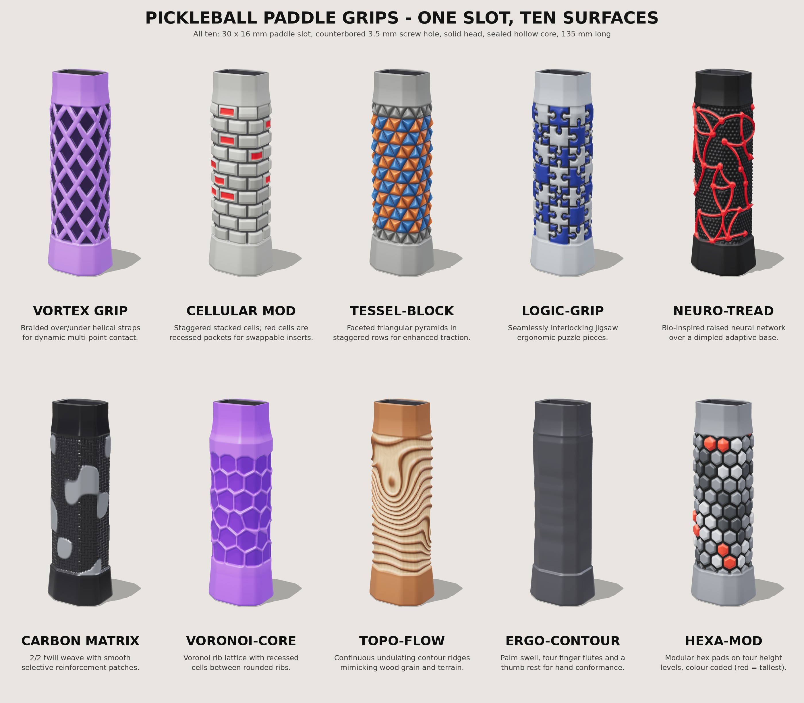
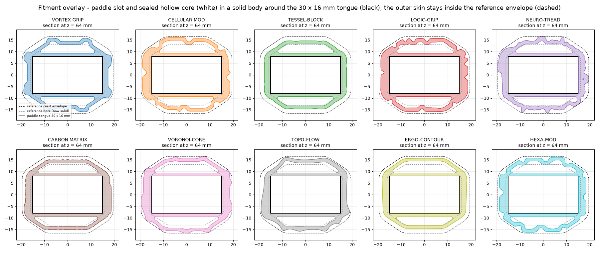

# Pickleball paddle grips - ten designs, one paddle slot

Ten printable grip sleeves generated from the catalog image.  The outer envelope comes from `reference/PickleballGrip_1.3mf`; only the
outer surface differs between designs.  **Revision 5:** every grip is **135 mm (13.5 cm) long** - a 5 mm base under a **130 mm deep** paddle slot
of 30.2 x 16.2 mm (the measured 30 x 16 mm flat handle + 0.2 mm) - so the paddle seats fully and its neck flare no longer rests on the rim; the
**top 25 mm (the head) is solid** and has a 0.5 mm lead-in chamfer at the slot mouth (it cracked when hollow); the 3.5 mm screw hole in the
butt has a **6.2 x 3.2 mm counterbore** so an M3 cap-head (socket-head, allen) screw sits flush; the rest of the walls keep a sealed hollow core.



## Weight (100 % infill, so mass = volume x density)

| Design | Volume cm3 | PLA 1.24 g | PETG 1.27 g | TPU 1.21 g | ABS 1.04 g |
|---|---|---|---|---|---|
| VORTEX GRIP | 46.1 | **57.2** | 58.6 | 55.8 | 47.9 |
| CELLULAR MOD | 46.6 | **57.8** | 59.2 | 56.4 | 48.5 |
| TESSEL-BLOCK | 46.2 | **57.3** | 58.7 | 55.9 | 48.0 |
| LOGIC-GRIP | 47.5 | **58.9** | 60.3 | 57.5 | 49.4 |
| NEURO-TREAD | 46.4 | **57.6** | 59.0 | 56.2 | 48.3 |
| CARBON MATRIX | 45.5 | **56.4** | 57.8 | 55.1 | 47.3 |
| VORONOI-CORE | 48.0 | **59.5** | 60.9 | 58.0 | 49.9 |
| TOPO-FLOW | 46.6 | **57.8** | 59.2 | 56.4 | 48.5 |
| ERGO-CONTOUR | 44.8 | **55.5** | 56.9 | 54.2 | 46.6 |
| HEXA-MOD | 46.3 | **57.5** | 58.9 | 56.1 | 48.2 |

All ten are **56-60 g in PLA** (up to 61 g in PETG; densities in g/cm3).  Slicers land within a few percent of
(outer volume - sealed core) x density, so budget +-3 %.  History: rev 2 was 40-49 g (a bore, no paddle slot), rev 3 filled the bore down to the slot
(88-98 g), rev 4 hollowed the walls (50-54 g) but the hollow head cracked, rev 5 makes the head solid again (about 5 g heavier) and is 2 mm longer.
The hollow core is **sealed**: nothing can be seen or reached from outside - it is just air.  Walls around it are about 1.2 mm (3 x 0.4 mm
perimeters; measured 3D median 1.2 mm, minimum 1.10 mm - table below).  Generate the fully solid version with
`python3 scripts/generate_grips.py --solid` (about 90-100 g).

## What is identical on all ten

| Feature | Value |
|---|---|
| Overall length | **135.0 mm = 13.5 cm**: 5.0 mm base + 130.0 mm slot (the reference sleeve was 132.823 mm; the 2.2 mm extension continues the neck straight up) |
| Paddle slot | **30.2 x 16.2 mm** rounded rectangle (corner radius 0.3 mm) = measured tongue 30 x 16 mm + 0.2 mm clearance; wide axis along x; floor at **z = 5.0** mm (a **5 mm base**, the most the base may be); open at the top with a **0.5 mm 45 degree lead-in chamfer** |
| Screw hole | **3.5 mm** round, on the slot axis, through the 5 mm butt (z 0 - 5), with a **6.2 mm x 3.2 mm counterbore** at the butt face: an M3 socket-head (cap) screw (5.5 mm x 3.0 mm head) sits flush, with 1.8 mm of floor left under its head - use an M3 x 12-16 mm screw |
| Head | the **top 25 mm (z 110-135) is solid** - no cavity there; it carries the pry of the paddle neck when the paddle is slid in |
| Hollow core | a sealed cavity in the thick side walls below z 110 (about 25-31 cm3; one connected piece on most designs, a few pieces on NEURO-TREAD, VORONOI-CORE and HEXA-MOD), walls about 1.1-1.2 mm or more to every outer surface, the slot, the hole and the floor (measured in 3D, table below); roofs at <= 45 degrees (flat bridges <= 4 mm) so it prints without supports; none under the slot floor, where the screw bears; no through-windows |
| Foot / butt flare | z 0-20: outer skin 5.29 (at z = 2) -> 3.54 mm from the reference bore line (at z = 20), ~2 mm bottom fillet, flat closed butt (max 42.6 x 36.6 mm) - unchanged |
| Outer envelope | no grip ever exceeds the reference's own outer envelope (crest 3.5 mm from the reference bore line) |

Reference bounding box 42.64 x 36.62 x 132.823 mm; all ten grips: 42.63 x 36.61 x 135.0 mm (2.2 mm longer).  "Base line" below = the reference's 32.06 x 26.04 mm
octagonal bore outline, which is now inside the solid body and only serves as the datum the outer skin is measured from.

**The slot size is a ruler measurement.**  Measure your paddle's handle with calipers; if it is not 30 x 16 mm change `PADDLE_W`, `PADDLE_T`
(and `SLOT_CLEAR`, 0.2 mm in total) in `scripts/grip_core.py` and run `generate_grips.py` again.  Printed holes come out slightly small, so
test-print one grip before the rest.  The counterbore is sized for an M3 **cap-head** (socket-head, allen) screw; a countersunk (flat) head would also sit flush but
not seat on the flat counterbore floor - for those, swap the counterbore for a 90 degree cone in `carve_cavity` (`scripts/grip_core.py`).  Your paddle's handle looks like
a hollow honeycomb core (your cross-section photo), so a screw into its end face may not hold well - consider a threaded insert or epoxy.

## What changed in revisions 3 and 4

* **Interior:** the 32.06 x 26.04 mm octagonal bore is filled; the only cavity is the 30.2 x 16.2 mm slot (z 5 to the top), so the grip no longer
  rattles on your flat paddle handle (the gaps marked on your photos).
* **Screw hole:** one 3.5 mm hole through the butt on the slot axis, to pin the grip to the paddle with an M3 allen screw.
* **VORONOI-CORE:** with a solid body its through-windows are gone; its 54 cells stay as recesses about 1 mm deep between the rounded ribs (floors 2.46 mm above the base line, crests 3.5 mm).
* **Rev 3 weight:** roughly doubled (88-98 g), which rev 4 fixes.
* **Rev 4:** a sealed hollow core in the side walls (50-54 g) and a 90 degree countersink on the screw hole.
* **Rev 5 - length:** 135.0 mm overall (was 132.8): 5.0 mm base + 130.0 mm slot, so the paddle (13.0 cm of handle inside, 39.5 cm total with the
  grip) seats fully on the floor.  With the old 127.8 mm slot the neck flare stopped on the rim, the grip stood about 7 mm proud of the paddle end and the flare
  pried the thin rim open.
* **Rev 5 - solid head:** no cavity above z 110 and a 0.5 mm 45 degree lead-in chamfer at the slot mouth; the hollow head had cracked on every print.
* **Rev 5 - counterbore** (6.2 x 3.2 mm) instead of the countersink, for cap-head screws.  Weight 50-54 -> 56-60 g in PLA.

Earlier revisions: rev 1 = ten designs + colour 3MFs; rev 2 = smooth finish, 1.2 mm base walls, <= 50 g each.

## The ten grips

| # | Design | File | Concept | Peak height above base line, mm |
|---|---|---|---|---|
| 01 | **VORTEX GRIP** | `stl/01_vortex_grip.stl` | 8 + 8 counter-wound straps (36 deg helix) braided over/under; dark valleys between straps give multi-point contact. | 2.85 |
| 02 | **CELLULAR MOD** | `stl/02_cellular_mod.stl` | 10 rows x 8 staggered cells, 1.4 mm gaps; cells on 3 heights, ~22% recessed as insert pockets (red in the preview). | 3.04 |
| 03 | **TESSEL-BLOCK** | `stl/03_tessel_block.stl` | 11 rows x 24 triangles (12 up + 12 down per row, 10.2 mm base), each a faceted pyramid; up-triangles stand taller than down-triangles. | 3.44 |
| 04 | **LOGIC-GRIP** | `stl/04_logic_grip.stl` | 8 x 7 interlocking jigsaw pieces with mushroom knobs (2.9 mm neck, 4.2 mm head), 0.84 mm grooves, shallow dome tops. | 2.81 |
| 05 | **NEURO-TREAD** | `stl/05_neuro_tread.stl` | Periodic Delaunay 'neuron' graph: curved ~1.5 mm axon ridges and soma nodes at full height over a hex-packed bump base (2.7 mm pitch). | 3.50 |
| 06 | **CARBON MATRIX** | `stl/06_carbon_matrix.stl` | Continuous 2/2 twill weave (2 mm tow pitch, every tow a rounded ridge that rises over / dives under) with smooth raised reinforcement patches. | 2.73 |
| 07 | **VORONOI-CORE** | `stl/07_voronoi_core.stl` | Lloyd-relaxed Voronoi rib lattice (2.6 mm ribs, rounded tops) around 54 recessed cells (about 1 mm deep); no through-windows any more - the body is solid. | 3.50 |
| 08 | **TOPO-FLOW** | `stl/08_topo_flow.stl` | Contour ridges of a terrain / wood-knot height field - continuous undulating lines flowing around four knots. | 3.11 |
| 09 | **ERGO-CONTOUR** | `stl/09_ergo_contour.stl` | Smooth hour-glass swell, palm pad on the back (about 1 mm proud; peak about 2.8 mm above the base line), four finger flutes and a thumb dish on the front face. | 2.76 |
| 10 | **HEXA-MOD** | `stl/10_hexa_mod.stl` | 12-column hex pads (10.2 mm across flats), 1.7 mm gaps, four height levels (red = tallest, full 3.5 mm). | 3.50 |

Close-ups: `renders/<id>_detail.png`; four-way turntable line-ups: `renders/<id>_lineup.png`;
hero shots: `renders/<id>_hero.png`.  Colours in the renders are **preview only** - the STLs are single-material.

## Specification sheets (`specs/`)

One 4-page A4 sheet per grip plus a 45-page book with a comparison, the reference fitment and the notes:

| Page | Content |
|---|---|
| 1 Overview | hero render, at-a-glance dimensions, weights (PLA/PETG/TPU/ABS), colourway, print profile, verification |
| 2 Technical drawing | third-angle top / front / side views at true 1:1 with dimensions, section marks A-A, B-B, C-C, title block |
| 3 Sections & profiles | dimensioned sections at z 10 / 60 / 128 mm, offset and area against height, dimension tables |
| 4 Views & surface | four-way turntable, close-ups, unrolled height map, design parameters, print verification |

`specs/01_vortex_grip_spec.pdf` ... `specs/10_hexa_mod_spec.pdf` and `specs/PickleballGrips_SpecBook.pdf` (bookmarked, clickable contents).
Every number on the sheets is measured from the STL files (`scripts/spec_data.py`), not copied from design intent.  Page 2 of each sheet
is true size when printed at 100 % (do not "fit to page").  Regenerate with:

```
cd scripts
python3 render_spec_assets.py      # hero / line-up / ortho / close-up renders -> specs/assets/ (headless Chromium)
python3 spec_data.py               # measurements -> specs/assets/<id>/data.json, relief.png
python3 build_specs.py             # -> specs/*.pdf   (needs reportlab and the Liberation Sans fonts)
```

## Brochure (`brochure/PickleballGrips_Brochure.pdf`)

A 2-page A4 pitch brochure / poster for single-colour PLA printing: page 1 is a dark poster (the ten grips as a hero, a short note on
the handle, ten PLA colour options), page 2 is a catalogue (two views, a surface close-up and a line of design inspiration for every
design).  All renders are one colour each (white vertex colours x one PLA tint), so they show what a one-colour print looks like.

```
cd scripts
python3 render_brochure_assets.py   # tinted renders -> brochure/assets/   (headless Chromium)
python3 build_brochure.py           # artwork + layout -> brochure/PickleballGrips_Brochure.pdf
```

## Design brochures (`brochure/designs/`)

Ten 2-page A4 brochures, one per design, for single-colour PLA printing - page 1 is a dark poster (hero, the design story, a close-up,
the handle note, the whole grip in ten PLA colours), page 2 is a light catalogue (two views, a half-section cutaway, the grip on an
illustrative generic paddle, four surface images, the inspiration behind the design, and all ten designs).

```
cd scripts
python3 render_brochure_assets.py   # tinted hero / close-up renders
python3 render_design_assets.py     # cutaway, rim view, unrolled relief, colour row, paddle mock-up, four turns
python3 build_design_brochures.py   # -> brochure/designs/<id>_brochure.pdf
```

## Print readiness (`scripts/verify_print.py`, data in `print_report.json`)

Each STL is sliced at the mid-plane of every 0.20 mm layer (675 layers).

| Design | Result | Outer bodies | Genus | Sealed cavity | Wall around cavity, min / median mm | Material < 0.4 mm wide | Widest flat bridge |
|---|---|---|---|---|---|---|---|
| VORTEX GRIP | PASS | 1 | 1 | 1 x 25.5 cm3 | 1.15 / 1.26 | 0.000% | 3.4 mm |
| CELLULAR MOD | PASS | 1 | 1 | 1 x 25.9 cm3 | 1.10 / 1.24 | 0.000% | 3.4 mm |
| TESSEL-BLOCK | PASS | 1 | 1 | 1 x 25.4 cm3 | 1.10 / 1.28 | 0.000% | 3.2 mm |
| LOGIC-GRIP | PASS | 1 | 1 | 1 x 25.3 cm3 | 1.10 / 1.24 | 0.000% | 3.7 mm |
| NEURO-TREAD | PASS | 1 | 1 | 7 x 25.2 cm3 | 1.10 / 1.24 | 0.000% | 3.4 mm |
| CARBON MATRIX | PASS | 1 | 1 | 1 x 27.4 cm3 | 1.11 / 1.24 | 0.000% | 3.6 mm |
| VORONOI-CORE | PASS | 1 | 1 | 6 x 31.6 cm3 | 1.14 / 1.22 | 0.001% | 3.7 mm |
| TOPO-FLOW | PASS | 1 | 1 | 1 x 26.0 cm3 | 1.09 / 1.25 | 0.000% | 3.4 mm |
| ERGO-CONTOUR | PASS | 1 | 1 | 1 x 27.2 cm3 | 1.11 / 1.23 | 0.000% | 3.6 mm |
| HEXA-MOD | PASS | 1 | 1 | 3 x 25.7 cm3 | 1.09 / 1.25 | 0.001% | 3.6 mm |

* *Outer bodies / genus* - one closed outer body each; genus 1 = the screw hole joining the slot to the outside.  *Sealed cavity* = the hollow core (volume), an inward-facing shell inside the part.
* *Wall around cavity* - 3D distance from 40 000 points on the cavity surface to the nearest outer surface.
* *Material < 0.4 mm wide* - share of volume that a 0.4 mm nozzle line cannot hold (opening test on every layer; corner tips under 0.02 mm2 ignored).
* *Widest flat bridge* - the short side of the widest patch of material that sits more than 0.35 mm past the layer below, over all 675 layers
  (cavity ceilings are limited to 45 degrees or flat strips <= 4 mm).  The textured skins are limited to 45 degrees too, and the slot is
  vertical, so nothing needs support.

## Colored 3MF (`3mf/`)

Each grip is also exported as a colored 3MF, `3mf/<id>.3mf`, using the 3MF Materials extension (`<m:colorgroup>` with a colour
on every triangle - the same mechanism your reference file uses).  Geometry is identical to the matching STL: same coordinates,
millimetres, z up, and the same triangle count.  Colours are a small print palette (not the shaded preview colours), and the
slot/floor/butt take the design's collar colour so no colour change is buried inside the part.  A thumbnail is embedded.

| Design | File | Size | Colours | Palette |
|---|---|---|---|---|
| VORTEX GRIP | `3mf/01_vortex_grip.3mf` | 4.2 MB | 2 | `#3A225C` `#9C6CDE` |
| CELLULAR MOD | `3mf/02_cellular_mod.3mf` | 2.1 MB | 3 | `#464648` `#969692` `#C81E22` |
| TESSEL-BLOCK | `3mf/03_tessel_block.3mf` | 4.5 MB | 3 | `#848482` `#E8742A` `#387AC4` |
| LOGIC-GRIP | `3mf/04_logic_grip.3mf` | 4.1 MB | 3 | `#323236` `#2A3C8A` `#9EA4AA` |
| NEURO-TREAD | `3mf/05_neuro_tread.3mf` | 5.1 MB | 2 | `#18181A` `#CE1820` |
| CARBON MATRIX | `3mf/06_carbon_matrix.3mf` | 4.2 MB | 2 | `#1C1C20` `#80848A` |
| VORONOI-CORE | `3mf/07_voronoi_core.3mf` | 2.4 MB | 1 | `#8A54E4` |
| TOPO-FLOW | `3mf/08_topo_flow.3mf` | 4.7 MB | 3 | `#D6AC80` `#A8744E` `#784828` |
| ERGO-CONTOUR | `3mf/09_ergo_contour.3mf` | 0.9 MB | 1 | `#424248` |
| HEXA-MOD | `3mf/10_hexa_mod.3mf` | 3.6 MB | 5 | `#1C1C1E` `#464A4E` `#74787E` `#B0B4BA` `#D63A28` |

Checked with the official `lib3mf` reader (`scripts/verify_3mf.py`): parses with zero warnings, triangle and vertex counts equal the STL,
every sampled triangle has a colour property, volume matches the STL, closed manifold.  `renders/catalog_3mf.png` is rendered from the
3MF files themselves.  Not tested in any slicer: viewers that support the materials extension show the colours; multi-extruder slicers
differ in how they import per-triangle colour, so expect to assign or paint filaments in the slicer.  The STLs stay single-material.

## Fitment verification (`scripts/verify_fitment.py`, full data in `fitment_report.json`)

Every STL is cross-sectioned at 40+ heights against the reference profile.

| Design | Result | Height mm | Max outside ref. envelope mm | Foot profile err mm | Min relief floor, textured zone mm | Min skin at the neck mm | Slot measured mm | Material inside slot mm2 | Screw hole / counterbore mm |
|---|---|---|---|---|---|---|---|---|---|
| VORTEX GRIP | PASS | 135.000 | +0.000 | 0.007 | 1.25 | 0.80 | 30.20 x 16.20 | 0.000 | 3.50 / 6.20 |
| CELLULAR MOD | PASS | 135.000 | +0.000 | 0.008 | 1.20 | 0.80 | 30.20 x 16.20 | 0.000 | 3.50 / 6.20 |
| TESSEL-BLOCK | PASS | 135.000 | +0.000 | 0.007 | 1.39 | 0.80 | 30.20 x 16.20 | 0.000 | 3.50 / 6.20 |
| LOGIC-GRIP | PASS | 135.000 | +0.000 | 0.007 | 1.22 | 0.80 | 30.20 x 16.20 | 0.000 | 3.50 / 6.20 |
| NEURO-TREAD | PASS | 135.000 | +0.000 | 0.007 | 1.33 | 0.80 | 30.20 x 16.20 | 0.000 | 3.50 / 6.20 |
| CARBON MATRIX | PASS | 135.000 | +0.000 | 0.007 | 1.63 | 0.80 | 30.20 x 16.20 | 0.000 | 3.50 / 6.20 |
| VORONOI-CORE | PASS | 135.000 | +0.003 | 0.007 | 1.70 | 0.80 | 30.20 x 16.20 | 0.000 | 3.50 / 6.20 |
| TOPO-FLOW | PASS | 135.000 | +0.000 | 0.007 | 1.48 | 0.80 | 30.20 x 16.20 | 0.000 | 3.50 / 6.20 |
| ERGO-CONTOUR | PASS | 135.000 | +0.000 | 0.008 | 1.29 | 0.80 | 30.20 x 16.20 | 0.000 | 3.50 / 6.20 |
| HEXA-MOD | PASS | 135.000 | +0.000 | 0.007 | 1.20 | 0.80 | 30.20 x 16.20 | 0.000 | 3.50 / 6.20 |

* *Max outside ref. envelope* - how far the outer skin ever exceeds the reference's own outer envelope (must be ~0).  The one deliberate
  exception is the neck, below.
* *Slot measured* - width x depth of the single cavity at z = 60; it must be one cavity at all 40 sampled heights and equal the slot outline.
* *Material inside slot* - area of material within the slot shrunk by 0.05 mm, worst case over 40 heights (must be 0).
* *Screw hole / counterbore* - mean hole diameter over z 3.5 - 4.9 (round, on the slot axis, floor solid around it) and the counterbore diameter at z 0.1 / 1.6 / 3.0 (6.2 mm, flat floor at 3.2 mm).
* *Min relief floor* - lowest the textured skin ever gets above the reference bore line (design value 1.2 mm).



## Printing notes

* Print **upright, butt-end down**, 100 % infill, 0.20 mm layers (as planned).  Nothing needs supports.  The sealed core is part of the model, so the slicer prints its walls with your perimeter count: use 3 perimeters (1.2 mm) or let gap-fill close the 1.2 mm walls; more perimeters would leave no room for the core's walls.  Each grip is 56-60 g in PLA.
* **Deliberate deviation from your reference - the neck outline.**  Your 3MF tapers to a 0.36 mm rim, thinner than one 0.4 mm line.  All ten keep the
  reference taper curve down to 0.8 mm and then hold 0.8 mm, so the
  top ~7 mm of the neck is up to **0.44 mm larger** than the reference at the very rim.  If that
  region must match your paddle exactly, change `MIN_RIM` in `scripts/grip_core.py` (the weight change is ~0.2 cm3).
* Weights are volume x density; the STLs are 4-24 MB each (169 MB total).  `python3 scripts/generate_grips.py --res 0.35` makes lighter files.
* These are geometry-verified but I have not run them through a slicer or printed them - do a preview slice before committing filament.

## Regenerating

```
pip install numpy scipy trimesh shapely manifold3d pillow mapbox_earcut matplotlib playwright lib3mf scikit-image
cd scripts
python3 extract_reference_profile.py          # reference 3MF -> data/reference_profile.json
python3 generate_grips.py                     # -> stl/*.stl   (~30 s)
python3 verify_fitment.py                     # -> fitment_report.json
python3 verify_print.py                       # -> print_report.json (slices every 0.2 mm layer, ~8 min)
npm install && python3 render_grips.py --catalog   # -> renders/*.png (headless Chromium + three.js)
python3 export_3mf.py && python3 verify_3mf.py     # -> 3mf/*.3mf (colored), validated with lib3mf
python3 render_grips.py --source 3mf --catalog     # -> renders/catalog_3mf.png
python3 make_fit_overlay.py && python3 ../make_readme.py
```

`grip_core.py` wraps a height-field skin around the reference bore line (P = bore point + h * normal + z), fills the body, carves the paddle slot and
screw hole (`PADDLE_W/T`, `SLOT_CLEAR`, `HOLE_D`) and holds the print rules (`BASE_WALL`, `MIN_RIM`, `ZONE_LO/HI`, overhang limit); `designs.py` holds the ten texture functions - edit one and re-run to iterate on a design.

## Interpretation notes

The catalog image is a concept render, and a few captions are garbled ("Seal baiking helical structures"), so each design is my
interpretation of the picture and caption rather than a copy.  CELLULAR MOD's red pockets are printable recesses sized for
inserts, but no separate insert parts are included.  VORONOI-CORE lost its through-windows when the body became solid; its cells are
recessed about 1 mm between the ribs instead.
