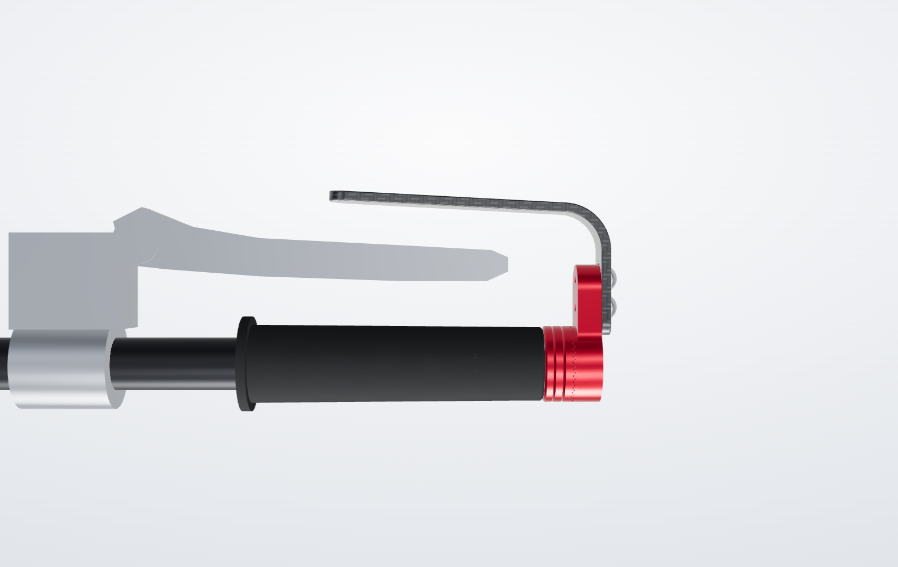

# Racing Lever Guard: universal carbon + CNC lever protector


Parametric CAD for a universal **racing handguard / brake and clutch lever protector**, modelled on the
[Darpan Sarvan "Racing Handguard/Lever Protector Carbon Finish Universal Fit For All Bikes"](https://darpansarvanstore.com/product/racing-handguard-lever-protector-carbon-finish-universal-fit-for-all-bikes/):
an anodised CNC-aluminium bar-end mount and arm with a carbon-finish guard blade that fits any
7/8" (22.2 mm) handlebar with an open end.

|  |  |
|---|---|


## About the reference product

The store page could not be opened from the build environment (its network policy blocks the
site), so its content was read through web-search results. The listing gives:

- price ₹1,499; "made from high-quality CNC aluminum and carbon fiber pattern"
- universal fit: Honda, Yamaha, KTM, Royal Enfield, Kawasaki and others; "plug-and-play
  installation with all necessary fittings included"
- colours black, blue, gold, red, silver

It publishes **no dimensions, drawings or bar sizes**. The geometry here follows the standard
construction of this product class (bar-end adapter, indexed arm, carbon blade in front of the
lever), with sizes taken from comparable universal guards (see [Research](#research-dimensions-of-comparable-guards)).
Every dimension is one named parameter in `cad/lever_guard.py`, so the shape can be matched to the
real part once it is in hand: measure it or send close-up photos, change the numbers, rebuild.

## What is in this folder

| Path | Contents |
|---|---|
| `exports/step/` | STEP for every part, plus the assembled guard with and without a reference handlebar (CNC, CAD) |
| `exports/stl/` | STL for every part, already turned to its 3D-print orientation |
| `docs/drawings/lever_guard_drawings.pdf` | 5 dimensioned A3 sheets: general arrangement, adapter, arm, blade, expander set |
| `docs/renders/` | Rendered views, including all five anodise colours |
| `docs/viewer.html` | Interactive 3D viewer: turn the arm in its 10° steps, slide the blade, change colour, explode |
| `exports/summary.json` | Key numbers, masses and fit-check results written by the build |
| `cad/lever_guard.py` | The parametric model (all parts, hardware and reference bike parts) |
| `cad/build.py` | Fit checks and STEP/STL export |
| `cad/drawings.py` | Drawing generator (hidden-line projections of the solids, dimensioned) |
| `tools/` | Scene export, viewer template and the headless render script |

## How the design works

| No. | Part | Material / finish | Qty per side | Mass |
|---|---|---|---|---|
| LG-01 | Bar-end adapter: Ø32 body, Ø12.4 spigot, 36-tooth face serration | 6061-T6, hard anodised (black / blue / gold / red / silver) | 1 | 25.9 g |
| LG-01b | Adapter without spigot, for bars with a threaded OEM bar-end insert | 6061-T6, hard anodised | (alternative) | 24.5 g |
| LG-02 | Guard arm: serrated hub + neck carrying the blade | 6061-T6, hard anodised | 1 | 37.8 g |
| LG-03 | Guard blade, 4 mm | 3K 2×2 twill carbon, gloss clear | 1 | 21 g |
| LG-03b | Guard blade, 6 mm, printable | PA12-CF / PETG-CF, carbon hydro-dip | (alternative) | 22 g |
| LG-04 | Expander sleeve S / M / L | TPU 95A or NBR 70A | 1 | 2–3 g |
| LG-05 | Expander cone nut S / M / L, M6 | 6061-T6 or zinc-plated steel | 1 | 2–4 g |
| H1 | Socket cap screw M6 × 45, ISO 4762 | A2-70 or 10.9 black | 1 | |
| H2 | Button head screw M5 × 12, ISO 7380 (M5 × 14 with LG-03b) | A2-70 | 2 | |
| H3 | Washer M5, ISO 7089 | A2 | 2 | |

About 109 g per side with the carbon blade and steel screws.

1. **Mount.** The adapter sits on the open bar end. Inside the bar, one M6 bolt pulls the cone
   nut into the slit elastomer sleeve, which grips the bar bore. Three sleeve sizes cover bar
   IDs from 13 to 19 mm. Bikes that keep a threaded OEM insert use the flat adapter LG-01b and a
   bolt into that thread instead.
2. **Angle.** Adapter and arm meet on a 36-tooth Hirth face serration (90° teeth, radial crests
   and roots). The arm seats only in **10° steps**, so it cannot creep round when the guard is
   hit. The CAD check confirms zero overlap in every step and a clash half a tooth out.
3. **Reach.** The blade is bolted to the arm through a 27.3 mm slot: **±5 mm** toward or away
   from the lever.
4. **Blade.** The 4 × 22 mm carbon section turns 87° on an R18 centre line (R16 inside) and runs
   100 mm inboard in front of the lever. The run is toed out 3° so its gap follows a lever that
   converges on the bar. The gap leaves room for the blade to flex in a hit before it can press
   the lever.
5. **Left and right.** Every part is symmetric about the lever plane. The clutch-side guard is
   the same set of parts with the arm turned over.

## Key dimensions

| Feature | Value |
|---|---|
| Envelope (along the bar, screw heads to blade tip × ahead of the bar axis × tall) | 122.8 × 88.9 × 32 mm |
| Blade centre-line length | 162.6 mm (35.3 straight + 87° bend on R18 + 100 straight) |
| Blade section | 22 × 4 mm carbon (22 × 6 mm printed) |
| Run covers the lever inboard of the bar end | 91 mm |
| Sticks out past the bar end | 31.75 mm (to the M5 screw heads) |
| Blade face ahead of the bar axis, start of run (slot −5 / 0 / +5) | 58.6 / 63.6 / 68.6 mm |
| Adapter body / spigot | Ø32 × 12 / Ø12.4 × 6 mm |
| Angle steps | 36 teeth → 10° |
| Fore-aft adjustment | ±5 mm |
| Bar fit | 7/8" (22.2 mm) bars, inside diameter 13–19 mm, or OEM threaded insert |

All dimensions are on the drawings in `docs/drawings/`.

## Fitment ("universal")

| Bar inside diameter | Use | Typical bars |
|---|---|---|
| 13–15 mm | Sleeve S + cone S | Aluminium clip-ons, tapered alloy bars |
| 15–17 mm | Sleeve M + cone M | Thin-wall steel and alloy bars |
| 17–19 mm | Sleeve L + cone L | Steel tubular bars |
| Threaded OEM insert | Flat adapter LG-01b + a bolt that suits the insert thread (often M6, check yours) | Bikes sold with bar-end weights |

- The bar end must be open. Remove the OEM bar-end weight; trim a closed grip end.
- Set the arm on the serration step nearest the lever's angle. The 22 mm tall blade covers the
  remaining ±5° offset.
- Slide the blade until there is **at least 10 mm all round the lever**. With the reference
  sport-bike lever in the CAD the closest gap is 12.2 / 17.2 / 22.2 mm at slot −5 / 0 / +5
  (11.3 / 16.3 / 21.3 mm with the 6 mm printed blade).
- Factory hand guards have to come off first.

## Install

1. Measure the bar's inside diameter and pick the sleeve and cone size (table above).
2. Thread the M6 × 45 bolt through the arm and adapter, then the sleeve, and start it in the cone
   nut. Push the stack into the bar until the adapter seats on the bar end.
3. Turn the arm to the lever's angle, settle it into the serration and tighten the M6 bolt to
   **8 N·m** with medium threadlocker.
4. Fit the blade with the two M5 screws and washers. Set the gap, then tighten to **4 N·m**.
5. Pull the lever through its full travel, use the reach adjuster across its range, and turn the
   bars lock to lock. Nothing may touch the guard, the fairing, the tank or the mirrors.
6. Re-check both torques after the first ride.

## Research: dimensions of comparable guards

| Source | Published figure | Used for |
|---|---|---|
| [Universal carbon-texture lever guard](https://www.amazon.com/Handguard-Motorcycle-Protector-Universal-Modification/dp/B0H3NW88B1) | aluminium with carbon texture, 13–19 mm bars, ~160 mm long | bar-ID range, overall length (blade 162.6 mm) |
| [Ysyqkn lever guards](https://www.walmart.com/ip/17212813508) | aluminium, 175 mm long, bar ID ≥ 17 mm | overall length range |
| [XWYINGAN carbon + aluminium guard](https://www.amazon.com/XWYINGAN-Universal-Handlebar-Protector-Motorcycle/dp/B0F4K9C1HM) | 7/8" bars, 135 mm; a 17.5 cm / 180 g variant | length, mass target |
| [LighTech carbon lever protection](https://www.wrs.it/en/adjustments-e-adapters/374630-carbon-brake-lever-protection-132mm-lightech-yamaha-r1-m-2020-2025-8052393423296.html) | 132 mm from bar-end mount to the lever end; carbon blade, coloured alloy end piece | construction, reach |
| [Voca lever guards](https://maxiscoot.com/en/product/lever-guards-voca-red-291507) | adjustable 130 / 148 mm, 14 mm bar ID | adjustable reach (±5 mm slot) |
| [Stage6 R/T lever guards](https://stage6-racing.com/en/product/lever-guards-cnc-stage6-r-t-set/) | inserts for alloy bars (14–14.5 mm) and steel bars (17–17.5 mm); angle continuously adjustable | sleeve sizes, angle adjustment |
| [R&G universal lever guard](https://www.sportsbikeshop.co.uk/motorcycle_parts/content_prod/666871) | expanding fit, 13–21 mm bar ID | expander concept |
| [Highsider lever protectors](https://www.louis-moto.com/en/highsider-lever-protectors-cnc-black-pair-60152580) | 7/8" and 1" bars, ID 12–22 mm | bar-ID range |
| [Womet-Tech ProGuard](https://tstindustries.com/products/womet-tech-proguard-universal-brake-lever-guard) | 16–20 mm ID, CNC aluminium + Delrin, expansion hardware | expander concept |
| [Oxford racing lever guard](https://firestormmotorcycles.com.au/oxford-delrin-racing-universal-motorcycle-lever-gu) | 22 mm bars, 12–18 mm expansion bolts | bar-ID range |
| [Woodcraft lever guard guide](https://ducatiomaha.com/products/woodcraft-lever-hand-guards) | at least 10 mm clearance round the lever end | clearance rule (CAD check) |
| [Twisted Throttle / R&G carbon guard](https://twistedthrottle.com/shop/protection/lever-guards/rg-racing-carbon-fibre-lever-guard-for-hollow-tube-bars-13-15mm/) | carbon arm for 13–15 mm hollow bars | carbon blade construction |

## Making the parts

**CNC (LG-01, LG-02, LG-05).** 6061-T6: Ø35 bar for the adapter and cone, 15 mm plate
(60 × 34 mm blank) for the arm. The serration can be cut with a 90° V-cutter on a 4th axis or indexed in 10° steps.
Hard anodise after machining in black, blue, gold, red or silver. Break all sharp edges 0.2–0.5 mm.

**Carbon blade (LG-03).** Lay up 3K 2×2 twill prepreg or wet layup to 4.0 ± 0.2 mm over a male
tool with the R16 inside bend, cure, then CNC-trim the outline and slot from the STEP. For a
*carbon finish* on a cheaper part, bend a 4 mm 5052-H32 strip (162.6 mm blank on the centre line)
and hydro-dip it with a carbon pattern.

**3D print.** For prototypes or low cost:
- `03b_guard_blade_6mm_3dprint.stl`: PA12-CF or PETG-CF, lying flat, 5 walls, 40 % gyroid.
  Hydro-dip or wrap it for the carbon look, and use M5 × 14 screws.
- Adapter and arm: PA12-CF, 100 % infill, for a test fit only. Ride on aluminium parts.
- Sleeve: TPU 95A, 100 % infill.

The STLs are already turned to these orientations.

## Changing the design

```bash
python -m venv .venv && . .venv/bin/activate
pip install cadquery matplotlib
cd cad
python build.py          # fit checks + STEP/STL + exports/summary.json
python drawings.py ../docs/drawings/lever_guard_drawings.pdf
```

The parameters most likely to change when matching the real part, all in `Params` in
`cad/lever_guard.py`:

| Parameter | Default | Effect |
|---|---|---|
| `front_len` | 100 | length of the run in front of the lever |
| `bend_r` | 18 | bend radius (centre line); moves the run toward or away from the lever |
| `front_toe_deg` | 3 | angle of the run relative to the bar |
| `blade_h`, `blade_t` | 22, 4 | blade section |
| `body_d`, `pitch_x` | 32, 12 | adapter diameter and length outside the bar |
| `teeth` | 36 | serration teeth (360 / teeth = angle step) |
| `adjust` | 5 | slot travel each way |

The viewer and renders are rebuilt with `tools/scene.py`, `tools/make_viewer.py` and
`tools/render.mjs` (Node + Playwright).

## CAD checks (`cad/build.py`)

All pass for both blade versions:

- every part is one valid solid
- serration meshes with 0.000 mm³ overlap at 0°, 10° and 50°, and clashes half a tooth out
- no unintended overlap between any two parts (threads excluded)
- M6 thread engagement in the cone nut 8.5 mm; M5 engagement in the arm 7 mm (≥ 1.2 d)
- blade ≥ 10 mm from the reference lever at the nominal slot position; adapter, arm and screws ≥ 27 mm
- finger room between grip and blade run ≥ 40 mm
- each sleeve and cone slides into the smallest bar of its range

## Safety

This is a protection accessory, not a certified crash part. Fit it only to bars with sound ends,
check the lever's full travel and the steering lock after fitting, and replace a guard that has
been hit: carbon can crack inside without showing it.
