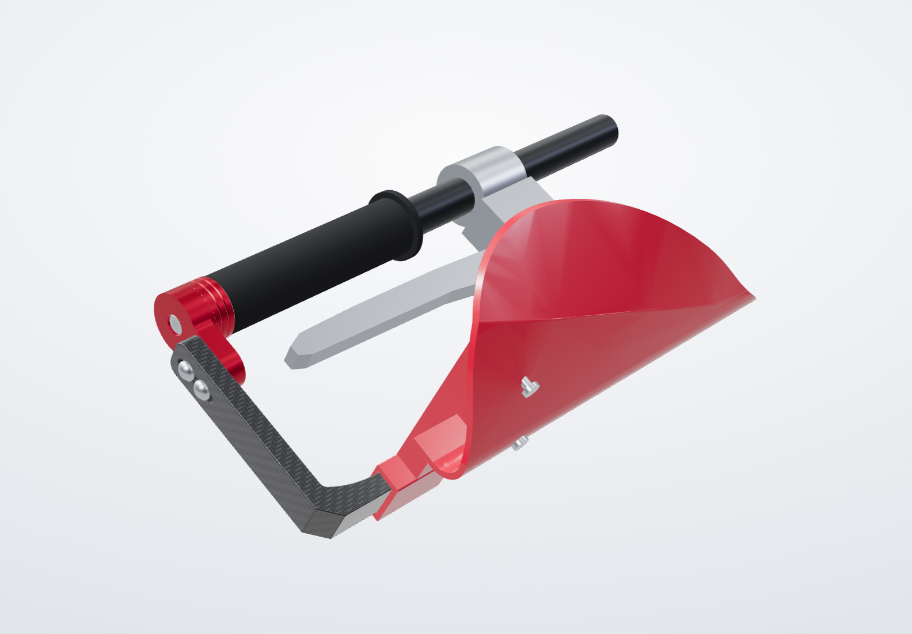
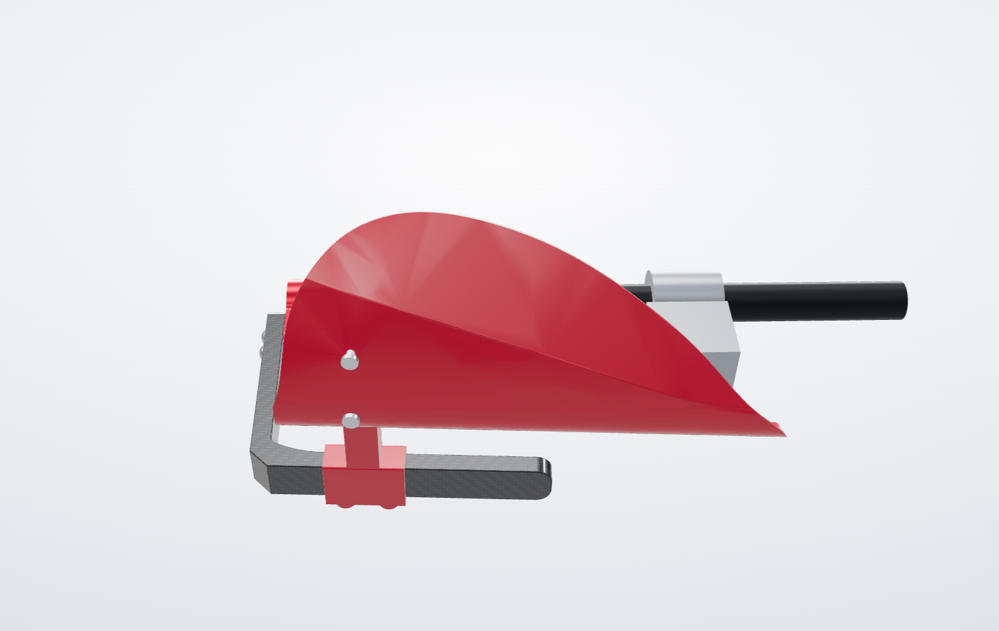
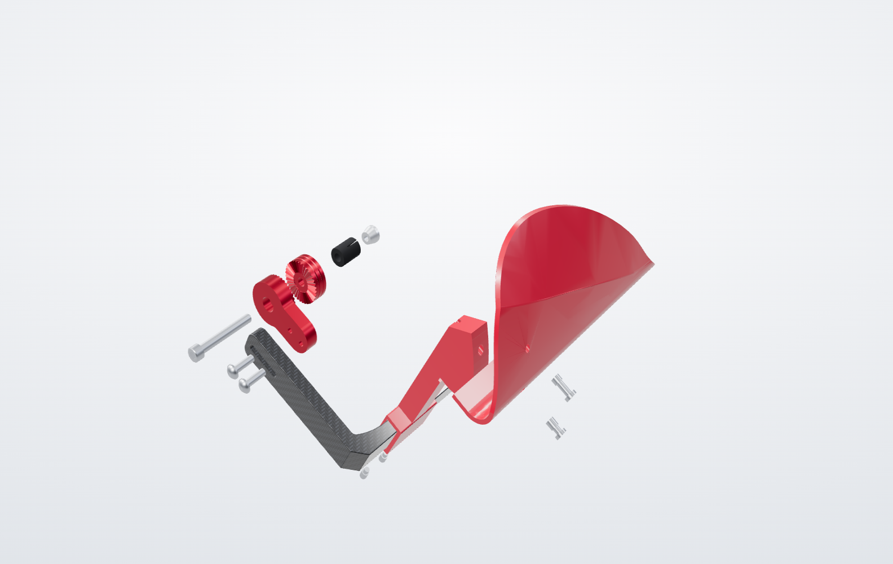
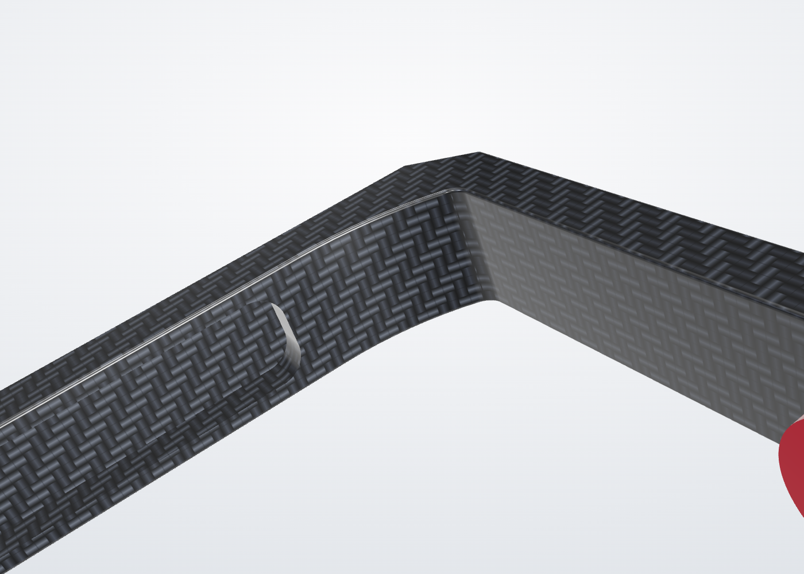
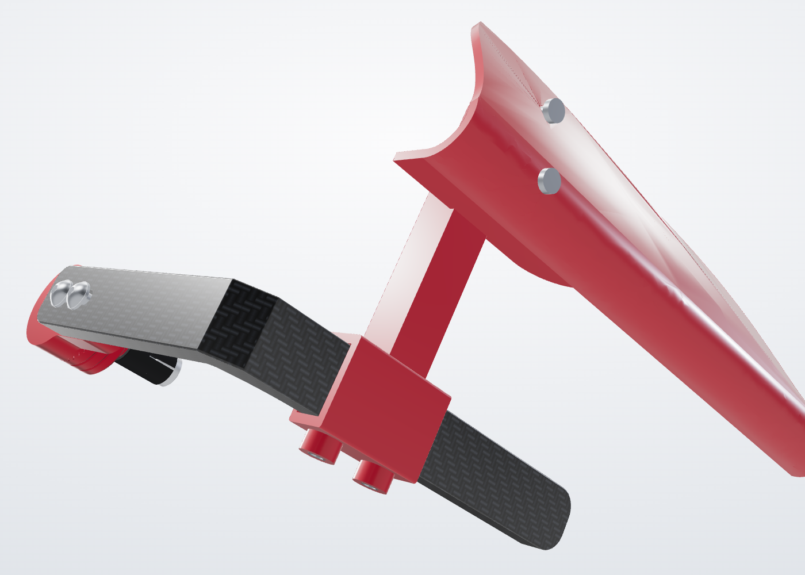
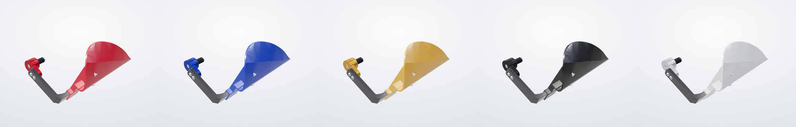
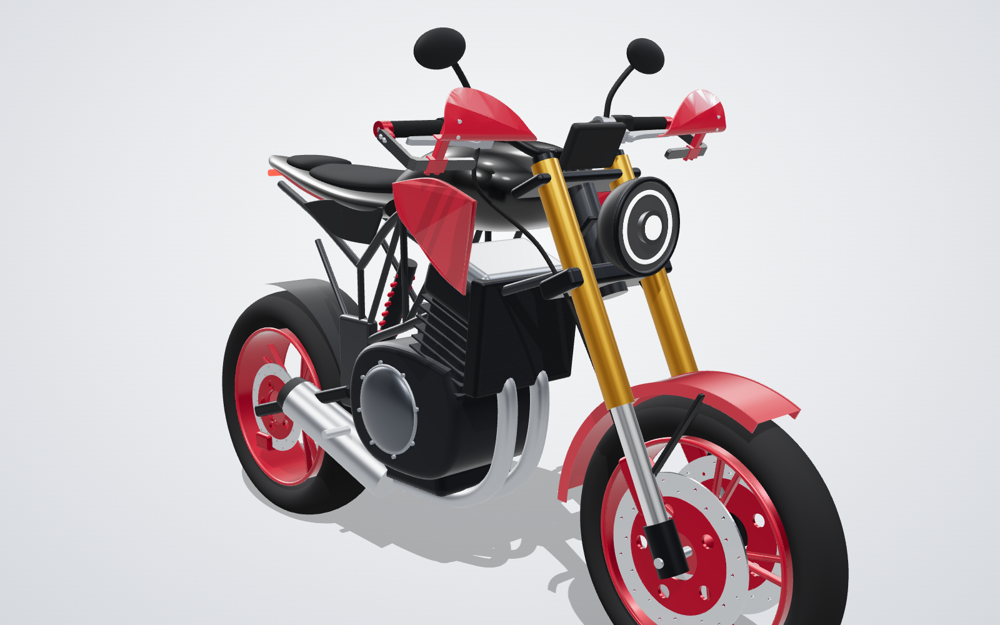
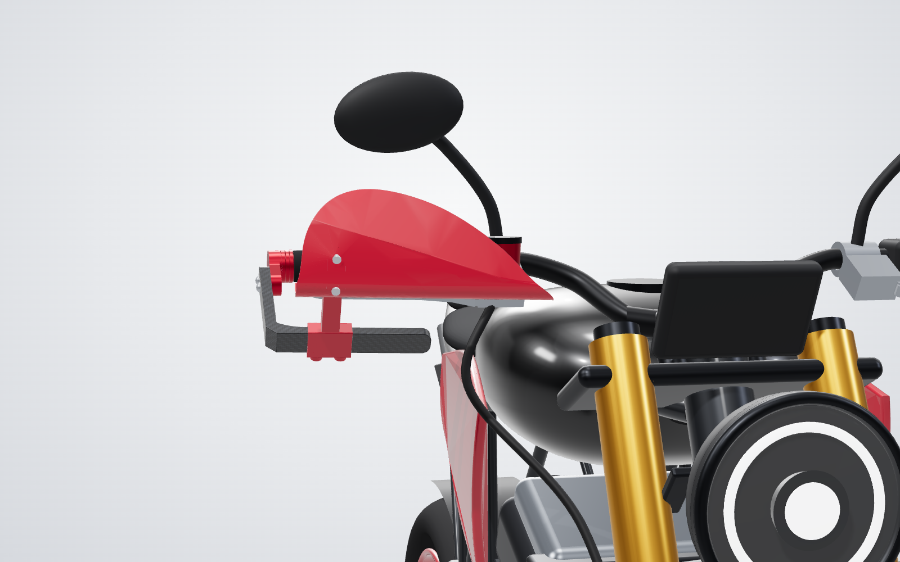
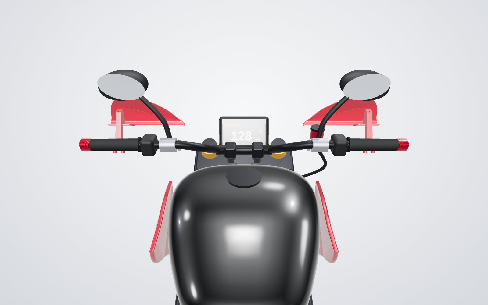
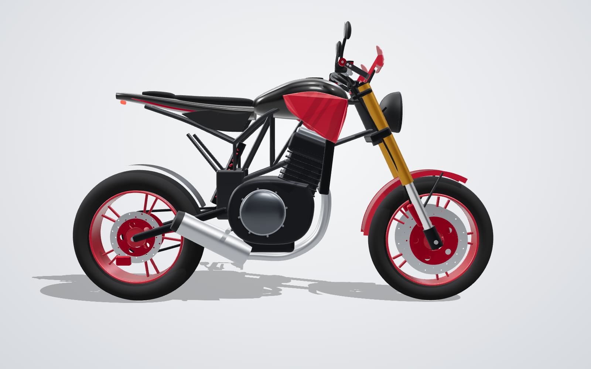

# Racing Lever Guard: universal carbon + CNC lever protector



Parametric CAD for a universal **racing handguard / brake and clutch lever protector**, modelled on the
[Darpan Sarvan "Racing Handguard/Lever Protector Carbon Finish Universal Fit For All Bikes"](https://darpansarvanstore.com/product/racing-handguard-lever-protector-carbon-finish-universal-fit-for-all-bikes/):
an anodised CNC-aluminium bar-end mount and arm with an L-shaped guard bar that fits any
7/8" (22.2 mm) handlebar with an open end. The bar copies a moulded reference part measured from
photos: a 150 mm long leg in front of the lever, a 120 mm short leg back to the bar end, a faceted
outer corner and a channel moulded into the back of the long leg. It is 10 mm thick, with a gusset
filling the inside of the bend. An optional wind guard, styled after motocross handguards, sits
up in front of the hand: its bracket slides along the bar in a closed slot, locks with two grub
screws and rises behind the shield to hold it by its back face.

|  |  |
|---|---|
|  |  |



### On a bike

|  |  |
|---|---|
|  |  |

The bike is a stylised stand-in built in code, not a real model. The guards on it are the CAD
meshes, fitted to both bar ends at the 30° lever angle; the left one is the mirror image, with the
left-hand shell. More views are in [`docs/renders/bike/`](docs/renders/bike/), and
[`docs/bike.html`](docs/bike.html) shows the bike in 3D.

## About the reference product

The store page could not be opened from the build environment (its network policy blocks the
site), so its content was read through web-search results. The listing gives:

- price ₹1,499; "made from high-quality CNC aluminum and carbon fiber pattern"
- universal fit: Honda, Yamaha, KTM, Royal Enfield, Kawasaki and others; "plug-and-play
  installation with all necessary fittings included"
- colours black, blue, gold, red, silver

It publishes **no dimensions, drawings or bar sizes**. The geometry here follows the standard
construction of this product class (bar-end adapter, indexed arm, carbon blade in front of the
lever), with sizes taken from comparable universal guards (see [Research](#research-dimensions-of-comparable-guards)).
Every dimension is one named parameter in `cad/lever_guard.py`, so the shape can be matched to the
real part once it is in hand: measure it or send close-up photos, change the numbers, rebuild.

## What is in this folder

| Path | Contents |
|---|---|
| `exports/step/` | STEP for every part, plus the assembled guard with and without a reference handlebar (CNC, CAD) |
| `exports/stl/` | STL for every part, already turned to its 3D-print orientation |
| `exports/stl/assembly_*.stl` | The whole guard as one mesh each: right side, left side (mirror image, with the left-hand shell) and right side without the wind guard. See [Assembly STLs](#assembly-stls) |
| `docs/drawings/lever_guard_drawings.pdf` | 6 dimensioned A3 sheets: general arrangement, adapter, arm, guard bar with gusset, expander set, wind guard shield and bracket |
| `docs/renders/` | Rendered views, including all five anodise colours |
| `docs/renders/bike/` | The guards fitted to a motorcycle, in red, blue and gold |
| `docs/viewer.html` | Interactive 3D viewer: turn the arm in its 10° steps, slide the bar and the wind guard, change colour, explode |
| `docs/bike.html` | The guards on the bike in 3D: drag to orbit; add `?scheme=blue` or `?scheme=gold` to the address for the other colours |
| `exports/summary.json` | Key numbers, masses and fit-check results written by the build |
| `cad/lever_guard.py` | The parametric model (all parts, hardware and reference bike parts) |
| `cad/build.py` | Fit checks and STEP/STL export |
| `cad/drawings.py` | Drawing generator (hidden-line projections of the solids, dimensioned) |
| `tools/` | Scene export, viewer template and the headless render script |

## How the design works

| No. | Part | Material / finish | Qty per side | Mass |
|---|---|---|---|---|
| LG-01 | Bar-end adapter: Ø32 body, Ø12.4 spigot, 36-tooth face serration | 6061-T6, hard anodised (black / blue / gold / red / silver) | 1 | 25.9 g |
| LG-01b | Adapter without spigot, for bars with a threaded OEM bar-end insert | 6061-T6, hard anodised | (alternative) | 24.5 g |
| LG-02 | Guard arm: serrated hub + neck carrying the bar | 6061-T6, hard anodised | 1 | 37.8 g |
| LG-03 | Guard bar, L-shaped, 10 mm, with gusset inside the bend and channel on the back | PA6-GF30 / PP-GF moulded, or PA12-CF / PETG-CF printed | 1 | 61 g |
| LG-03b | Guard bar, 12 mm, heavy duty | PA12-CF / PETG-CF printed | (alternative) | 60 g |
| LG-04 | Expander sleeve S / M / L | TPU 95A or NBR 70A | 1 | 2–3 g |
| LG-05 | Expander cone nut S / M / L, M6 | 6061-T6 or zinc-plated steel | 1 | 2–4 g |
| LG-06 / 06b | Wind guard shield, right / left (mirror pair; optional) | HDPE or PP, injection moulded, colour to order (or printed ASA / PA12) | 1 | 55 g |
| LG-07 / 07b | Wind guard bracket: slotted mount + web, right / left (optional) | as LG-06 | 1 | 39 g |
| H1 | Socket cap screw M6 × 45, ISO 4762 | A2-70 or 10.9 black | 1 | |
| H2 | Button head screw M5 × 18, ISO 7380 (M5 × 20 with LG-03b) | A2-70 | 2 | |
| H3 | Washer M5, ISO 7089 | A2 | 2 | |
| H4 | Heat-set insert M4 × 5.7 (Ø5.6 hole): 2 in the bracket's bosses, 2 in its web (wind guard) | brass | 4 | |
| H5 | Grub screw M4 × 8, ISO 4029 cup point, nylon-tipped if available, from below onto the bar (wind guard) | A2 | 2 | |
| H6 | Button head screw M4 × 10, ISO 7380, with washer: shield to bracket (wind guard) | A2 | 2 | |

About 151 g per side with the moulded bar and steel screws, 252 g with the wind guard.

1. **Mount.** The adapter sits on the open bar end. Inside the bar, one M6 bolt pulls the cone
   nut into the slit elastomer sleeve, which grips the bar bore. Three sleeve sizes cover bar
   IDs from 13 to 19 mm. Bikes that keep a threaded OEM insert use the flat adapter LG-01b and a
   bolt into that thread instead.
2. **Angle.** Adapter and arm meet on a 36-tooth Hirth face serration (90° teeth, radial crests
   and roots). The arm seats only in **10° steps**, so it cannot creep round when the guard is
   hit. The CAD check confirms zero overlap in every step and a clash half a tooth out.
3. **Reach.** The bar is bolted to the arm through a 27.3 mm slot: **±5 mm** toward or away
   from the lever.
4. **Guard bar.** An L like the reference part in the photos. The short leg runs 120 mm from the
   bar end to the outside of the corner; the 10 × 22 mm section turns 87° on an R13 centre line
   (inner fillet R8, flat facet across the outer corner), and the long leg runs 150 mm inboard in
   front of the lever, toed out 3° to follow a lever that converges on the bar. A channel 6 mm
   deep with 3 mm flanges is moulded into the long leg's lever side, as on the reference part.
   On the reference lever the bar sits 39 mm ahead of the lever, at every slot position.
5. **Crash strength at the bend.** A fall loads the bar hardest where it turns into the bend. A
   gusset fills the inside of the bend: its edge leaves the seat face on an R4 blend, follows an
   R54.4 arc and runs out tangentially 18 mm along the long leg, with no corner or step for a crack
   to start from. The section across the bend goes from 10 to 13 mm, about 1.7× the bending
   strength of the plain bend (12 → 15.1 mm, 1.6×, on the 12 mm heavy-duty bar).
6. **Wind guard.** Two parts, each printed in its best orientation:
   - The **shield** (LG-06 / 06b) is a shell in the style of a motocross handguard, convex to
     the wind and curling back over the knuckles, tall at the outboard end and sweeping down to
     a rounded tip past the brake perch, with a diagonal crease that stiffens it.
   - The **bracket** (LG-07 / 07b) is a sleeve with a slot closed on all four sides (10.6 × 22.6
     mm, 0.3 mm clearance round the bar) and a 16 mm web that rises from it behind the shield.
     The web's front face is shaped to the shield's back face and holds it over the 50 mm above
     its lower edge, with two M4 button screws through the shield into heat-set inserts.

   Mounting the shield on a web behind it, instead of on a flange at its foot, lifts it
   65 mm off the bar (normal to the lever plane), so on the bike it covers the knuckles: it runs
   from 22 mm below to 77 mm above the bar axis, where before it sat low and threw the air up
   onto them. Two M4 grub screws in heat-set inserts under the sleeve lock the bracket on the
   bar's lower edge; loosen them and the guard slides 74 mm along the long leg. There are no
   holes in the bar, and the bracket slides on from the bar's tip.
7. **Left and right.** Every part except the wind guard is symmetric about the lever plane, so
   the clutch-side guard is the same set of parts with the arm turned over. Like any handguard,
   the shield and bracket come as mirror-image pairs (LG-06 / 07 right, LG-06b / 07b left).

## Key dimensions

| Feature | Value |
|---|---|
| Guard bar legs (outside) | 150 mm long leg × 120 mm short leg, 22 mm tall |
| Envelope without the wind guard (along the bar, screw heads to bar tip × ahead of the bar axis × tall) | 154 × 148 × 32 mm |
| Length along the bar with the wind guard (screw heads to shield tip) | about 250 mm |
| Bar centre-line length | 247.5 mm (94.8 straight + 87° bend on R13 + 133 straight) |
| Bar section | 22 × 10 mm (22 × 12 mm heavy duty), channel 6 mm deep on the long leg's lever side |
| Section across the bend | 13 mm with the gusset (10 mm plain) |
| Long leg covers the lever inboard of the bar end | 116 mm |
| Sticks out past the bar end | 37.75 mm (to the M5 screw heads) |
| Bar face ahead of the bar axis, start of the long leg (slot −5 / 0 / +5) | 110 / 115 / 120 mm |
| Wind guard | 230 mm long, 3 mm wall, 40 mm slotted bracket; on the bike 141–182 mm ahead of the bar axis, from 22 mm below to 77 mm above it; slides 74 mm along the long leg |
| Adapter body / spigot | Ø32 × 12 / Ø12.4 × 6 mm |
| Angle steps | 36 teeth → 10° |
| Fore-aft adjustment | ±5 mm |
| Bar fit | 7/8" (22.2 mm) bars, inside diameter 13–19 mm, or OEM threaded insert |

All dimensions are on the drawings in `docs/drawings/`.

## Fitment ("universal")

| Bar inside diameter | Use | Typical bars |
|---|---|---|
| 13–15 mm | Sleeve S + cone S | Aluminium clip-ons, tapered alloy bars |
| 15–17 mm | Sleeve M + cone M | Thin-wall steel and alloy bars |
| 17–19 mm | Sleeve L + cone L | Steel tubular bars |
| Threaded OEM insert | Flat adapter LG-01b + a bolt that suits the insert thread (often M6, check yours) | Bikes sold with bar-end weights |

- The bar end must be open. Remove the OEM bar-end weight; trim a closed grip end.
- Set the arm on the serration step nearest the lever's angle. The 22 mm tall bar covers the
  remaining ±5° offset.
- Keep **at least 10 mm all round the lever**. With the reference sport-bike lever in the CAD
  the closest gap is 39 mm at every slot position: the 120 mm short leg puts the long leg well
  ahead of a typical lever. Bikes with long or adjustable levers set far out still need a check.
- With the wind guard fitted, it keeps at least 65 mm from the lever, 72 mm from the brake perch
  and 92 mm from a Ø100 mm gloved-hand envelope round the grip, anywhere along its travel.
- The shield reaches about 210–285 mm inboard of the bar end (depending on where it is slid) and
  182 mm ahead of the bar axis. Turn the bars lock to lock and check the fork, fairing, tank, mirrors and
  fluid reservoir before riding. Slide it outboard if anything is close.
- Factory hand guards have to come off first.

## Install

1. Measure the bar's inside diameter and pick the sleeve and cone size (table above).
2. Thread the M6 × 45 bolt through the arm and adapter, then the sleeve, and start it in the cone
   nut. Push the stack into the bar until the adapter seats on the bar end.
3. Turn the arm to the lever's angle, settle it into the serration and tighten the M6 bolt to
   **8 N·m** with medium threadlocker.
4. Fit the bar with the two M5 × 18 screws and washers. Set the gap, then tighten to **4 N·m**.
5. Wind guard (optional): press the four M4 heat-set inserts into the bracket, two in the bosses
   under the sleeve and two in the web (soldering iron at about 230 °C, flush). Bolt the shield to
   the web with the two M4 × 10 button screws and washers, **1 N·m**. Slide the bracket onto the
   bar's long leg from its tip, shield in front of the lever, move it to where you want it and
   turn the two M4 × 8 grub screws up onto the bar's lower edge, **1 N·m**.
6. Pull the lever through its full travel, use the reach adjuster across its range, and turn the
   bars lock to lock. Nothing may touch the guard, the fairing, the tank or the mirrors.
7. Re-check all torques after the first ride.

## Research: dimensions of comparable guards

| Source | Published figure | Used for |
|---|---|---|
| [Universal carbon-texture lever guard](https://www.amazon.com/Handguard-Motorcycle-Protector-Universal-Modification/dp/B0H3NW88B1) | aluminium with carbon texture, 13–19 mm bars, ~160 mm long | bar-ID range, overall length (bar centre line 247.5 mm) |
| [Ysyqkn lever guards](https://www.walmart.com/ip/17212813508) | aluminium, 175 mm long, bar ID ≥ 17 mm | overall length range |
| [XWYINGAN carbon + aluminium guard](https://www.amazon.com/XWYINGAN-Universal-Handlebar-Protector-Motorcycle/dp/B0F4K9C1HM) | 7/8" bars, 135 mm; a 17.5 cm / 180 g variant | length, mass target |
| [LighTech carbon lever protection](https://www.wrs.it/en/adjustments-e-adapters/374630-carbon-brake-lever-protection-132mm-lightech-yamaha-r1-m-2020-2025-8052393423296.html) | 132 mm from bar-end mount to the lever end; carbon blade, coloured alloy end piece | construction, reach |
| [Voca lever guards](https://maxiscoot.com/en/product/lever-guards-voca-red-291507) | adjustable 130 / 148 mm, 14 mm bar ID | adjustable reach (±5 mm slot) |
| [Stage6 R/T lever guards](https://stage6-racing.com/en/product/lever-guards-cnc-stage6-r-t-set/) | inserts for alloy bars (14–14.5 mm) and steel bars (17–17.5 mm); angle continuously adjustable | sleeve sizes, angle adjustment |
| [R&G universal lever guard](https://www.sportsbikeshop.co.uk/motorcycle_parts/content_prod/666871) | expanding fit, 13–21 mm bar ID | expander concept |
| [Highsider lever protectors](https://www.louis-moto.com/en/highsider-lever-protectors-cnc-black-pair-60152580) | 7/8" and 1" bars, ID 12–22 mm | bar-ID range |
| [Womet-Tech ProGuard](https://tstindustries.com/products/womet-tech-proguard-universal-brake-lever-guard) | 16–20 mm ID, CNC aluminium + Delrin, expansion hardware | expander concept |
| [Oxford racing lever guard](https://firestormmotorcycles.com.au/oxford-delrin-racing-universal-motorcycle-lever-gu) | 22 mm bars, 12–18 mm expansion bolts | bar-ID range |
| [Woodcraft lever guard guide](https://ducatiomaha.com/products/woodcraft-lever-hand-guards) | at least 10 mm clearance round the lever end | clearance rule (CAD check) |
| [Twisted Throttle / R&G carbon guard](https://twistedthrottle.com/shop/protection/lever-guards/rg-racing-carbon-fibre-lever-guard-for-hollow-tube-bars-13-15mm/) | carbon arm for 13–15 mm hollow bars | carbon blade construction |

## Making the parts

**CNC (LG-01, LG-02, LG-05).** 6061-T6: Ø35 bar for the adapter and cone, 15 mm plate
(60 × 34 mm blank) for the arm. The serration can be cut with a 90° V-cutter on a 4th axis or indexed in 10° steps.
Hard anodise after machining in black, blue, gold, red or silver. Break all sharp edges 0.2–0.5 mm.

**Guard bar (LG-03).** Injection mould it in PA6-GF30 or PP-GF from the STEP, black or to order;
the channel on the long leg's back is a straight pull. For one-offs or a carbon look, print it
(below) and hydro-dip or wrap it.

**Wind guard (LG-06, LG-07).** Shield and bracket are separate parts so each can be made in its
best orientation. Injection mould both in HDPE or PP, in any colour, from the STEP files:
`06_wind_guard_shell_RH` / `07_wind_guard_bracket_RH` for the right side and the `06b` / `07b`
files for the left. Break the edges R1. The bracket's slot core is a straight pull along the bar.

**3D print.** For prototypes or low cost:
- Guard bar `03_guard_bar_10mm.stl` (or `03b_guard_bar_12mm_heavy_duty.stl`): PA12-CF or
  PETG-CF, lying flat (lever plane on the bed), 6 walls, 50 % gyroid. The channel opens
  sideways and its flange bridges 6 mm; no supports needed. Use M5 × 18 screws (M5 × 20 for 03b).
- Wind guard shield `06` / `06b`: ASA or PA12, 100 % infill (3 mm wall). Print with the lower
  flange flat on the bed, shield up, with tree supports under the bend and the top edge.
- Wind guard bracket `07` / `07b`: ASA or PA12, 100 % infill. It lies on its flat lever-side face
  (sleeve and web flush), so it needs no supports except a few under the insert bosses. If the
  bar is tight in the slot, file the slot rather than scaling the print.
- Adapter and arm: PA12-CF, 100 % infill, for a test fit only. Ride on aluminium parts.
- Sleeve: TPU 95A, 100 % infill.

The STLs are already turned to these orientations, one part per file.

### Assembly STLs

For mock-ups, renders and checking the look on a bike model (not for printing), `exports/stl/`
also holds the assembled guard as one mesh:

| File | Contents |
|---|---|
| `assembly_right_guard.stl` | right (brake side) guard with the wind guard, its bracket, inserts and screws |
| `assembly_left_guard.stl` | left (clutch side) guard: the mirror image, so it carries the left-hand shell |
| `assembly_right_guard_without_wind_guard.stl` | right guard with the bar only |

They are in bike axes, in mm: X to the rider's right, Y forward, Z up, with the origin at the
centre of that side's bar-end face and the lever plane 30° below horizontal (`lever_deg`). Put
each origin on its bar end and the guard sits as fitted. They show the M expander (bar ID 15–17 mm).

## Changing the design

```bash
python -m venv .venv && . .venv/bin/activate
pip install cadquery matplotlib
cd cad
python build.py          # fit checks + STEP/STL + exports/summary.json
python build.py --check  # fit checks + summary.json only (leaves STEP/STL untouched)
python drawings.py ../docs/drawings/lever_guard_drawings.pdf
```

The parameters most likely to change when matching the real part, all in `Params` in
`cad/lever_guard.py`:

| Parameter | Default | Effect |
|---|---|---|
| `front_len` | 133 | straight long leg in front of the lever (150 mm overall from the corner) |
| `seat_ext` | 59.5 | extra straight on the short leg (120 mm overall to the corner); moves the long leg toward or away from the lever |
| `bend_r`, `corner_facet` | 13, 0.55 | bend radius (centre line) and the flat facet across the outer corner (0 = round) |
| `front_toe_deg` | 3 | angle of the long leg relative to the bar |
| `blade_h`, `blade_t` | 22, 10 | bar section |
| `pocket_depth`, `pocket_wall` | 6, 3 | channel on the long leg's lever side (0 = solid) |
| `haunch_len`, `haunch_seat_gap`, `haunch_blend_r` | 18, 1, 4 | where the gusset's edge runs out on the long leg / crosses the seat face / blend radius into the seat face |
| `shell_len`, `shell_crest`, `shell_crease` | 230, 84, (60, −4) | wind guard length, height and crease line (outboard end, tip) |
| `lever_deg` | 30 | lever angle below horizontal; sets "up" and "forward" for the wind guard |
| `clamp_pos` | 20 | wind guard bracket position along the long leg (19–93 mm from the bend) |
| `clamp_clear` | 0.3 | slot clearance round the bar; lower it for a moulded part, raise it for a loose printer |
| `shell_lift`, `web_reach` | 65, 50 | how high the shield sits above the bar (normal to the lever plane), and how far up its back face the web holds it |
| `body_d`, `pitch_x` | 32, 12 | adapter diameter and length outside the bar |
| `teeth` | 36 | serration teeth (360 / teeth = angle step) |
| `adjust` | 5 | slot travel each way |

The viewer and renders are rebuilt with `tools/scene.py`, `tools/make_viewer.py` and
`tools/render.mjs` (Node + Playwright). The bike page uses the same scene file with the other
template, and its shot list is in `tools/bike_shots.json`:

```bash
python tools/scene.py scene.json
python tools/make_viewer.py scene.json docs/bike.html --template bike_template.html
SHOTS_FILE=tools/bike_shots.json node tools/render.mjs docs/bike.html docs/renders/bike
```

## CAD checks (`cad/build.py`)

All pass for both bar versions (10 mm and 12 mm):

- every part is one valid solid
- serration meshes with 0.000 mm³ overlap at 0°, 10° and 50°, and clashes half a tooth out
- no unintended overlap between any two parts (threads excluded)
- the bar, gusset included, clears the arm, adapter and screws at slot −5 and +5
- section across the bend 13 mm with the gusset against 10 mm plain (bending strength ×1.7;
  ×1.6 on the 12 mm bar)
- the gusset's R4 blend starts well past the end of the arm's neck even with the bar at slot −5,
  and its edge is tangent all along
- M6 thread engagement in the cone nut 8.5 mm; M5 engagement in the arm 7 mm (≥ 1.2 d)
- bar ≥ 10 mm from the reference lever (39 mm); adapter, arm and screws ≥ 27 mm
- with the bar at the nominal slot position and the wind guard at either end of its travel,
  no part of the wind guard overlaps the bar or another part, the bar slides in the bracket's
  slot with 0.3 mm clearance and the grub screws bear on it. The wind guard stays ≥ 65 mm from
  the lever, ≥ 49 mm from the perch and ≥ 80 mm from the grip; the shield stays ≥ 90 mm from a
  Ø100 mm gloved-hand envelope round the grip, and the bracket no closer to it than the bar
- finger room between grip and the bar's long leg ≥ 40 mm (98 mm)
- each sleeve and cone slides into the smallest bar of its range

## Safety

This is a protection accessory, not a certified crash part. Fit it only to bars with sound ends,
check the lever's full travel and the steering lock after fitting, and replace a guard that has
been hit: moulded and printed parts can crack inside without showing it.
