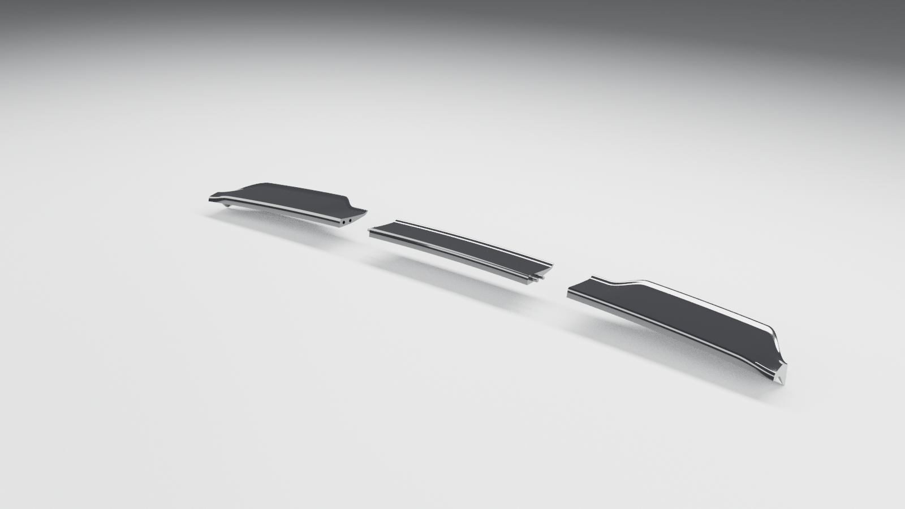

# Universal M-Style Rear Spoiler – 98 cm (Hatchback & Sedan)

Parametric 3D model of the universal "M-Style" roof/hatch spoiler, shaped from the
reference product photos (gloss black ABS, adhesive-tape mount).


## Design features (matched to the photos)
- **98 cm** tip-to-tip blade, bowed in plan (tips swept forward 30 mm) and in elevation
  (tips drop 16 mm) so it follows the roof/trunk crown.
- **Stepped outer wings**: centre chord 72 mm, outer chord 100 mm, joined by an angled step
  at ~40 % of the half-span; the outer wings also sit 6 mm higher.
- Thin wedge blade: 15 mm rounded mounting nose → 2.2 mm trailing edge with a 4 mm ducktail kick
  (gives the crease line along the top).
- **Angle-cut tips** that turn down into solid **end plates** (24 mm drop).
- Flat **adhesive pad** on the underside (front 38 % of the chord) for 3M double-sided tape.

## Overall size
| | mm |
|---|---|
| Length | 980 |
| Depth (fore/aft, incl. plan curvature) | 123 |
| Height (incl. end-plate drop and crown) | 55 |

## Files (`output/`)
- `m_style_spoiler_98cm.stl` – for 3D printing / CNC / mould making (units: mm)
- `m_style_spoiler_98cm.obj` + `.mtl` – for CAD/3D apps (mm)
- `m_style_spoiler_98cm.glb` – for web/AR viewers (metres)
- `render_*.png` – studio renders

## 3-piece version (pin-and-hole joints)



The spoiler is split into three equal 326.7 mm sections so each fits a typical printer bed:

| File | Size (mm) | Joint feature |
|---|---|---|
| `m_style_spoiler_98cm_piece_l.stl` | 326.7 × 123 × 55 | 2 blind holes |
| `m_style_spoiler_98cm_piece_c.stl` | 350.7 × 76 × 17 (incl. pins) | 2 pins each end |
| `m_style_spoiler_98cm_piece_r.stl` | 326.7 × 123 × 55 | 2 blind holes |

- **Pins**: Ø6 mm, protrude 12 mm, 0.8 mm lead-in chamfer, moulded onto the centre piece.
  Two pins per joint (11 mm and 27 mm back from the nose, at mid-thickness) stop the pieces rotating.
- **Holes**: Ø6.3 mm (0.15 mm radial clearance), 12.8 mm deep; the extra 0.8 mm is a glue pocket.
- Wall around each pin: 4.0 mm (front pin), 3.1 mm (rear pin).
- **Locking**: dry-fit, then glue the faces and pins (epoxy, CA, or ABS/acetone slurry for ABS)
  and clamp. Sand and paint over the seams for a one-piece look.
- Print each piece lying on its flat mounting pad. The centre piece's pins then print as horizontal
  cylinders; use 100 % infill for the outer 10 mm of each piece for strong joints.
- If the pins fit too tight or loose, change `clearance` in the `S` dict and rebuild.
  `--no-split` skips the split.

## Regenerate / customise
Every dimension is a parameter in the `P` dict at the top of `build_spoiler.py`.
```bash
blender -b -P build_spoiler.py -- --render
```
(The GLB exporter needs `numpy` on Blender's Python path.)

## Manufacturing notes
- The model is solid. For a moulded ABS part, shell it to ~2.5 mm wall thickness in your CAD tool.
- 98 cm is longer than most 3D printer beds, so use the 3-piece version above.
  ASA or ABS is recommended for UV and heat resistance.
- Dimensions were set from the listed 98 cm length and proportions read off the product photos;
  check the fit against your vehicle before production.
