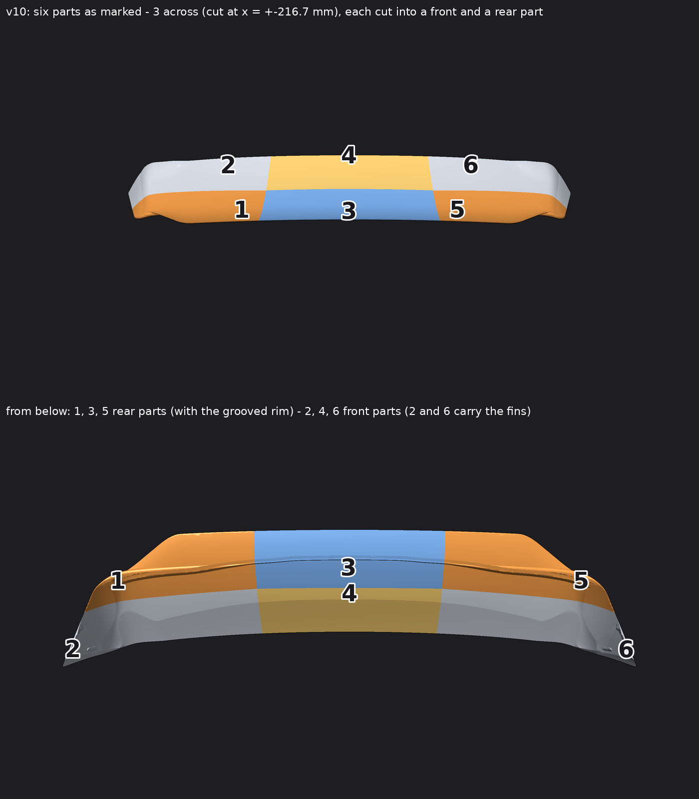
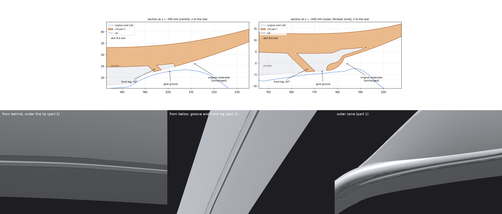
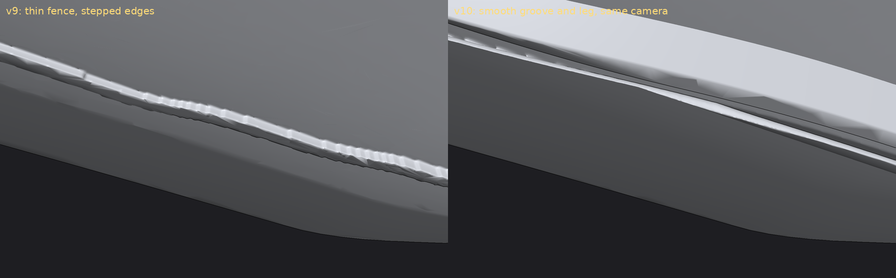
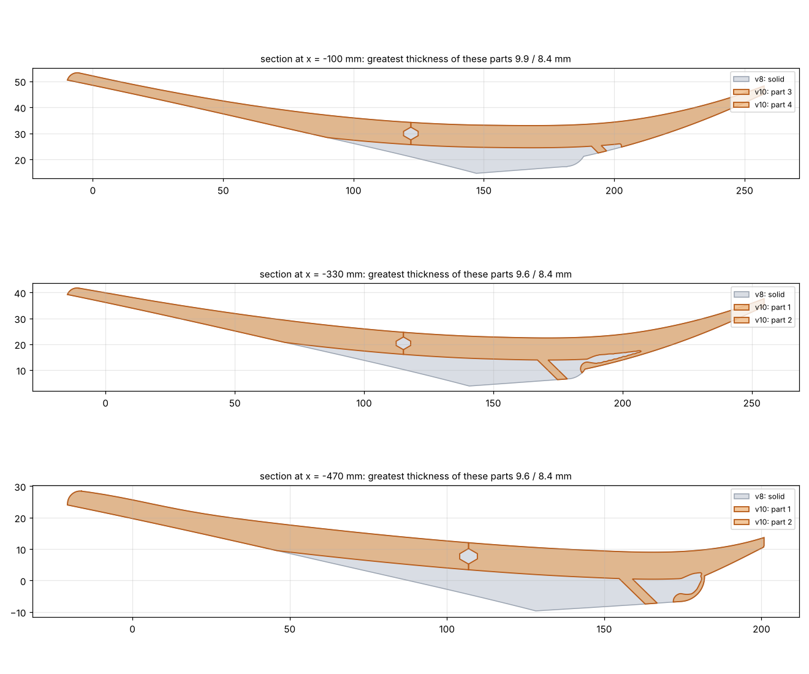
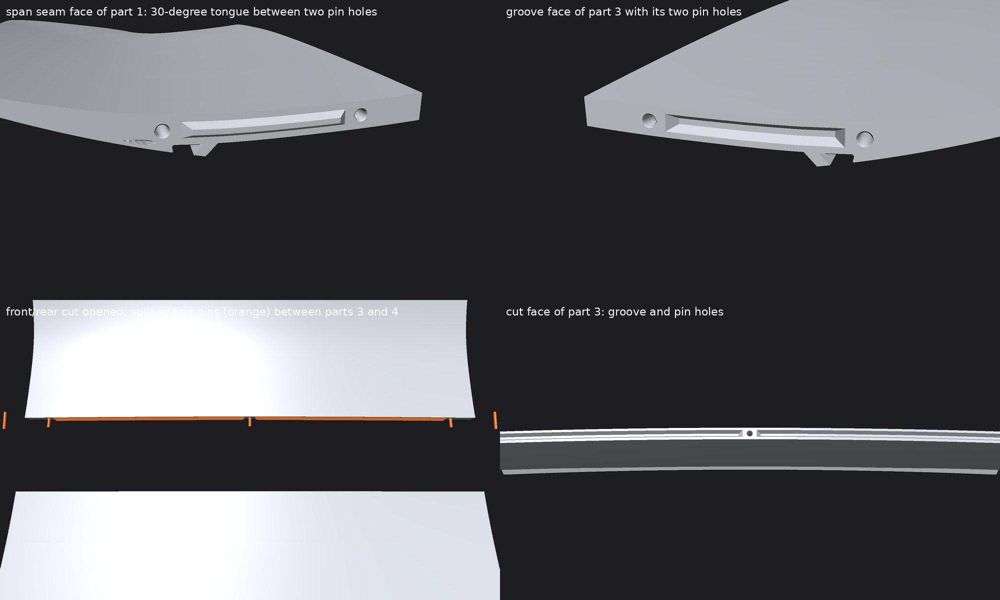
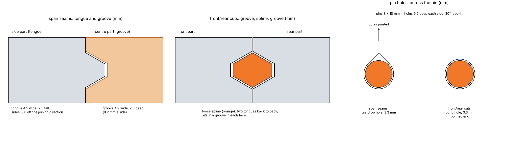
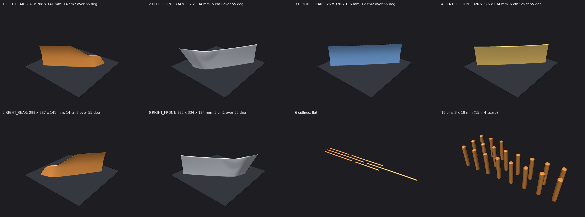

# Polo Oettinger-style roof spoiler v10: six parts as marked, smooth grooved rim

v10 is a new print build of the same spoiler. The outside shape, the underside that sits on the car, and the car coordinates are the same as v6–v9: X across the car, Y up, +Z to the rear. It is still 1,300 × 147 × 292 mm overall, and no part is thicker than 10 mm. Three things changed, as asked:

1. **A smooth, grooved rim at the back.** The v9 rim was a thin 3.5 mm fence with stepped edges and a notch behind it. That is the rough strip in the slicer screenshot. v10 replaces it with clean geometry built along one smooth line.
2. **Six new parts, as marked.** Three sections across the span, each cut again into a front and a rear part.
3. **Printing on the cut faces.** Every part stands on its front/rear cut, so the prints are 134–141 mm tall instead of v9's 217 mm and stand on a long base.

## 1. The grooved rim

From outside, the back edge now looks exactly like the original spoiler. Underneath it is built like this, from the back forward:

- **The original underside stays.**
  - Behind the rim line, the spoiler's own underside (the rear contact strip and the underside of the lip) is kept as a skin at least 2.5 mm thick.
  - Material that has to come out to stay under 10 mm is taken from above that skin, out of sight. The space opens only into the groove.
  - There are no steps or notches under the lip any more.
- **Glue groove.** A channel along the whole rim, about 4 mm wide where it meets the car and 2–9 mm deep, wider inside. It takes a bead of PU adhesive (or a 3 mm foam seal cord), and the narrow mouth holds the adhesive in.
- **Front leg.** In front of the groove, a 4 mm leg on the car, leaning forward at 45° up to the skin. Behind it is the pocket.
- **One smooth line.** Everything follows a single curve fitted to where the underside meets the car, smoothed over 25 mm. Its tightest bend is 285 mm in radius in the middle and about 190 mm near the ends. The rim used to step wherever the car model's crest stepped.
  - The leg is one clean swept solid along that line.
  - Under the leg the gap to the car is at most 3 mm, filled by the adhesive.
- **Printable.** Every face that looks forward leans at 45°, so the rear parts print standing on their front cut without supports.

The same close-up of the back edge in v9 and v10:

## 2. The six parts

Cut as marked in the owner's sketch, and numbered the same way:

| Part | File | Where | Volume |
|---|---|---|---|
| 1 | `v10_1_LEFT_REAR` | left section, rear (with the rim) | 330 cm³ |
| 2 | `v10_2_LEFT_FRONT` | left section, front (with the left fin) | 376 cm³ |
| 3 | `v10_3_CENTRE_REAR` | centre section, rear (with the rim) | 446 cm³ |
| 4 | `v10_4_CENTRE_FRONT` | centre section, front | 331 cm³ |
| 5 | `v10_5_RIGHT_REAR` | right section, rear (with the rim) | 330 cm³ |
| 6 | `v10_6_RIGHT_FRONT` | right section, front (with the right fin) | 376 cm³ |
| | | **Total** | **2,189 cm³** (v8 solid: 2,963 cm³) |

- **Across the span:** cuts at x = ±216.7 mm, the v9 seams between pieces 2|3 and 4|5. The centre section is 433 mm wide; each side section is 433 mm including its fin.
- **Front/rear:** one flat, vertical cut per section, about the middle of the chord. It runs at z = 122 mm across the centre and slopes to z = 100 mm at the ends, following the marked line. The three cuts meet at the span seams, so four parts meet at one point on each side.
- **Symmetry:** the left and right parts are exact mirror images. The spoiler is symmetric to 0.02 mm; the car model under it is not quite (up to about 1 mm), so the right section is made as the mirror of the left one.

## 3. Thickness: still 10 mm at most

The coring is as in v9. Every visible surface stays as it is, and material more than 8.5 mm below them comes out from the hidden underside. Behind the rim line, that skin is 7 mm above the 2.5 mm underside skin.

Greatest thickness per part, measured as the largest sphere that fits inside:

| Part | 1 | 2 | 3 | 4 | 5 | 6 |
|---|---|---|---|---|---|---|
| mm | 9.6 | 8.4 | 9.9 | 8.4 | 9.6 | 8.3 |

## 4. Joints: pins and 30° chamfers at every seam

**Span seams** (x = ±216.7 mm; tongue on the side part, groove in the centre part):

- **Rear segment** (parts 1|3 and 3|5):
  - two 3 mm pins, at z = 141 and 199 mm;
  - between them, a 47 mm tongue (4.5 mm wide, 2.5 mm tall, sides 30° off the joining direction).
- **Front segment** (parts 2|4 and 4|6):
  - The front band there is thinner than the skin (3–8 mm), leaving room for one pin, at z = 103 mm.
  - In front of it is a 36 mm tongue of the smaller size (3.0 wide, 1.7 tall, same 30° sides).
- **Printing:** these faces stand upright when printed. The holes are teardrop-shaped, pointed towards the top of the print, so they come out round. The tongue and groove ends taper at 45°.

**Front/rear cuts** (parts 2|1, 4|3, 6|5):

- Both parts print standing on this face, so both faces carry a groove.
- **Splines:** a loose double-sided spline (two 30° tongues back to back) sits in the grooves. There are two per cut, 102–184 mm long.
- **Pins:** three 3 mm pins per cut, between and beyond the splines.
  - Centre cut: at x = −194, 0 and +194 mm.
  - Side cuts: at x = ±239, ±389 and ±501 mm.

**Pins and fit:**

- 15 pins in all, 3 × 18 mm, in 3.3 mm holes 9.5 mm deep each side, with a 30° lead-in. Use steel dowels, 3 mm rod cut to length, or the printed pins (plate of 19).
- At least 1.6 mm of wall around every hole.
- Measured clearance: 0.17 mm round every tongue and spline.

## Print files

`print/` holds bed-ready files for a 420 × 420 mm bed (Anycubic Kobra 3 Max). Each part stands on its cut face, set across the bed's diagonal.

| File | Print size (mm) | Notes |
|---|---|---|
| `v10_1_LEFT_REAR.stl` | 287 × 288 × 141 | stands on its front cut |
| `v10_2_LEFT_FRONT.stl` | 334 × 332 × 134 | stands on its rear cut |
| `v10_3_CENTRE_REAR.stl` | 326 × 326 × 136 | stands on its front cut |
| `v10_4_CENTRE_FRONT.stl` | 326 × 326 × 134 | stands on its rear cut |
| `v10_5_RIGHT_REAR.stl` | 288 × 287 × 141 | stands on its front cut |
| `v10_6_RIGHT_FRONT.stl` | 332 × 334 × 134 | stands on its rear cut |
| `v10_SPLINES_plate.stl` | 379 × 35 × 5 | the six splines, flat |
| `v10_PINS_3x18_plate_x19.stl` | | 15 pins + 4 spare, standing; skip if using metal pins |

**Why this prints faster and better than v9:**
- Each part is a long, low curved wall: 134–141 mm tall instead of 217 mm, on a base up to 433 mm long. It is steadier on the bed and has fewer layers.
- The visible top surface is printed as a side wall, so it carries no supports and no bed marks.
- There are two seams across the span instead of five.

**Supports: none needed.**
- The steepest faces are the 1.7 mm-wide roofs of the spline grooves, which are short bridges.
- The 1–2 mm rounded back edge of the glue groove is a small overhang inside the groove, where looks do not matter.
- If your slicer flags the fin tip on parts 2 and 6 (under 1 cm²), allow a small tree support there.

**Settings:**
- ASA (UV-stable) or PETG.
- 0.25–0.28 mm layers with a 0.4 mm nozzle (0.3 mm with a 0.6 mm nozzle for speed).
- 4 walls, 20–25% gyroid infill.
- An 8–10 mm brim on every part and on the splines.

## Assembly

1. **Dry-fit.**
   - At each front/rear cut, lay the splines in the rear part's groove and push in its three pins, then press the front part on.
   - At the span seams, push the pins into the centre parts and slide the side parts on along the span.
   - The 30° sides centre every part, so you don't need to line anything up by eye.
2. **Glue.** Use epoxy, or for ASA, ABS/ASA cement. Put it on both faces, in the holes, in the grooves and on the tongues.
   - Join each front/rear pair first: 1+2, 3+4, 5+6.
   - Then join the three sections at the span seams.
   - Hold or clamp each joint until it sets.
3. **Finish.** Fill the seam lines, prime and paint as before.

## Mounting

- **Front band:** two strips of 12 mm 3M VHB tape. The 1.5 mm tape gap is built into the underside.
- **Back:** run a 3–4 mm bead of PU adhesive (Sikaflex or similar) along the glue groove, then press the spoiler on. The two lands either side of the groove sit on the car, and the groove keeps the bead from squeezing out at the back.
- **Fins:** a thin bead or 6 mm tape on the edges that touch the pillars.

## Checks on the delivered files

`src/p3_validate.py` checks every part, spline and pin, and stops if a check fails. Results are in `out/validation.json`.

- **Meshes:** all watertight, with consistent winding, one body each, no self-intersections and no zero-area faces. The print files are checked again as written (float32 STL).
  - Part files are reduced with a quality-preserving decimation that moves no surface point more than 0.02 mm.
- **Thickness:** 8.3–9.9 mm at most per part.
- **Fit:**
  - No part overlaps a neighbour, a spline or a pin.
  - Tongue and spline clearance is 0.17 mm.
  - Pin-hole walls are at least 1.6 mm.
- **Seams:** the outer surfaces of neighbouring parts come from the same body, so they meet. The profiles differ by at most a few mm² of area per seam, from the 0.02 mm decimation.

## Files and rebuilding

- `assembled/`: the six parts, splines and pins in car coordinates, in place. Load them together to see the assembly.
- `docs/`: the figures above, plus `rim_v10.png` (a studio render of the grooved rim on part 3's cut end).
- `src/`: the scripts. `sh v10/src/run_all.sh` from `spoiler/` rebuilds everything in about 25 minutes.
- **To change the design:** edit `src/layout.py`.
  - Cut lines: `C0`, `C1`.
  - Rim: `RIM_LEG`, `RIM_GAP`, `SKIRT`.
  - Skin: `T_SKIN`.
  - Pins and joints: as in v9.
- **The rim** is built by `src/rim.py` (the smooth line and the swept leg) and `src/p1_core.py` (coring and the skirt).

**Limits.**
- The underside comes from a car model built from VW's published dimensions, not from a scan. Dry-fit on the car before gluing, as with earlier versions.
- Where the car model's crest has small steps, the rim line runs up to about 8 mm forward of the exact contact edge, to stay smooth.
