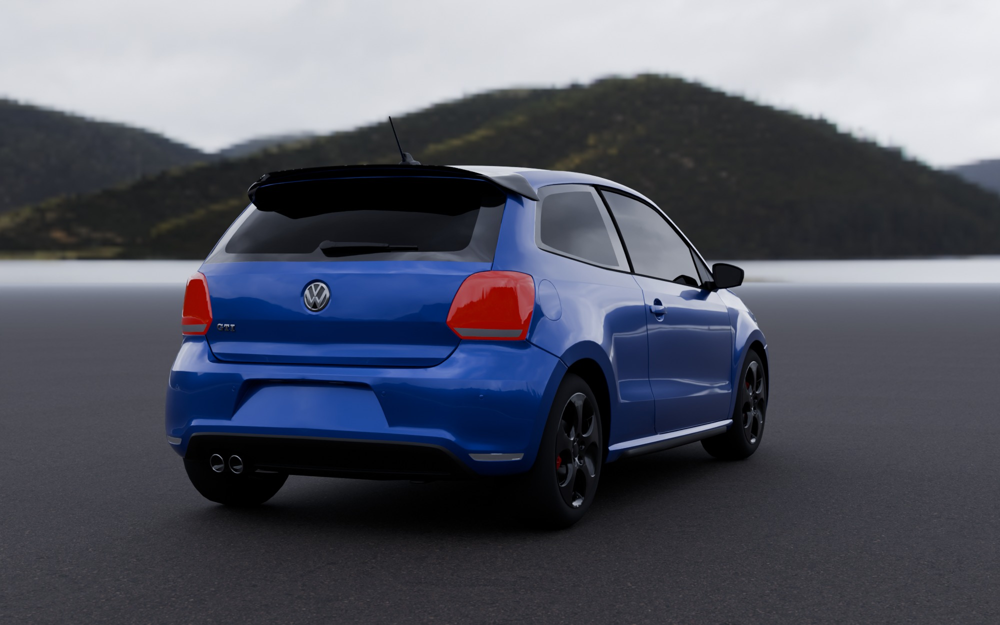
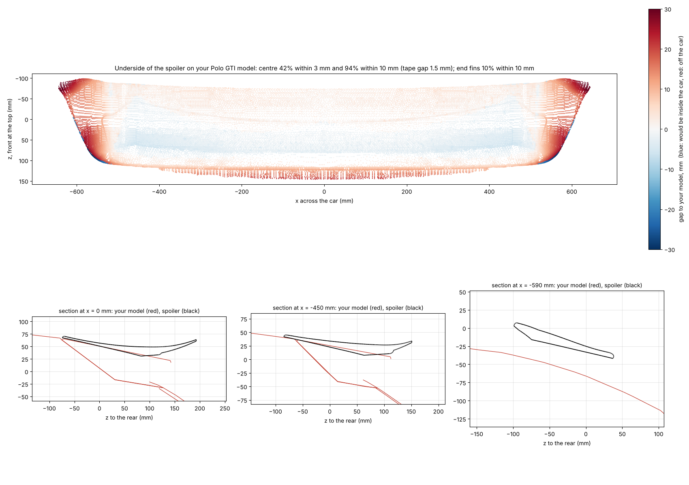

# v11: the spoiler on the owner's Polo GTI model

The owner supplied a detailed 3D model of a Polo GTI (6R), `FINAL_MODEL_11.fbx`. It also came as a SketchUp OBJ export without its material file. This folder places the spoiler on that model and renders it.

The model's size matches VW's dimension drawing once its 1/100 import scale is undone: 3,956 mm long (drawing: 3,970), 1,703 mm wide over the body, and 1,446 mm to the roof.

## How it was placed

1. **Scale and place the model.** The model is scaled to millimetres and set in the spoiler's car frame (X across, Y up, Z to the rear), standing on the ground with its bumpers where the old car model had them.
2. **Remove the factory spoiler.** The model's own GTI roof spoiler, with the third brake light in it, is hidden. Ours replaces it.
3. **Fit the spoiler.** `src/fit_spoiler.py` fits the spoiler's underside to the model's roof and tailgate, allowing for the 1.5 mm tape gap. The car and spoiler are both symmetric, so it only moves the spoiler fore and aft, up and down, and in pitch.
   - Along the smooth roof the fit hardly changes with position (mean distance 4.8–6 mm). The position is therefore set where the spoiler belongs: its rear contact edge on the model's crest, where the tailgate top ends and the rear glass drops away. That is where the factory spoiler sits.
   - Height and pitch are then fitted.
   - **Result:** 65 mm further forward, 15 mm higher and 0.3° in pitch compared with where it sat on the old car model.

## How well it fits this model

- **Centre (roof and tailgate top):** median gap 1.6 mm; 42% of the contact area within 3 mm and 94% within 10 mm.
  - The front band and the middle sit well.
  - The rear contact edge stands 10–30 mm off the tailgate top on this model.
- **End fins:** only 10% within 10 mm. Here the model's roof is narrower and its rear pillars drop away faster than on our old car model, so the fins stand 2–5 cm outside the pillars.

**What this means for the print.** The spoiler's underside is the v5 design, and the old car model was shaped to it, so on the old model it always looked perfect. This model matches VW's published dimensions, and on it the rear edge and the fins don't meet the car. If this model is true to the owner's car, refit the underside and fins to it before printing: the top surface stays the same, and v10's parts and joints are rebuilt on the new underside. Dry-fit on the real car either way.

## Renders

`renders/`, Cycles, 2000 × 1250:

| File | View |
|---|---|
| `polo_gti_photo.jpg` | right rear three-quarter, low |
| `polo_gti_photo_left.jpg` | left rear three-quarter |
| `polo_gti_rear_low.jpg` | straight from behind |
| `polo_gti_top_rear.jpg` | high rear view across the roof |
| `polo_gti_fin.jpg` | close-up of the right fin and roof corner |
| `polo_gti_side.jpg` | side view |

**Rendering details:**
- The model's texture images were not supplied, so materials are set from their names: the owner's blue metallic paint, black trim, glass, lamps, dark wheels and red calipers.
- The spoiler is the finished one-piece part (`../v6/out/E2.stl`) in gloss black.
- The sky and asphalt are the Poly Haven CC0 assets of the v6 renders.
- The model carries VW and GTI badges. Keep that in mind before using these images in marketing; the brochure's renders deliberately have none.

## Rebuild

The FBX is not stored in the repository (it is a third-party model). Put it at `v11/input/FINAL_MODEL_11.fbx`, then from `spoiler/`:

1. Export the model's exterior: the snippet in `src/export_model.py`, which writes `out/user_exterior_carframe0.ply`.
2. `python3 v11/src/fit_spoiler.py` writes `out/fit.json`.
3. `python3 v11/src/fit_figure.py` writes the fit figure.
4. `python3 v11/src/blend_usercar.py <view> <out.png> 2000 1250 96` renders a view: photo, photo_left, rear_low, top_rear, fin or side.
