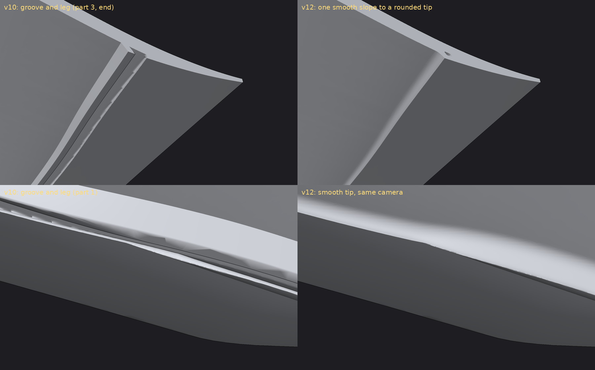
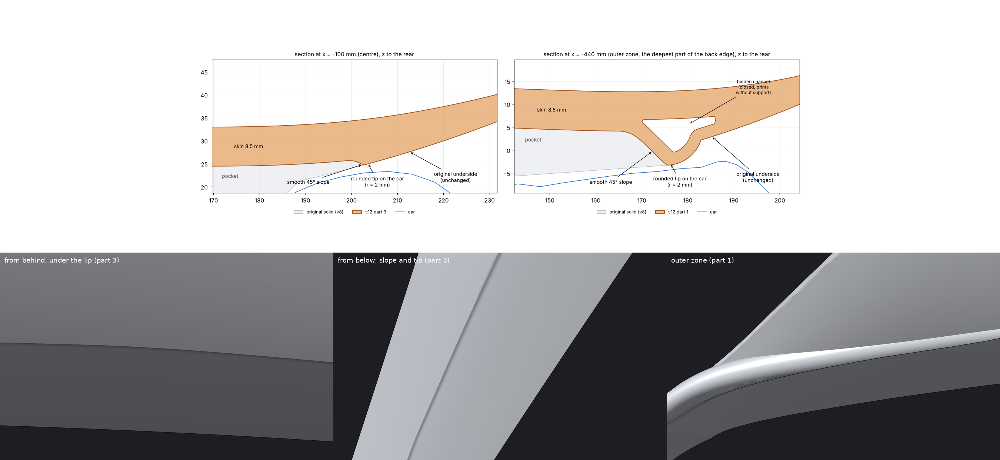
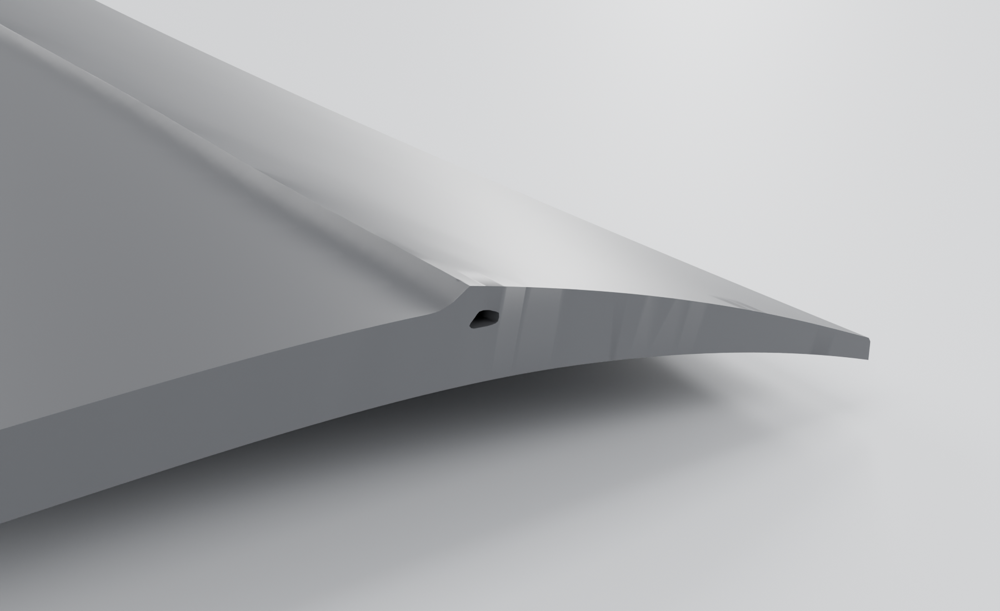
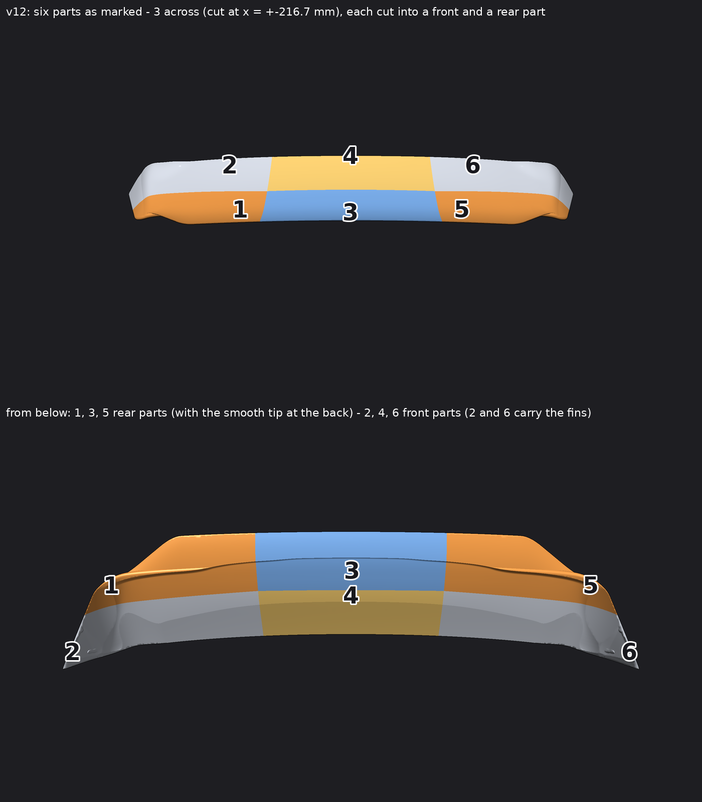
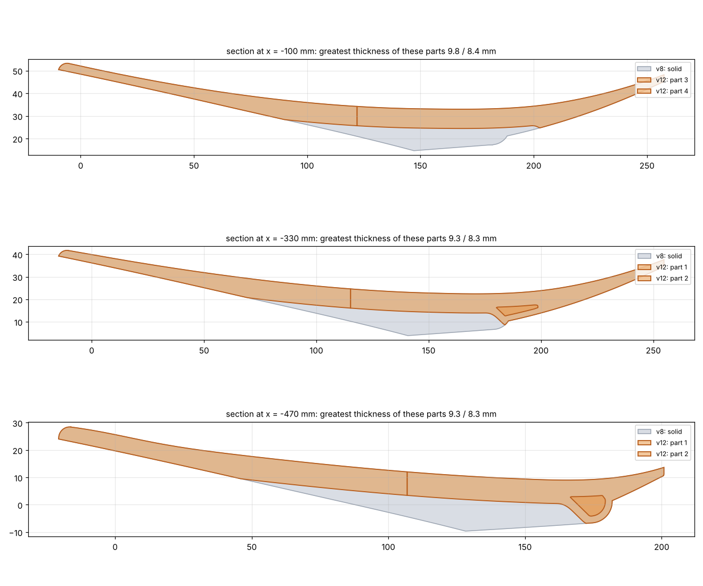
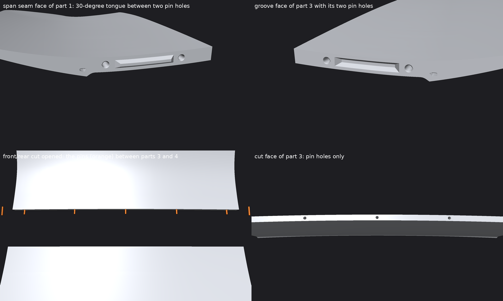
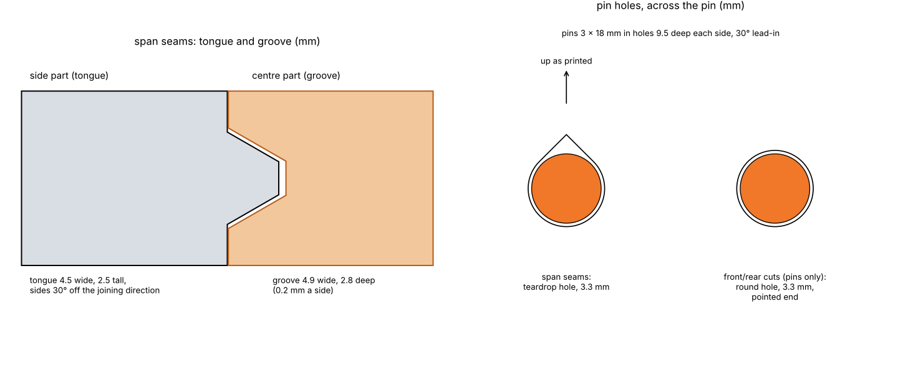
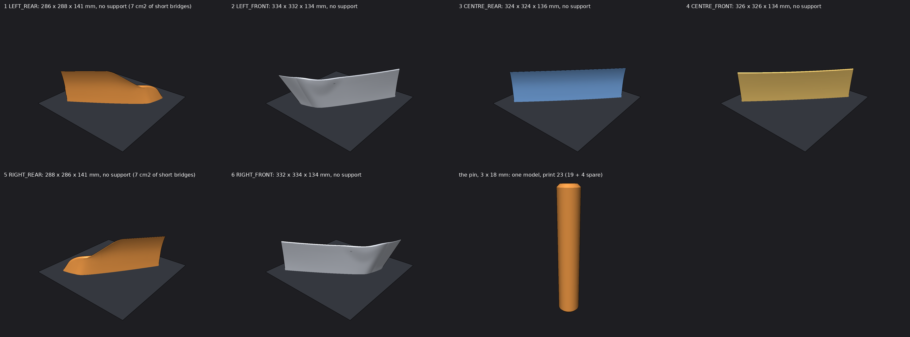

# Polo Oettinger-style roof spoiler v12: one smooth, rounded tip at the back

v12 is v10 with the back edge redesigned, as asked: the leg-and-groove rim is gone.

- **Unchanged from v10:**
  - The outside shape, the underside that sits on the car, and the car coordinates (X across the car, Y up, +Z to the rear).
  - The six parts and the way they print.
  - The size: 1,300 × 147 × 292 mm overall, and no part is thicker than 10 mm.
- **New: the back edge** now runs down from the pocket in one smooth 45° slope to a single rounded tip that sits on the car. Behind the tip, the spoiler's own underside carries on unchanged. That is the line marked in red on the owner's close-up.
- **New: the print set is just the six parts and one pin model.** The front/rear cuts join with dowel pins only (v10 had loose splines there), so there is nothing else to print: `print/` holds the seven files.

## 1. The smooth tip

From the front of the part to the back, the underside now looks like this:

- **Pocket:** the hollow under the ridge, with the 8.5 mm skin above it, as in v9 and v10.
- **One smooth slope:** the pocket ceiling curves into a 45° slope with a soft fillet, and the slope runs straight down to the tip.
  - 45° is the steepest face that prints without support, so the rear parts still print standing on their front cut.
- **Rounded tip:** 2 mm radius.
  - It sits 1.5 mm in front of the line where the underside leaves the car, along the whole back edge.
  - It follows the same smooth line as v10's rim: fitted to where the underside meets the car, smoothed over 25 mm, with no steps.
  - The gap between the tip and the car is 0.9–1.8 mm, the 1.5 mm tape gap built into the underside. The adhesive fills it.
- **Behind the tip:** the spoiler's original underside, unchanged.
  - This is the contact strip, then the underside of the lip back to the trailing edge.
  - No groove, no leg, no slot, no step.

**Hidden channel in the deep part of the back edge.**
- Towards the ends (|x| beyond about 155 mm), the back edge is 10–16 mm deep from the top surface down to the car. A solid tip there would be thicker than the 10 mm limit, so it is hollow inside.
- The channel runs along the back edge inside the part:
  - under a 6 mm top skin,
  - over a 2.5 mm skirt (the spoiler's own underside, unchanged),
  - behind the slope's 3 mm wall.
- Nothing of it shows from outside. It is 1.5–7.7 mm tall and up to 16 mm from front to back, largest at |x| ≈ 440 mm, and ends at |x| ≈ 541 mm.
- **It runs through the span seams.** On the seam faces of parts 1, 3 and 5 it shows as a small slot, 3.6 × 1.9 mm, just above the tip. Glue covers it when the parts are joined.
  - Because the channel opens there, each part is a single closed shell with no sealed cavity. Every slicer prints it correctly.
- **It prints without support.** As printed, its walls stand nearly upright. Its closed top end is a bridge about 1.5 mm wide.

The same close-up as the owner's photo, rendered (`docs/rim_v12.png`):

## 2. The six parts (as v10)

| Part | File | Where | Volume |
|---|---|---|---|
| 1 | `v12_1_LEFT_REAR` | left section, rear (with the tip) | 327 cm³ |
| 2 | `v12_2_LEFT_FRONT` | left section, front (with the left fin) | 378 cm³ |
| 3 | `v12_3_CENTRE_REAR` | centre section, rear (with the tip) | 445 cm³ |
| 4 | `v12_4_CENTRE_FRONT` | centre section, front | 334 cm³ |
| 5 | `v12_5_RIGHT_REAR` | right section, rear (with the tip) | 327 cm³ |
| 6 | `v12_6_RIGHT_FRONT` | right section, front (with the right fin) | 378 cm³ |
| | | **Total** | **2,189 cm³** (v8 solid: 2,963 cm³) |

- **Across the span:** cuts at x = ±216.7 mm. The centre section is 433 mm wide; each side section is 433 mm including its fin.
- **Front/rear:** one flat, vertical cut per section. It runs at z = 122 mm across the centre and slopes to z = 100 mm at the ends.
- **Symmetry:** the left and right parts are exact mirror images.

## 3. Thickness: 10 mm at most

Every visible surface stays as it is; material more than 8.5 mm below them comes out from the hidden underside. Greatest thickness per part, measured as the largest sphere that fits inside:

| Part | 1 | 2 | 3 | 4 | 5 | 6 |
|---|---|---|---|---|---|---|
| mm | 9.3 | 8.3 | 9.8 | 8.4 | 9.3 | 8.3 |

## 4. Joints: dowel pins at every seam, 30° tongues across the span

**Span seams** (x = ±216.7 mm; tongue on the side part, groove in the centre part):

- **Rear segment** (parts 1|3 and 3|5):
  - two 3 mm pins, at z = 141.5 and 186 mm;
  - between them, a 35 mm tongue (4.5 mm wide, 2.5 mm tall, sides 30° off the joining direction).
  - The rear pin sits 13 mm further forward than in v10 (it was at z = 199), clear of the channel.
- **Front segment** (parts 2|4 and 4|6): one pin at z = 103 mm and, in front of it, a 36 mm tongue of the smaller size (3.0 wide, 1.7 tall, same 30° sides).
- **Printing:** these faces stand upright when printed. The holes are teardrop-shaped, pointed towards the top of the print, and the tongue and groove ends taper at 45°.

**Front/rear cuts** (parts 2|1, 4|3, 6|5):

- Both parts print standing on this face, so nothing may stand proud of it. The joint is dowel pins only, about every 80 mm, with round holes and pointed ends:
  - five pins on the centre cut, at x = 0, ±97 and ±194 mm;
  - four pins on each side cut, at x = ±239, ±339, ±439 and ±501 mm.
- There are no loose splines any more, and no grooves in these faces. The pins line the parts up; the glue holds them.

**Pins and fit:**

- 19 pins in all, 3 × 18 mm, in 3.3 mm holes 9.5 mm deep each side, with a 30° lead-in. They are all the same: print `v12_PIN_3x18.stl` 23 times (19 + 4 spare), or use 3 mm steel dowels or rod cut to 18 mm.
- At least 1.6 mm of wall around every hole.
- Measured clearance: 0.17 mm round every tongue.

## Print files

`print/` holds the whole print set, seven files, bed-ready for a 420 × 420 mm bed (Anycubic Kobra 3 Max). Each part stands on its cut face, set across the bed's diagonal.

| File | Print size (mm) | Notes |
|---|---|---|
| `v12_1_LEFT_REAR.stl` | 286 × 288 × 141 | stands on its front cut |
| `v12_2_LEFT_FRONT.stl` | 334 × 332 × 134 | stands on its rear cut |
| `v12_3_CENTRE_REAR.stl` | 324 × 324 × 136 | stands on its front cut |
| `v12_4_CENTRE_FRONT.stl` | 326 × 326 × 134 | stands on its rear cut |
| `v12_5_RIGHT_REAR.stl` | 288 × 286 × 141 | stands on its front cut |
| `v12_6_RIGHT_FRONT.stl` | 332 × 334 × 134 | stands on its rear cut |
| `v12_PIN_3x18.stl` | 3 × 18 | the pin, standing on end: print 23 (19 + 4 spare); skip if using metal pins |

**Supports: none needed.**
- The tip's slope leans at 45°.
- The only steeper face is a short bridge: the closed top end of the hidden channel, about 1.5 mm wide (6.7 cm² on parts 1 and 5, 1 cm² on part 3).
- With the spline grooves gone, the other parts have at most 1.2 cm² over 55° (v10: 5–14 cm² per part).
- If your slicer flags the fin tip on parts 2 and 6 (under 1 cm²), allow a small tree support there.

**Settings (as v10):**
- ASA (UV-stable) or PETG.
- 0.25–0.28 mm layers with a 0.4 mm nozzle.
- 4 walls, 20–25% gyroid infill.
- An 8–10 mm brim on every part.

## Assembly (as v10)

1. **Dry-fit.**
   - At each front/rear cut, push the pins into the rear part's holes, then press the front part on.
   - At the span seams, push the pins into the centre parts and slide the side parts on along the span.
2. **Glue.** Use epoxy, or for ASA, ABS/ASA cement, on both faces, in the holes, and in the grooves and on the tongues of the span seams.
   - Join each front/rear pair first: 1+2, 3+4, 5+6.
   - Then join the three sections at the span seams. Glue on the seam faces also closes the end of the hidden channel.
3. **Finish.** Fill the seam lines, prime and paint.

## Mounting

- **Front band:** two strips of 12 mm 3M VHB tape. The 1.5 mm tape gap is built into the underside.
- **Back:** run a 3 mm bead of PU adhesive (Sikaflex or similar) along the rounded tip, then press the spoiler on.
  - Under the 1.5 mm gap the bead spreads to about 5 mm wide.
  - The slope in front of the tip gives any excess room to go, so it does not squeeze out at the back.
- **Fins:** a thin bead or 6 mm tape on the edges that touch the pillars.

## Checks on the delivered files

`src/p3_validate.py` checks every part and pin, and stops if a check fails. Results are in `out/validation.json`.

- **Meshes:** all watertight, with consistent winding, one body each, no self-intersections and no zero-area faces. The print files are checked again as written (float32 STL).
- **Thickness:** 8.3–9.8 mm at most per part.
- **Fit:**
  - No part overlaps a neighbour or a pin.
  - Tongue clearance is 0.17 mm.
  - Pin-hole walls are at least 1.6 mm.
- **Seams:** the outer outlines of neighbouring parts match to 1–1.4 mm² at the span seams and 5–9 mm² at the front/rear cuts, from the 0.02 mm decimation.

## Files and rebuilding

- `print/`: the print set, the six parts and the pin (above). The zip `Polo_spoiler_v12_print_package.zip` holds the same seven models plus this README and its figures.
- The scripts also write the parts and the 19 pins in place on the car to `out/assembled/`, for the checks, figures and renders. These working copies are not part of the print set and are not stored in the repository.
- `docs/`: the figures above and `rim_v12.png`, a studio render of the tip at part 3's end, from the same camera as the owner's close-up of v10.
- `src/`: the scripts. `sh v12/src/run_all.sh` from `spoiler/` rebuilds everything in about 25 minutes.
- **To change the design:** edit `src/layout.py`.
  - Tip: `TIP_T` (how far forward of the contact line), `TIP_R` (radius), `M_FRONT` (slope), `K_BLEND` (fillet).
  - Hidden channel: `SKIN_V`, `SKIRT`, `WALL`, `C_MIN`.
  - Skin: `T_SKIN`. Cut lines: `C0`, `C1`. Pins on the front/rear cuts: `CUT_PIN_PITCH`.
- **The back edge** is built by `src/rim.py` (the smooth line and the tip's profile) and `src/p1_core.py` (the pocket, the tip and the channel as smooth fields on a 0.5 mm grid, then marching cubes).

**Limits.**
- The underside comes from a car model built from VW's published dimensions, not from a scan. Dry-fit on the car before gluing, as with earlier versions.
- v11 found that on the owner's own Polo GTI model the rear edge stands 10–30 mm off. If that model is true to the car, refit the underside first; the tip and parts are then rebuilt on it by the same scripts.
