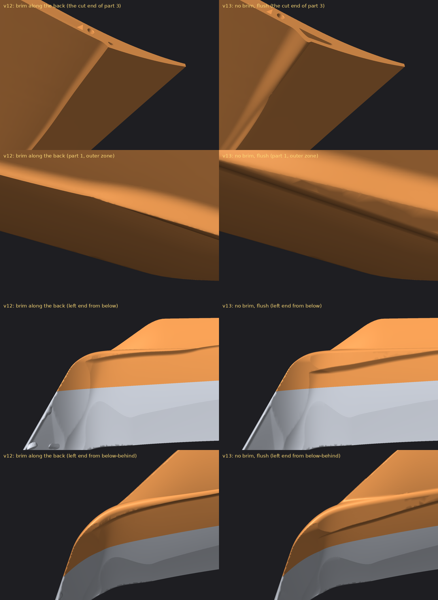
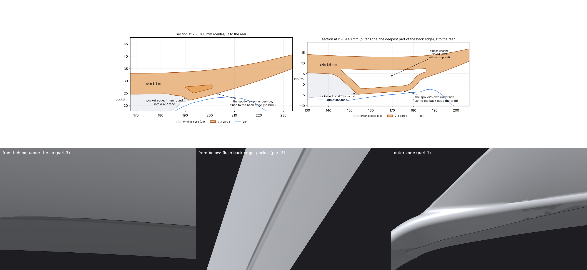
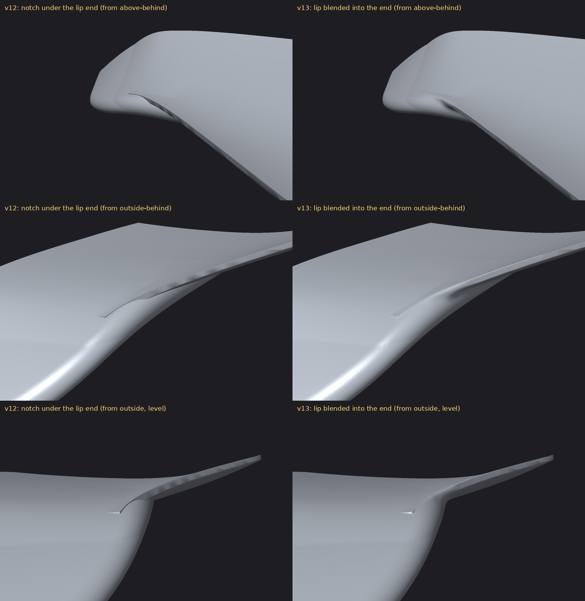
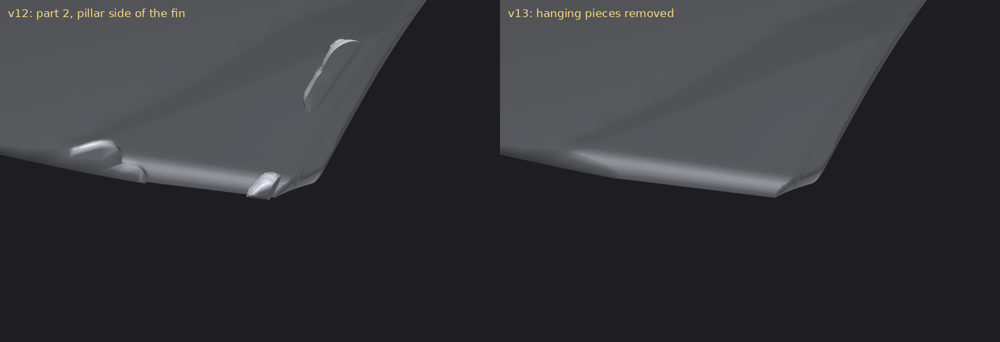
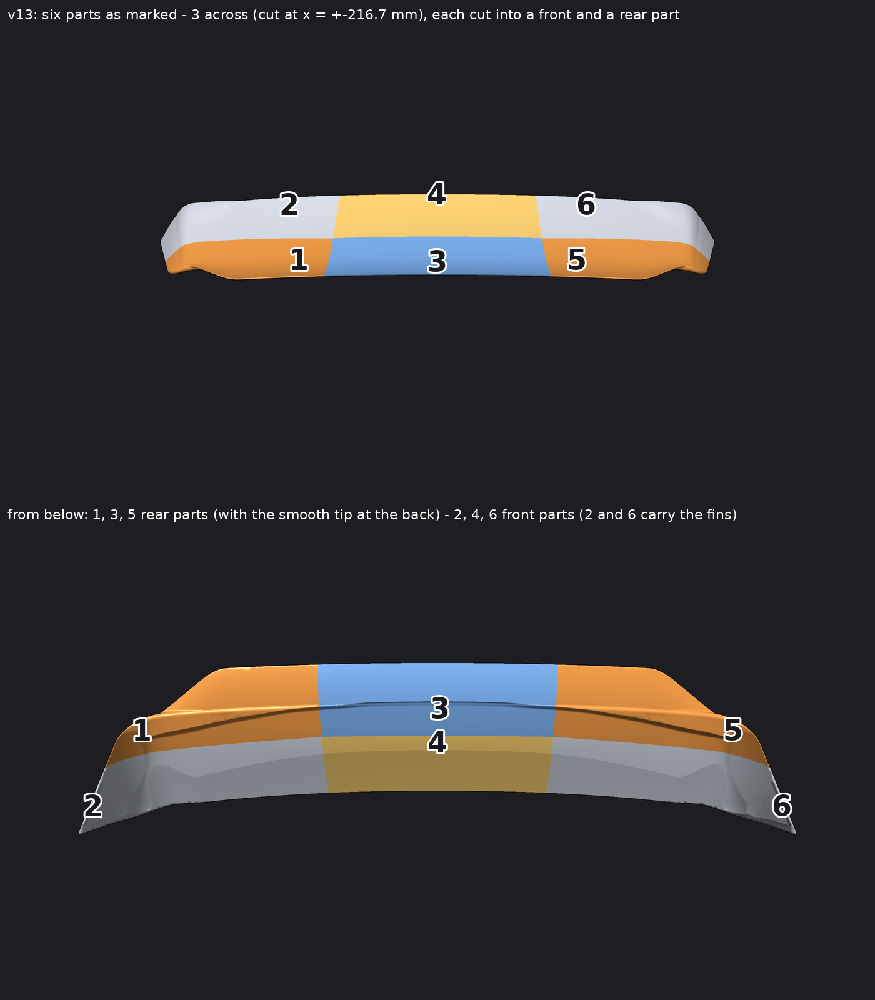
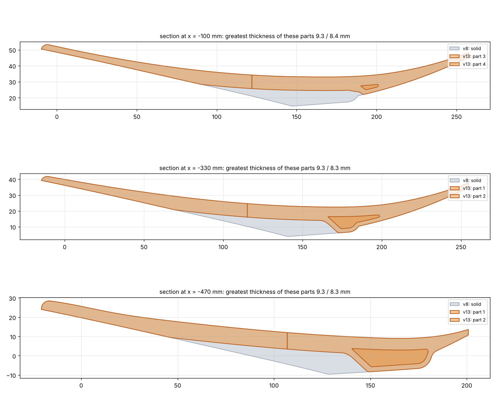
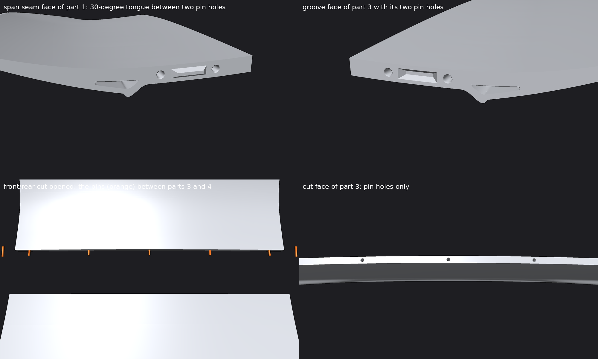
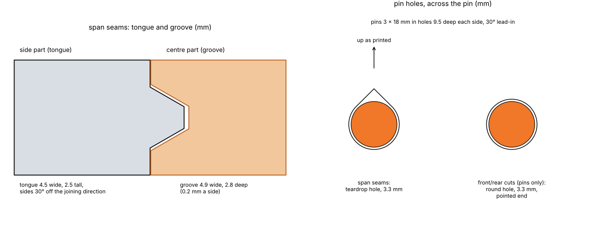
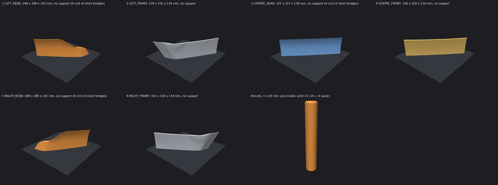

# Polo Oettinger-style roof spoiler v13: no brim, blended ducktail corners

v13 is v12 with the changes asked for on the v12 parts:

- **No brim at the back.** v12 had a rounded tip along the back edge with a 45° slope up into the hollow underneath; seen from below it stood out as a brim, and at the ends it hooked round the corner. It is gone, along the whole back edge. The spoiler's own underside now runs flush to the back edge and round the ends, exactly as on the solid spoiler. The hollow starts 10 mm in front of the line where the underside leaves the car (22 mm towards the ends).
- **Ducktail corners blended.** At both outer rear corners the notch under the end of the ducktail lip is filled, the lip's squared end is rounded off and the small step beyond it is gone, so the lip runs smoothly into the rounded end of the spoiler. Only these two corners of the outside shape change.
- **No hanging pieces on the fins.** The small lumps on the pillar side of the fins (parts 2 and 6) are gone. Each was a small patch of the hidden underside that had been taken for visible surface, so a full skin was kept behind it; they are now hollowed like the rest.
- **Unchanged:** the outside shape everywhere else, the six parts and the way they print, the seven-file print set, and the 10 mm limit.

## 1. The back edge: flush, no brim

From the front of the part to the back, the underside now looks like this:

- **Pocket:** the hollow under the ridge, with the 8.5 mm skin above it, as before.
- **Pocket edge:** the hollow's back face leaves the underside with a 4 mm round and rises at 45°, the steepest face that prints without support. It runs 10 mm in front of the line where the underside leaves the car, moving out to 22 mm towards the ends (|x| from 340 to 470 mm), so the corners stay solid and smooth.
- **Behind it, to the back edge:** the spoiler's own underside, unchanged and flush: the rear of the contact band on the car, then the underside of the lip up to the trailing edge. No bead, no ridge, no step, and round the ends the same.

**Hidden channel.** Where the back of the spoiler is more than 10 mm deep from the top surface to the car (towards the ends it is up to 16 mm), the flush band would be thicker than the 10 mm limit, so it is hollow inside:
- a channel runs along the back inside the part, under a 6 mm top skin, over a 2.5 mm skirt (the spoiler's own underside, unchanged) and 3 mm behind the pocket's face;
- nothing of it shows from outside;
- it runs through the span seams, where it opens on the seam faces of parts 1, 3 and 5 as a slot about 20 × 5 mm. Glue covers it when the parts are joined. Because it opens there, each part is one closed shell with no sealed cavity, which every slicer prints correctly;
- printed, its walls stand nearly upright and its closed top end is a short bridge.

## 2. The ducktail corners

- The body is rebuilt locally at each corner from its distance field: a rolling-ball fillet of 4.5 mm radius fills the notch under the lip's end and the step beyond it, and a light smoothing right along the corner rounds the lip's squared end.
- The change fades out within 16 mm of the corner, and everywhere else the surface is the original one: each corner gains 0.11 cm³ and loses 0.03 cm³.
- `src/e3_corners.py` builds this body (`out/E3.stl`) from the v6 body; everything else is cut from it.

## 3. The fins

The pillar side of each fin is now hollowed evenly. Small patches of hidden surface there (each under 5 cm²) had been taken for visible surface, so a full skin was kept behind each; any such patch is now treated as hidden, so no thick lumps are left.

## 4. The six parts

| Part | File | Where | Volume |
|---|---|---|---|
| 1 | `v13_1_LEFT_REAR` | left section, rear (flush back edge) | 328 cm³ |
| 2 | `v13_2_LEFT_FRONT` | left section, front (with the left fin) | 376 cm³ |
| 3 | `v13_3_CENTRE_REAR` | centre section, rear (flush back edge) | 451 cm³ |
| 4 | `v13_4_CENTRE_FRONT` | centre section, front | 334 cm³ |
| 5 | `v13_5_RIGHT_REAR` | right section, rear (flush back edge) | 328 cm³ |
| 6 | `v13_6_RIGHT_FRONT` | right section, front (with the right fin) | 376 cm³ |
| | | **Total** | **2,194 cm³** (v12: 2,189 cm³; v8 solid: 2,963 cm³) |

- **Across the span:** cuts at x = ±216.7 mm. The centre section is 433 mm wide; each side section is 433 mm including its fin.
- **Front/rear:** one flat, vertical cut per section. It runs at z = 122 mm across the centre and slopes to z = 100 mm at the ends.
- **Symmetry:** the left and right parts are exact mirror images.

## 5. Thickness: 10 mm at most

Greatest thickness per part, measured as the largest sphere that fits inside:

| Part | 1 | 2 | 3 | 4 | 5 | 6 |
|---|---|---|---|---|---|---|
| mm | 9.3 | 8.3 | 9.3 | 8.4 | 9.3 | 8.3 |

## 6. Joints: dowel pins at every seam, 30° tongues across the span

**Span seams** (x = ±216.7 mm; tongue on the side part, groove in the centre part):

- **Rear segment** (parts 1|3 and 3|5): 2 × 3 mm pins at z = 141.5 and 169.6 mm, and an 18 mm tongue (4.5 mm wide, 2.5 mm tall, sides 30° off the joining direction).
- **Front segment** (parts 2|4 and 4|6): one pin at z = 102.9 mm and, in front of it, a 36 mm tongue (3.0 wide, 1.7 tall, same 30° sides).
- **Printing:** these faces stand upright when printed. The holes are teardrop-shaped, pointed towards the top of the print, and the tongue and groove ends taper at 45°.

**Front/rear cuts** (parts 2|1, 4|3, 6|5): dowel pins only, about every 80 mm, with round holes and pointed ends:
- 5 pins on the centre cut, at x = -194.3, -97.1, 0.1, 97.4, 194.6 mm;
- 4 pins on each side cut, at x = ±239.2, 339.1, 438.8, 500.5 mm.

**Pins and fit:**
- 19 pins in all, 3 × 18 mm, in 3.3 mm holes 9.5 mm deep each side, with a 30° lead-in. They are all the same: print `v13_PIN_3x18.stl` 23 times (19 + 4 spare), or use 3 mm steel dowels or rod cut to 18 mm.
- At least 1.6 mm of wall around every hole.
- Measured clearance round the tongues: 0.17 mm at least.

## Print files

`print/` holds the whole print set, seven files, bed-ready for a 420 × 420 mm bed (Anycubic Kobra 3 Max). Each part stands on its cut face, set across the bed's diagonal.

| File | Print size (mm) | Notes |
|---|---|---|
| `v13_1_LEFT_REAR.stl` | 288 × 288 × 141 | stands on its front cut face |
| `v13_2_LEFT_FRONT.stl` | 334 × 332 × 134 | stands on its rear cut face |
| `v13_3_CENTRE_REAR.stl` | 327 × 327 × 136 | stands on its front cut face |
| `v13_4_CENTRE_FRONT.stl` | 326 × 326 × 134 | stands on its rear cut face |
| `v13_5_RIGHT_REAR.stl` | 288 × 288 × 141 | stands on its front cut face |
| `v13_6_RIGHT_FRONT.stl` | 332 × 334 × 134 | stands on its rear cut face |
| `v13_PIN_3x18.stl` | 3 × 18 | the pin, standing on end: print 23 (19 + 4 spare); skip if using metal pins |

**Supports: none needed.** The pocket's back face leans at 45°. The only steeper faces are the closed top end of the hidden channel, a short bridge on the rear parts, and a few small spots: faces over 55° add up to 6.0 cm² on parts 1 and 5, 4.5 cm² on part 3 and under 0.2 cm² on the front parts. If your slicer flags the fin tip on parts 2 and 6, allow a small tree support there.

**Settings (as v12):** ASA (UV-stable) or PETG; 0.25–0.28 mm layers with a 0.4 mm nozzle; 4 walls, 20–25% gyroid infill; an 8–10 mm brim on every part.

## Assembly (as v12)

1. **Dry-fit.** At each front/rear cut, push the pins into the rear part's holes, then press the front part on. At the span seams, push the pins into the centre parts and slide the side parts on along the span.
2. **Glue.** Epoxy, or for ASA, ABS/ASA cement, on both faces, in the holes, and in the grooves and on the tongues of the span seams. Join each front/rear pair first (1+2, 3+4, 5+6), then the three sections at the span seams. Glue on the seam faces also closes the ends of the hidden channel.
3. **Finish.** Fill the seam lines, prime and paint.

## Mounting

- **Front band:** two strips of 12 mm 3M VHB tape. The 1.5 mm tape gap is built into the underside.
- **Back:** run a 3 mm bead of PU adhesive (Sikaflex or similar) along the flush band at the back, just in front of the line where the underside leaves the car, then press the spoiler on. The band sits on the car with the same 1.5 mm gap, so the bead spreads to a thin, even seal.
- **Fins:** a thin bead or 6 mm tape on the edges that touch the pillars.

## Checks on the delivered files

`src/p3_validate.py` checks every part and pin, and stops if a check fails. Results are in `out/validation.json`.

- **Meshes:** all watertight, with consistent winding, one body each, no self-intersections and no zero-area faces. The print files are checked again as written (float32 STL).
- **Thickness:** 8.3–9.3 mm at most per part.
- **Fit:** no part overlaps a neighbour or a pin; tongue clearance as above; pin-hole walls at least 1.6 mm.
- **Seams:** the outer outlines of neighbouring parts match to within a few mm² (from the 0.02 mm decimation).

## Files and rebuilding

- `print/`: the print set, the six parts and the pin (above). The zip `Polo_spoiler_v13_print_package.zip` holds the same seven models plus this README and its figures.
- The scripts also write the parts and the pins in place on the car to `out/assembled/`, for the checks, figures and renders. These working copies are not part of the print set and are not stored in the repository.
- `docs/`: the figures above and `rim_v13.png`, a studio render of the flush back edge at part 3's end, from the same camera as the owner's close-up of v10.
- `src/`: the scripts. `sh v13/src/run_all.sh` from `spoiler/` rebuilds everything in about 50 minutes (the corner blend takes 15 of them).
- **To change the design:** edit `src/layout.py`.
  - Back edge: `TIP_SHIFT` and `END_SHIFT` (how far in the pocket starts, centre and ends), `END_FADE`, `TIP_R` (the round at the pocket's edge).
  - Hidden channel: `SKIN_V`, `SKIRT`, `WALL`, `C_MIN`.
  - Corners: `CORNER_CURVE` (the line of the notch), `R_FILLET`, `CORNER_W`, `CORNER_SIG`.
  - Skin: `T_SKIN`. Cut lines: `C0`, `C1`. Pins on the front/rear cuts: `CUT_PIN_PITCH`.

**Limits.**
- The underside comes from a car model built from VW's published dimensions, not from a scan. Dry-fit on the car before gluing, as with earlier versions.
- v11 found that on the owner's own Polo GTI model the rear edge stands 10–30 mm off. If that model is true to the car, refit the underside first; the parts are then rebuilt on it by the same scripts.
