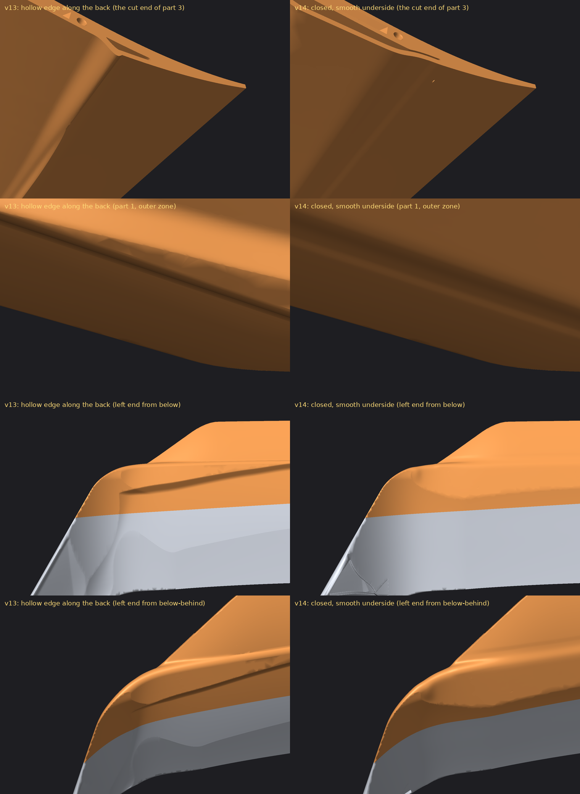
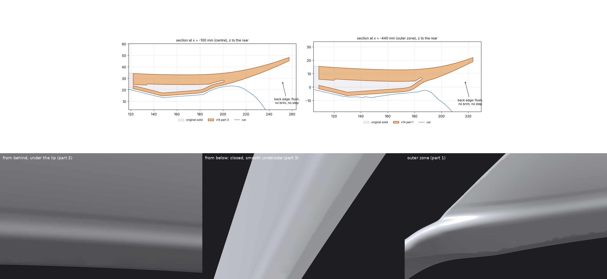
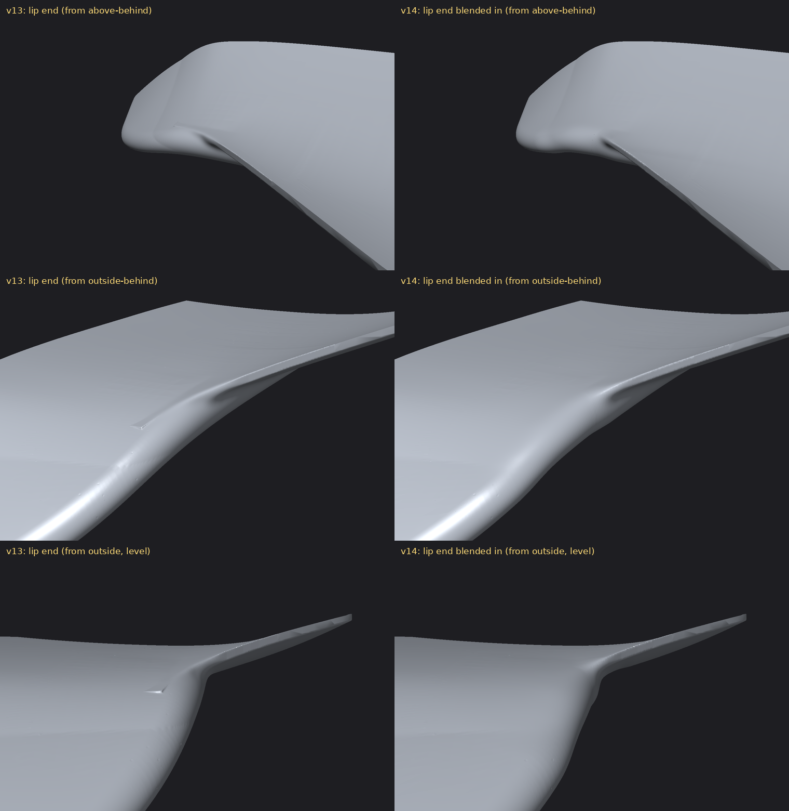
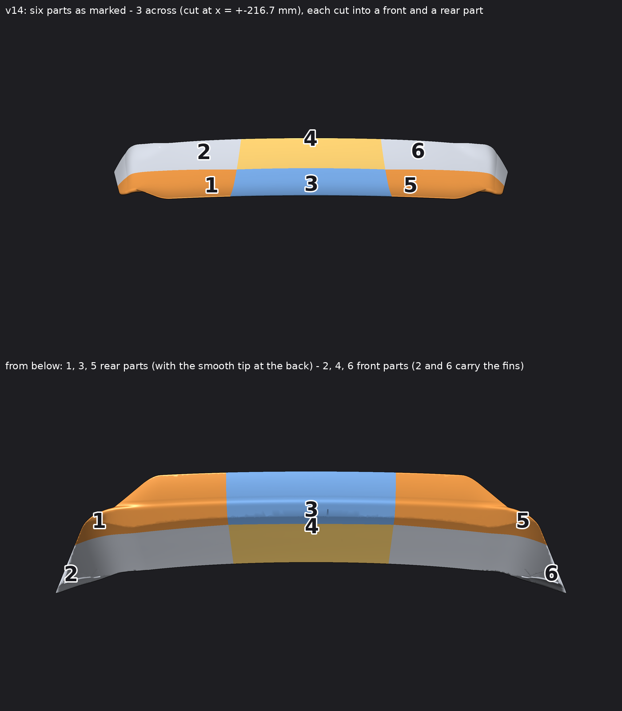
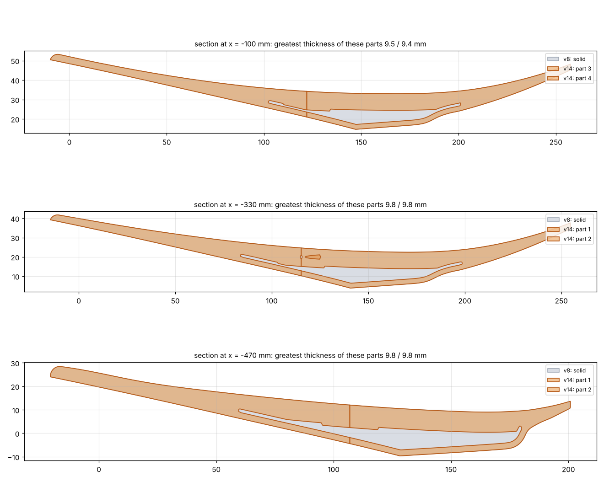
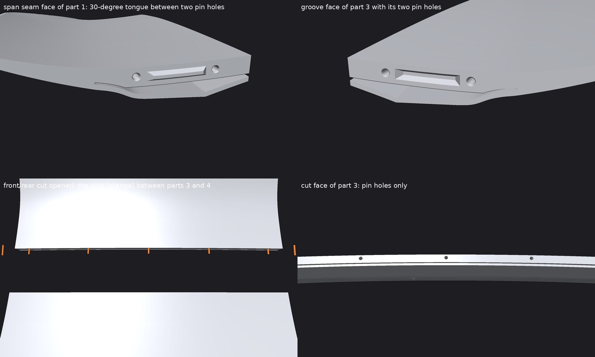
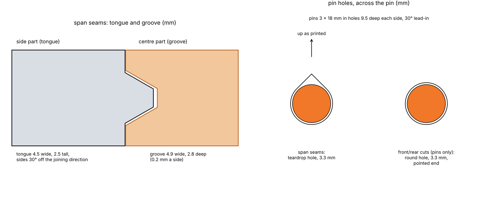
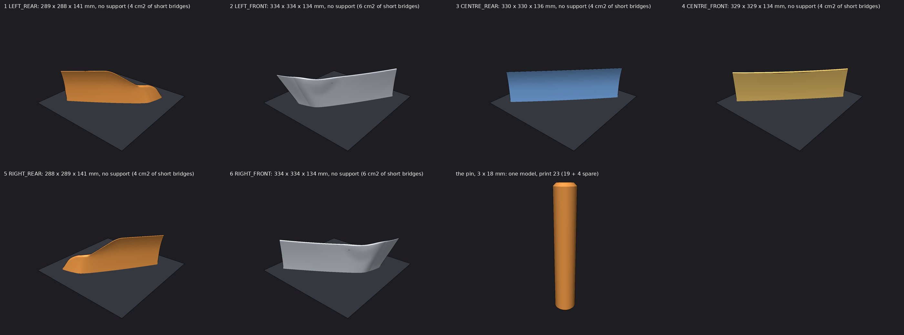

# Polo Oettinger-style roof spoiler v14: closed, smooth underside; ducktail lip ends blended in

v14 is v13 with the two changes asked for on the v13 parts:

- **A smooth underside, with no line along the back.** In v13 the hollow underneath was open to the car, and its edge showed as a line all along the back. In v14 the underside is closed: every part keeps the spoiler's own smooth underside, exactly as on the solid spoiler, and all the hollowing is inside the parts. Seen from below there is nothing to see: no brim, no step, no line, front to back and end to end.
- **The ducktail lip ends blended in.** At both outer rear corners the end of the ducktail lip no longer stands out as a blade: a broad 12 mm round runs the lip's underside into the rounded end of the spoiler, and the lip's tip is rounded off, on top of v13's fill of the notch under the lip.
- **Unchanged:** the outside shape everywhere else, the six parts and the way they print, the seven-file print set, and the 10 mm limit.

## 1. The underside: closed and smooth

Each part is now a closed shell with a cavity inside, wherever the spoiler is more than 10 mm deep:

- **Top skin:** 8.5 mm under every visible surface where the spoiler is deep, thinning to 6 mm where it is shallower, so the cavity under it is always at least 1.5 mm tall.
- **Skirt:** 2.5 mm, over the spoiler's own underside: smooth, flush to the back edge, with the 1.5 mm tape gap built in.
- **The step along the back, faired out.** Where the underside was fitted to the car (the contact band, with its 1.5 mm tape gap), it met the original underside behind it with a step 2-5 mm tall, which ran along the whole back and showed as a line from below. It is now one gentle ramp: `src/e4_underside.py` smooths the body only within 14 mm of that line.
- **Elsewhere** (the thin front band, the lip) the part is solid and thinner than 10 mm.
- **The fins** (parts 2 and 6, beyond |x| = 570 mm) are the one exception: their thick lower part is hollowed from the pillar side, as in v13, because that face sits against the car's pillar and is never seen.
- **The cavity opens only on the joint faces** (the span seams and the front/rear cuts), so each part is one closed shell with no sealed void, which every slicer prints correctly. Glue on the joint faces closes it at assembly; the finished spoiler is a sealed hollow body, about 506 cm³ of cavity in all.
- **It prints without support.** Printed standing on its cut face, each cavity is open at the bed and its walls stand nearly upright; where the top skin and skirt meet at the back and front edges they close in at a shallow angle.

## 2. The ducktail lip ends

- At each outer rear corner the body is rebuilt locally from its distance field: a 4.5 mm rolling-ball fillet fills the notch under the lip (as in v13), and a 12 mm one at the lip's outer end runs its underside into the rounded end of the spoiler in one broad curve; a light smoothing right at the end rounds the lip's tip.
- The change fades out within 20 mm of the lip's end, and everywhere else the surface is the original one: each corner gains 0.30 cm³ and loses 0.59 cm³.
- `src/e3_corners.py` builds this body (`out/E3.stl`) from the v6 body, `src/e4_underside.py` fairs the step under the back (`out/E4.stl`), and everything else is cut from that.

## 3. The six parts

| Part | File | Where | Volume |
|---|---|---|---|
| 1 | `v14_1_LEFT_REAR` | left section, rear | 386 cm³ |
| 2 | `v14_2_LEFT_FRONT` | left section, front (with the left fin) | 409 cm³ |
| 3 | `v14_3_CENTRE_REAR` | centre section, rear | 532 cm³ |
| 4 | `v14_4_CENTRE_FRONT` | centre section, front | 356 cm³ |
| 5 | `v14_5_RIGHT_REAR` | right section, rear | 386 cm³ |
| 6 | `v14_6_RIGHT_FRONT` | right section, front (with the right fin) | 409 cm³ |
| | | **Total** | **2,477 cm³** (v13: 2,194 cm³; solid: 2,963 cm³) |

- **Across the span:** cuts at x = ±216.7 mm. The centre section is 433 mm wide; each side section is 433 mm including its fin.
- **Front/rear:** one flat, vertical cut per section. It runs at z = 122 mm across the centre and slopes to z = 100 mm at the ends.
- **Symmetry:** the left and right parts are exact mirror images.
- The closed underside adds about 283 cm³ of plastic over v13 (the skirt), for about 0.30 kg in ASA.

## 4. Thickness: 10 mm at most

Greatest thickness per part, measured as the largest sphere that fits inside:

| Part | 1 | 2 | 3 | 4 | 5 | 6 |
|---|---|---|---|---|---|---|
| mm | 9.8 | 9.8 | 9.5 | 9.4 | 9.8 | 9.8 |

## 5. Joints: dowel pins at every seam, 30° tongues across the span

The pins and tongues sit in the top skin. Within 12 mm of each joint face the top skin may be up to 9.5 mm thick (the cavity there is at least 1 mm tall), so every hole has at least 1.6 mm of wall all round.

**Span seams** (x = ±216.7 mm; tongue on the side part, groove in the centre part):

- **Rear segment** (parts 1|3 and 3|5): 2 × 3 mm pins at z = 141.1 and 180.9 mm, and a 30 mm tongue (4.5 mm wide, 2.5 mm tall, sides 30° off the joining direction).
- **Front segment** (parts 2|4 and 4|6): 1 pin at z = 87.5 mm and a 20 mm tongue (3.0 wide, 1.7 tall, same 30° sides).
- **Printing:** these faces stand upright when printed. The holes are teardrop-shaped, pointed towards the top of the print, and the tongue and groove ends taper at 45°.

**Front/rear cuts** (parts 2|1, 4|3, 6|5): dowel pins only, about every 80 mm, with round holes and pointed ends:
- 5 pins on the centre cut, at x = -194.3, -97.1, 0.1, 97.3, 194.5 mm;
- 4 pins on each side cut, at x = ±239.2, 328.2, 417.1, 498.8 mm.

**Pins and fit:**
- 19 pins in all, 3 × 18 mm, in 3.3 mm holes 9.5 mm deep each side, with a 30° lead-in. They are all the same: print `v14_PIN_3x18.stl` 23 times (19 + 4 spare), or use 3 mm steel dowels or rod cut to 18 mm.
- At least 1.6 mm of wall around every hole.
- Measured clearance round the tongues: 0.17 mm at least.

## Print files

`print/` holds the whole print set, seven files, bed-ready for a 420 × 420 mm bed (Anycubic Kobra 3 Max). Each part stands on its cut face, set across the bed's diagonal.

| File | Print size (mm) | Notes |
|---|---|---|
| `v14_1_LEFT_REAR.stl` | 289 × 288 × 141 | stands on its front cut face |
| `v14_2_LEFT_FRONT.stl` | 334 × 334 × 134 | stands on its rear cut face |
| `v14_3_CENTRE_REAR.stl` | 330 × 330 × 136 | stands on its front cut face |
| `v14_4_CENTRE_FRONT.stl` | 329 × 329 × 134 | stands on its rear cut face |
| `v14_5_RIGHT_REAR.stl` | 288 × 289 × 141 | stands on its front cut face |
| `v14_6_RIGHT_FRONT.stl` | 334 × 334 × 134 | stands on its rear cut face |
| `v14_PIN_3x18.stl` | 3 × 18 | the pin, standing on end: print 23 (19 + 4 spare); skip if using metal pins |

**Supports: none needed.** Faces steeper than 55° add up to 4.4 cm² on part 1, 5.8 cm² on part 2, 4.3 cm² on part 3, 4.1 cm² on part 4, 4.4 cm² on part 5, 5.8 cm² on part 6: the closing tops of the cavities, short and narrow enough to bridge. If your slicer flags the fin tip on parts 2 and 6, allow a small tree support there.

**Settings:** ASA (UV-stable) or PETG; 0.25–0.28 mm layers with a 0.4 mm nozzle; 4 walls, 20–25% gyroid infill; an 8–10 mm brim on every part.

## Assembly

1. **Dry-fit.** At each front/rear cut, push the pins into the rear part's holes, then press the front part on. At the span seams, push the pins into the centre parts and slide the side parts on along the span.
2. **Glue.** Epoxy, or for ASA, ABS/ASA cement, on the whole of both faces (the top skin and the skirt), in the holes, and in the grooves and on the tongues of the span seams. Join each front/rear pair first (1+2, 3+4, 5+6), then the three sections at the span seams. The glue closes the cavities.
3. **Finish.** Fill the seam lines, prime and paint.

## Mounting

- **Front band:** two strips of 12 mm 3M VHB tape. The 1.5 mm tape gap is built into the underside.
- **Back:** run a 3 mm bead of PU adhesive (Sikaflex or similar) along the back of the underside, just in front of the line where it leaves the car, then press the spoiler on. That band sits on the car with the same 1.5 mm gap, so the bead spreads to a thin, even seal.
- **Fins:** a thin bead or 6 mm tape on the edges that touch the pillars.

## Checks on the delivered files

`src/p3_validate.py` checks every part and pin, and stops if a check fails. Results are in `out/validation.json`.

- **Meshes:** all watertight, with consistent winding, one body each, no self-intersections and no zero-area faces. The print files are checked again as written (float32 STL).
- **Thickness:** 9.4–9.8 mm at most per part.
- **Fit:** no part overlaps a neighbour or a pin; tongue clearance as above; pin-hole walls at least 1.6 mm.
- **Seams:** the outer outlines of neighbouring parts match to within a few mm² (from the 0.02 mm decimation).

## Files and rebuilding

- `print/`: the print set, the six parts and the pin (above). The zip `Polo_spoiler_v14_print_package.zip` holds the same seven models plus this README and its figures.
- The scripts also write the parts and the pins in place on the car to `out/assembled/`, for the checks, figures and renders. These working copies are not part of the print set and are not stored in the repository.
- `docs/`: the figures above and `rim_v14.png`, a studio render of the back edge at part 3's end, from the same camera as the owner's close-up of v10.
- `src/`: the scripts. `sh v14/src/run_all.sh` from `spoiler/` rebuilds everything in about 50 minutes (the corner blend takes 15 of them).
- **To change the design:** edit `src/layout.py`.
  - Hollowing: `T_SKIN` and `SKIN_MIN` (top skin), `SKIRT`, `CAV_MIN`, `C_MIN`.
  - Corners: `CORNER_CURVE` and `R_FILLET` (the notch under the lip), `CORNER_END`, `R_END`, `CORNER_END_W`, `CORNER_END_SIG` (the lip's end).
  - Cut lines: `C0`, `C1`. Pins on the front/rear cuts: `CUT_PIN_PITCH`.

**Limits.**
- The underside comes from a car model built from VW's published dimensions, not from a scan. Dry-fit on the car before gluing, as with earlier versions.
- v11 found that on the owner's own Polo GTI model the rear edge stands 10–30 mm off. If that model is true to the car, refit the underside first; the parts are then rebuilt on it by the same scripts.
