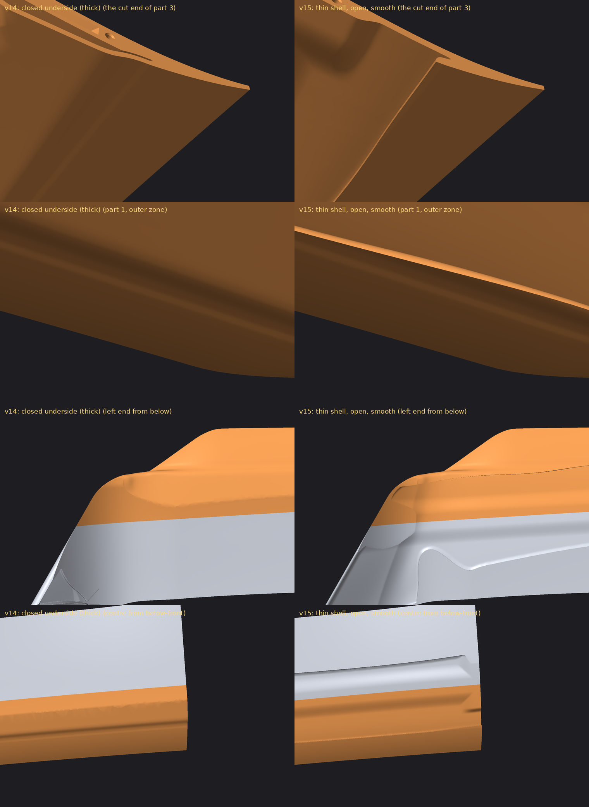
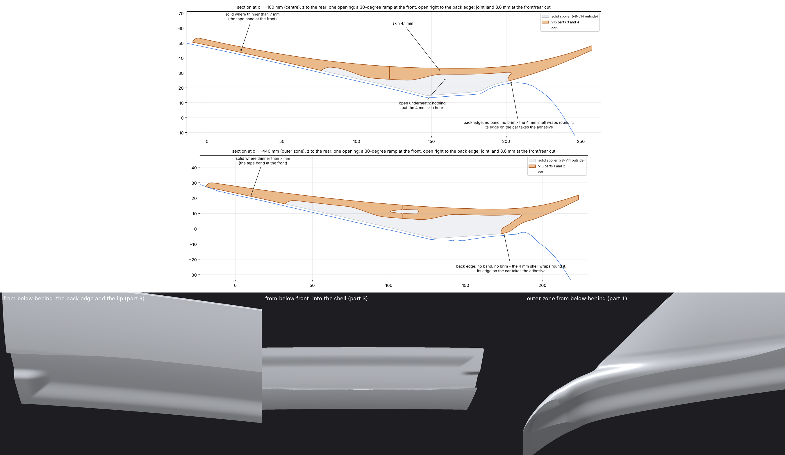
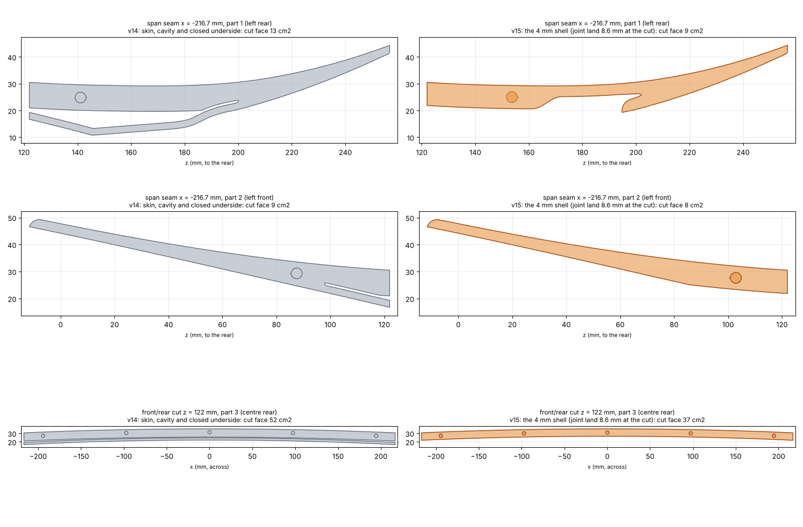
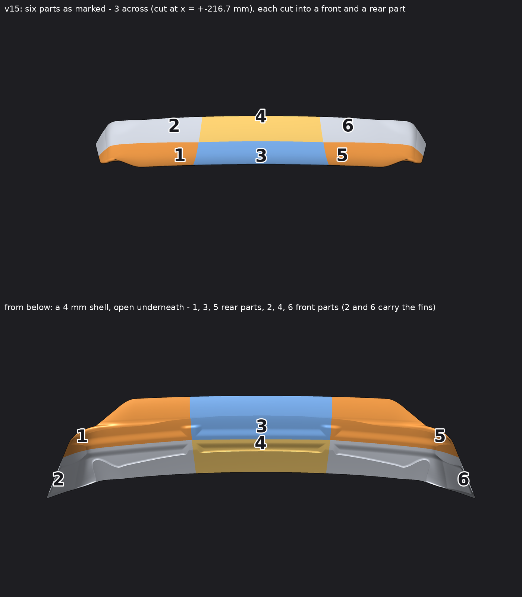
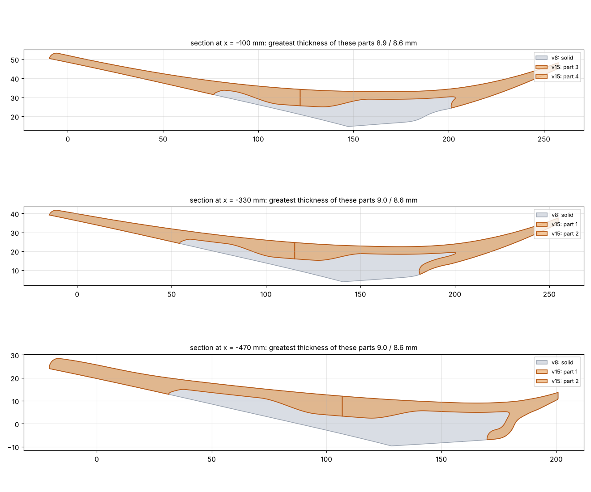
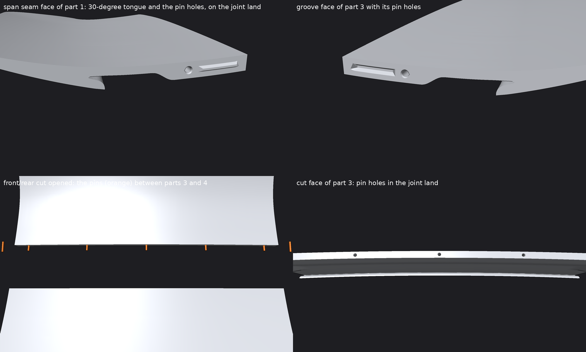
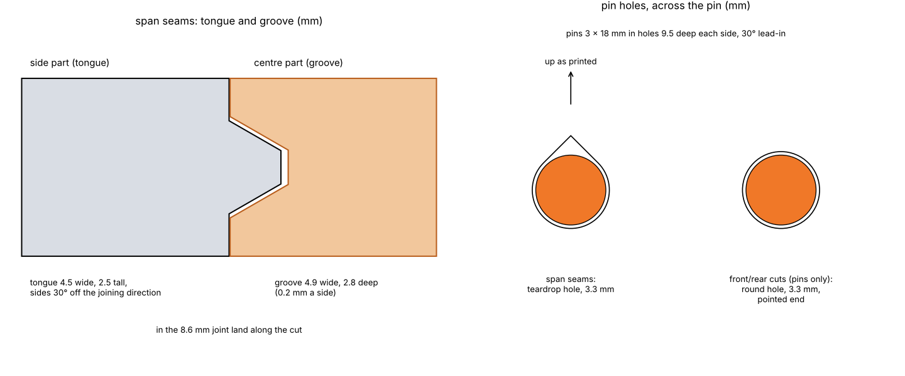
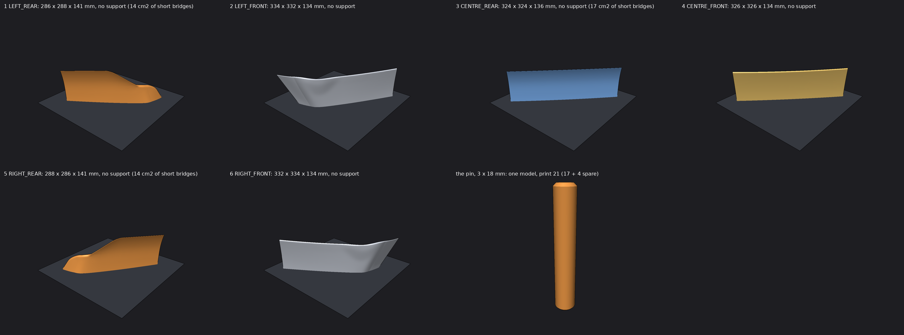

# Polo Oettinger-style roof spoiler v15: a thin 4 mm shell, open underneath, smooth all over

v15 is v14 with the closed underside taken out again, as marked in blue on the v14 cut faces:

- **Thinner.** In v14 every part was a skin, a cavity and a closed underside one over the other, so its cut faces showed the whole depth of the spoiler, up to 19 mm. v15 is a **4 mm shell** under every visible surface (as thin as the spoiler's own front edge) and open underneath. It is thicker only where it has to be: 8.6 mm joint lands along the cuts for the pins and tongues. The six parts weigh in at **1,754 cm³** of plastic, down from 2,477 cm³ in v14 and 2,194 cm³ in v13.
- **Smooth and simple underneath, with no brim at the back.** Seen from below there is the front band, one opening, and the shell round the back edge, nothing else:
  - the front band (where the spoiler is thinner than 7 mm, 49–85 mm deep) stays closed, and the opening starts on it with a 30° ramp up into the 4 mm ceiling, along one clean, crisp line;
  - at the back there is no band, no ramp and no strip: the opening runs right to the line where the underside leaves the car, and the 4 mm shell wraps round the back edge as a smooth offset of the outside, so the rear side seen from below is as smooth as the top;
  - there is no brim, no lip, no slot and no channel.
- **Unchanged:** the outside shape, including v14's blended ducktail lip ends; the six parts and the way they print; the seven-file print set; the joints; and the 10 mm limit.

## 1. The shell

- **Skin:** 4 mm under every visible surface: the top, the front edge, the spoiler's own underside behind the back edge (under the ducktail lip), and the fins' outer faces.
- **Open underneath** through the faces that sit on the car (in front of the line where the underside leaves the car at the back) and through the fins' pillar side.
- **Front band:** solid where the spoiler is thinner than 7 mm. That is the band at the front, 49–85 mm deep, where the VHB tape goes.
- **The opening** starts on the front band with a 30° ramp up to the 4 mm ceiling, so it never starts with a step, and the ramp meets the underside along one clean, crisp line, a smooth curve across the whole span.
- **The back edge:** no band and no ramp. The opening runs right back to the line where the underside leaves the car, and behind it the 4 mm shell wraps round the back edge: it follows the top over the back edge, then the ducktail lip's own underside back to that line, everywhere 4 mm from the outside. Inside, the shell is a smooth offset of the outer surface. The shell's edge along that line sits on the car and takes the adhesive bead.
- **Joint lands:** along every cut (the span seams and the front/rear cuts) the skin is 8.6 mm thick for 11 mm. It then tapers smoothly back to 4 mm by 36 mm from the cut, so the pin holes and grooves have walls all round. From below they show as gentle swells along the cuts. The span seams' lands stop 37 mm before the back edge, so the shell is 4 mm all round the back edge.
- **Smooth everywhere:** the whole inside comes from one smooth field, so the ramp runs into the ceiling in a soft curve and the inside follows the outside round the back edge. The only edges are the crisp line where the ramp meets the underside and the shell's own edge at the back. There are no voxel steps, no slots and no ledges.
- **Fins:** parts 2 and 6 are hollowed from the pillar side, as before. That face sits against the car's pillar.

## 2. The cut faces, v14 and v15

The faces you marked: in v14 a cut face showed the skin, the cavity and the closed underside, the whole depth of the spoiler. In v15 it shows the 8.6 mm joint land over the opening, plus the solid front band and, at the back, the 4 mm shell round the back edge.

## 3. The six parts

| Part | File | Where | Volume | v14 |
|---|---|---|---|---|
| 1 | `v15_1_LEFT_REAR` | left section, rear | 259 cm³ | 386 cm³ |
| 2 | `v15_2_LEFT_FRONT` | left section, front (with the left fin) | 296 cm³ | 409 cm³ |
| 3 | `v15_3_CENTRE_REAR` | centre section, rear | 343 cm³ | 532 cm³ |
| 4 | `v15_4_CENTRE_FRONT` | centre section, front | 302 cm³ | 356 cm³ |
| 5 | `v15_5_RIGHT_REAR` | right section, rear | 259 cm³ | 386 cm³ |
| 6 | `v15_6_RIGHT_FRONT` | right section, front (with the right fin) | 296 cm³ | 409 cm³ |
| | | **Total** | **1,754 cm³** | 2,477 cm³ |

- **Across the span:** cuts at x = ±216.7 mm. The centre section is 433 mm wide; each side section is 433 mm including its fin.
- **Front/rear:** one flat, vertical cut per section. It runs at z = 122 mm across the centre and slopes to z = 100 mm at the ends.
- **Symmetry:** the left and right parts are exact mirror images.
- **Weight:** 1,754 cm³ of part is about 1.7 kg in ASA or 2.0 kg in PETG, plus primer and paint. With 4 walls the 4 mm shell prints practically solid, so this is about 90% of solid plastic; v14's thicker parts were more infill.

## 4. Thickness: 10 mm at most

Greatest thickness per part, measured as the largest sphere that fits inside. The thickest places are the joint lands; the shell itself is 4 mm.

| Part | 1 | 2 | 3 | 4 | 5 | 6 |
|---|---|---|---|---|---|---|
| mm | 9.0 | 8.6 | 8.9 | 8.6 | 9.0 | 8.5 |

## 5. Joints: dowel pins at every seam, 30° tongues across the span

The pins and tongues sit in the joint lands, the 8.6 mm thickening of the skin along each cut. Every hole has at least 1.6 mm of wall all round.

**Span seams** (x = ±216.7 mm; tongue on the side part, groove in the centre part):

- **Rear segment** (parts 1|3 and 3|5): 1 × 3 mm pin at z = 153.7 mm, and a 22 mm tongue (3.0 mm wide, 1.7 mm tall, sides 30° off the joining direction).
- **Front segment** (parts 2|4 and 4|6): 1 pin at z = 102.9 mm and a 36 mm tongue (3.0 wide, 1.7 tall, same 30° sides).
- **Printing:** these faces stand upright when printed. The holes are teardrop-shaped, pointed towards the top of the print, and the tongue and groove ends taper at 45°.

**Front/rear cuts** (parts 2|1, 4|3, 6|5): dowel pins only, about every 80 mm, with round holes and pointed ends:
- 5 pins on the centre cut, at x = -194.3, -97.1, 0.1, 97.4, 194.6 mm;
- 4 pins on each side cut, at x = ±239.2, 339.1, 438.8, 506.4 mm.

**Pins and fit:**
- 17 pins in all, 3 × 18 mm, in 3.3 mm holes 9.5 mm deep each side, with a 30° lead-in. They are all the same: print `v15_PIN_3x18.stl` 21 times (17 + 4 spare), or use 3 mm steel dowels or rod cut to 18 mm.
- At least 1.6 mm of wall around every hole.
- Measured clearance round the tongues: 0.13 mm at least.

## Print files

`print/` holds the whole print set, seven files, bed-ready for a 420 × 420 mm bed (Anycubic Kobra 3 Max). Each part stands on its cut face, set across the bed's diagonal.

| File | Print size (mm) | Notes |
|---|---|---|
| `v15_1_LEFT_REAR.stl` | 286 × 288 × 141 | stands on its front cut face |
| `v15_2_LEFT_FRONT.stl` | 334 × 332 × 134 | stands on its rear cut face |
| `v15_3_CENTRE_REAR.stl` | 324 × 324 × 136 | stands on its front cut face |
| `v15_4_CENTRE_FRONT.stl` | 326 × 326 × 134 | stands on its rear cut face |
| `v15_5_RIGHT_REAR.stl` | 288 × 286 × 141 | stands on its front cut face |
| `v15_6_RIGHT_FRONT.stl` | 332 × 334 × 134 | stands on its rear cut face |
| `v15_PIN_3x18.stl` | 3 × 18 | the pin, standing on end: print 21 (17 + 4 spare); skip if using metal pins |

**Supports: only inside the back edge of parts 1, 3 and 5.** Standing on its front cut face, each rear part has its back edge at the top of the print, and with no band or ramp under it any more the shell's edge there hangs free: 18 cm² on parts 1 and 5 and 24 cm² on part 3 have nothing below them. Use tree supports from the build plate only, at about 45°. They grow up through the open underside to the inside of the back edge, so they touch only the edge that is glued to the car, never a face you see. Parts 2, 4 and 6 print without support (their 2–3 cm² of steep faces are scattered facets a slicer bridges); if your slicer flags the fin tip on parts 2 and 6, allow a small tree support there.

**Settings:** ASA (UV-stable) or PETG; 0.25–0.28 mm layers with a 0.4 mm nozzle; 4 walls (at 4 mm the shell is then solid), 20–25% gyroid infill for the lands and the front band; an 8–10 mm slicer brim (the bed-adhesion setting, not part of the model) on every part. A thin shell this size can lift at the corners while printing, so keep that brim and an enclosure.

## Assembly

1. **Dry-fit.** At each front/rear cut, push the pins into the rear part's holes, then press the front part on. At the span seams, push the pins into the centre parts and slide the side parts on along the span.
2. **Glue.** Epoxy, or for ASA, ABS/ASA cement, on both faces of each joint (the shell's cut faces, the lands and the front band), in the holes, and in the grooves and on the tongues of the span seams. Join each front/rear pair first (1+2, 3+4, 5+6), then the three sections at the span seams. For extra strength, a strip of glass cloth and epoxy across each joint on the inside of the shell, where it is never seen.
3. **Finish.** Fill the seam lines, prime and paint.

## Mounting

- **Front band:** two strips of 12 mm 3M VHB tape on the solid front band. The 1.5 mm tape gap is built into the underside.
- **Back edge:** run a 3 mm bead of PU adhesive (Sikaflex or similar) along the shell's back edge, the edge of the shell that sits on the car along the line where the underside leaves it, then press the spoiler on. It sits on the car with the same 1.5 mm gap, so the bead spreads to a thin, even seal along the edge and a little way up inside the shell.
- **Fins:** a thin bead or 6 mm tape on the edges that touch the pillars.

## Checks on the delivered files

`src/p3_validate.py` checks every part and pin, and stops if a check fails. Results are in `out/validation.json`.

- **Meshes:** all watertight, with consistent winding, one body each, no self-intersections and no zero-area faces. The print files are checked again as written (float32 STL).
- **Thickness:** 8.5–9.0 mm at most per part.
- **Fit:** no part overlaps a neighbour or a pin; tongue clearance as above; pin-hole walls at least 1.6 mm.
- **Seams:** the outer outlines of neighbouring parts match to within a few mm² (from the 0.02 mm decimation).

## Files and rebuilding

- `print/`: the print set, the six parts and the pin (above). The zip `Polo_spoiler_v15_print_package.zip` holds the same seven models plus this README and its figures.
- The scripts also write the parts and the pins in place on the car to `out/assembled/`, for the checks, figures and renders. These working copies are not part of the print set and are not stored in the repository.
- `docs/`: the figures above and `rim_v15.png`, a studio render of the back edge at part 3's end.
- `src/`: the scripts. `sh v15/src/run_all.sh` from `spoiler/` rebuilds everything in about an hour. v15 cores the same outer body as v14 (`v14/out/E4.stl`), which the v14 scripts build first if it is missing.
- **To change the design:** edit `src/layout.py`.
  - Shell: `T_SKIN` (the skin), `OPEN_H` and `K_WALL` (where the opening starts at the front, and its ramp).
  - Joint lands: `LAND_T`, `LAND`, `LAND_BACK`. Cut lines: `C0`, `C1`. Pins on the front/rear cuts: `CUT_PIN_PITCH`.

**Limits.**
- The underside comes from a car model built from VW's published dimensions, not from a scan. Dry-fit on the car before gluing, as with earlier versions.
- v11 found that on the owner's own Polo GTI model the rear edge stands 10–30 mm off. If that model is true to the car, refit the underside first; the parts are then rebuilt on it by the same scripts.
