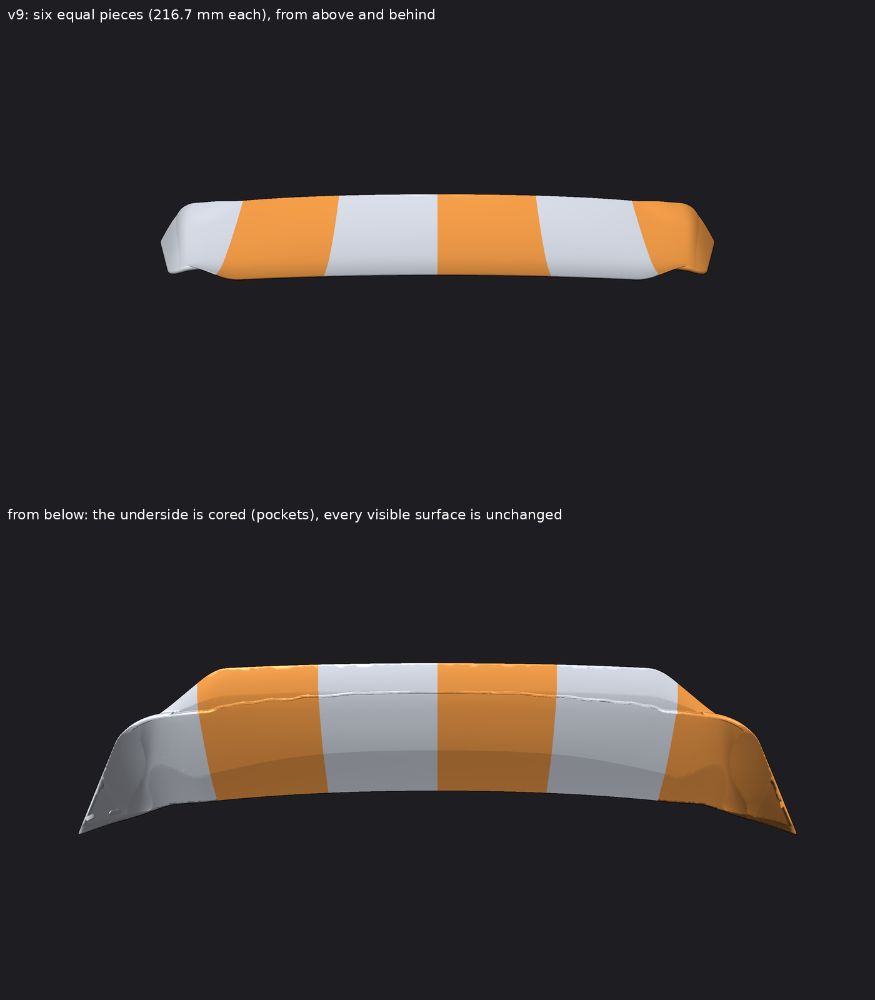
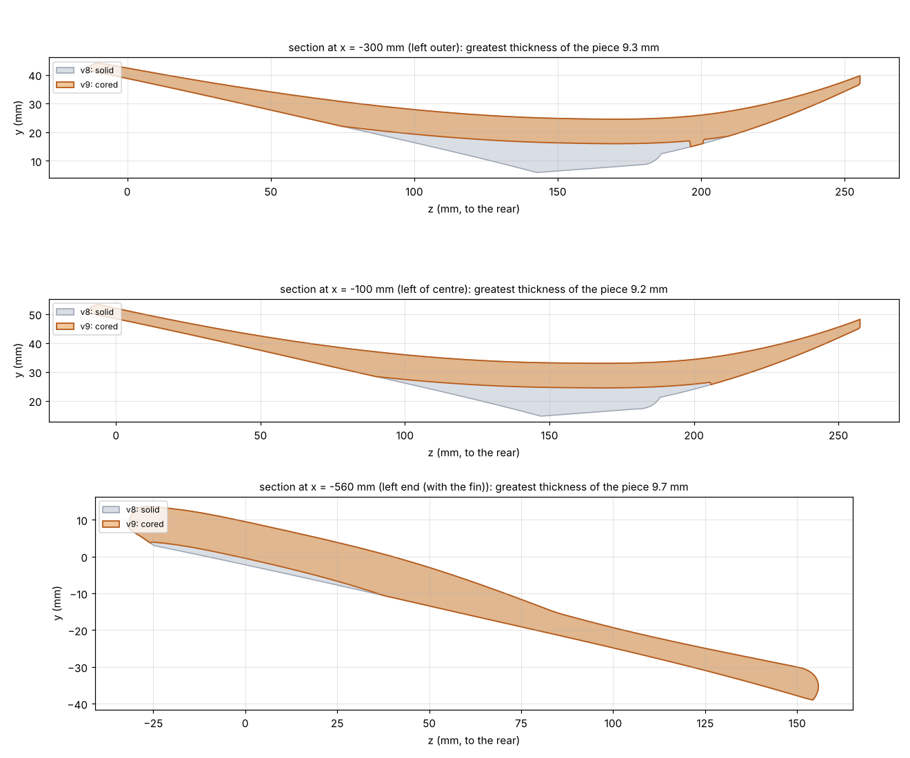
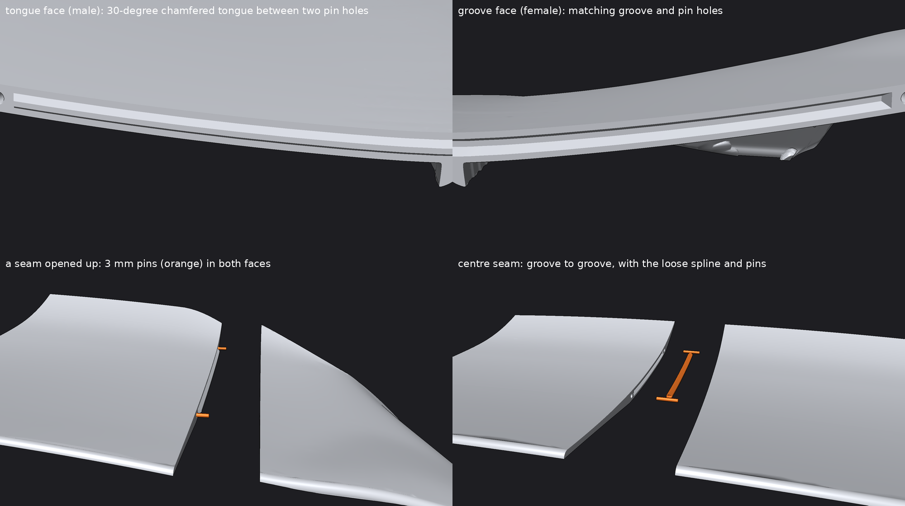
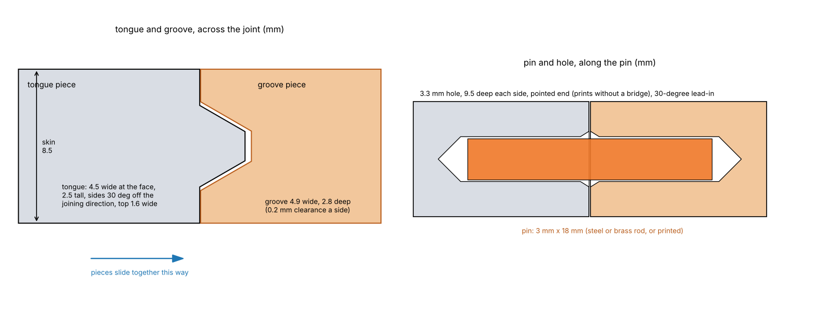
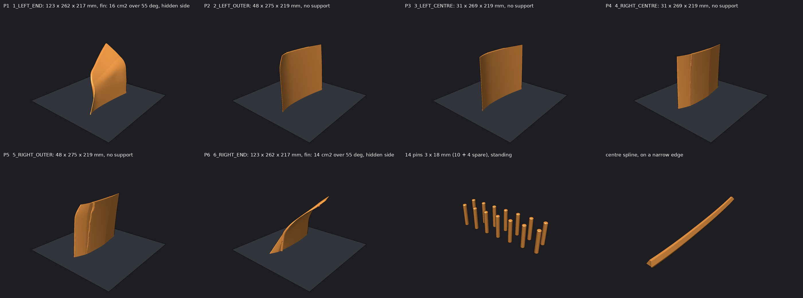

# Polo Oettinger-style roof spoiler v9: 6 equal pieces, 10 mm max, pins and chamfered joints

v9 is a new print build of the same spoiler. The outside shape, the underside that sits on the car, and the car coordinates are the same as v6–v8: X across the car, Y up, +Z to the rear. It is still 1,300 × 147 × 292 mm overall. Four things changed, as asked:

1. **No part is thicker than 10 mm.** The pieces are cored from underneath. The thickest point in any piece is now **9.7 mm** (v8 was solid, up to 28 mm).
2. **Pins in holes instead of bow-tie keys.** Each seam has two 3 mm dowel pins.
3. **A 30° chamfered locating joint at every seam**, so the pieces centre themselves and the outer surfaces line up.
4. **Six equal pieces**, each 216.7 mm wide, all cut straight across the span.

## 1. Thickness: no more than 10 mm anywhere

All visible surfaces stay exactly as they were: the top, the lip edge, the ends and the outside of the fins. Material more than 8.5 mm below them is removed from the underside.

- **Under the ridge** there is now a pocket, open to the car side and hidden when fitted. The skin above it is 8.5 mm.
- **The front band stays solid.** It sits on the roof and is thinner than the skin already (4–8 mm), so it keeps its full contact for the tape.
- **Seal rim.** Where the underside leaves the car at the back (the top of the tailgate), a 3.5 mm rim is kept. The spoiler still sits on the car there, and no gap shows under the lip.
- **The lip's root** was 11–13 mm thick between the top and the underside of the lip. That underside is trimmed to 8.5 mm below the top. The change is at most about 3 mm, only on the underside of the lip, and only where it was thicker.
- **The fin tips** were solid triangles about 13.5 mm across. They keep a 5.5 mm wall and are cored from the pillar side.

How thickness was checked: for every finished piece, the largest sphere that fits inside it was found. Its diameter is the piece's greatest thickness.

| Piece | Greatest thickness | v8 solid volume | v9 volume |
|---|---|---|---|
| 1 left end | 9.7 mm | 381 cm³ | 291 cm³ |
| 2 left outer | 9.3 mm | 575 cm³ | 410 cm³ |
| 3 left of centre | 9.2 mm | 526 cm³ | 389 cm³ |
| 4 right of centre | 9.3 mm | 526 cm³ | 389 cm³ |
| 5 right outer | 9.2 mm | 575 cm³ | 410 cm³ |
| 6 right end | 9.7 mm | 381 cm³ | 290 cm³ |
| **Total** | | **2,963 cm³** | **2,180 cm³ (26% less)** |

## 2–3. Joints: pins plus a 30° tongue and groove

Every seam has the same three parts, set along the middle of the skin:

- **Two dowel pins**, 3 mm × 18 mm, in 3.3 mm holes 9.5 mm deep in each face. Each hole has a 30° lead-in at the mouth and a pointed end, so it prints without a bridge.
  - Use steel dowels, or 3 mm steel or brass rod cut to 18 mm. Printed pins work too: 14 are on one plate (10 needed, 4 spare).
  - There is at least 1.5 mm of wall all the way round every hole: 1.5 mm at the outer seams, 2.1–2.5 mm at the others.
- **A tongue on one face** that seats in **a groove in the other**. This is the reference the parts align on.
  - The tongue is 4.5 mm wide at the face and 2.5 mm tall. Its sides lean 30° off the direction the pieces slide together, and its ends are tapered the same way.
  - The groove is 0.2 mm bigger each side and 0.3 mm deeper. Pushed together, the 30° sides steer the pieces into line, so the outer surfaces meet flush.
  - Measured clearance between tongue and groove is 0.15–0.17 mm.
  - The tongue runs 100–125 mm between the two pins.
- **The centre seam is groove to groove** and takes a loose **spline**: a strip shaped like two tongues back to back. This is needed because the end pieces print standing on their only cut face, so it has to be a groove. With six pieces and five seams, that leaves the middle seam with a groove on both sides.

| Seam | Pieces | Tongue on | Groove on | Pins at (z, mm) |
|---|---|---|---|---|
| x = −433 | 1 / 2 | piece 2 | piece 1 | 53, 187 |
| x = −217 | 2 / 3 | piece 3 | piece 2 | 89, 204 |
| x = 0 | 3 / 4 | spline | both | 96, 206 |
| x = +217 | 4 / 5 | piece 4 | piece 5 | 89, 204 |
| x = +433 | 5 / 6 | piece 5 | piece 6 | 53, 188 |

## Print files

`print/` holds bed-ready files, oriented and centred on a 420 × 420 mm bed (Anycubic Kobra 3 Max). Every piece stands on its **groove face**, so any tongue is on top.

| File | Qty | Print size (mm) | Supports |
|---|---|---|---|
| `v9_1_LEFT_END.stl` | 1 | 123 × 262 × 217 | Under the fin only: 16 cm² steeper than 55°, all on the hidden pillar side |
| `v9_2_LEFT_OUTER.stl` | 1 | 48 × 275 × 219 | None |
| `v9_3_LEFT_CENTRE.stl` | 1 | 31 × 269 × 219 | None |
| `v9_4_RIGHT_CENTRE.stl` | 1 | 31 × 269 × 219 | None |
| `v9_5_RIGHT_OUTER.stl` | 1 | 48 × 275 × 219 | None |
| `v9_6_RIGHT_END.stl` | 1 | 123 × 262 × 217 | Under the fin only: 14 cm² steeper than 55°, all on the hidden pillar side |
| `v9_CENTRE_SPLINE.stl` | 1 | 7 × 100 × 5 | None. It stands on a narrow edge, so use a brim |
| `v9_PINS_3x18_plate_x14.stl` | 1 plate | 14 pins, standing | None. Skip it if you use metal pins |
| `v9_PIN_3x18.stl` | — | one pin | None |

### Settings for fast, strong prints

- **Material:** ASA (UV-stable, best outdoors) or PETG.
- **Layers:** 0.25–0.28 mm with a 0.4 mm nozzle, or 0.3 mm with a 0.6 mm nozzle for speed.
- **Walls:** 4 perimeters. The skin is 8.5 mm, so that is about 2 mm each side with infill between.
- **Infill:** 20–25% gyroid, or 100% for the most strength. The pieces are thin, so 100% costs little.
- **Brim:** 8–10 mm. The pieces are tall, thin curved walls about 12 cm² on the bed. Add a brim on the spline too.
- **Supports:** pieces 2–5 and the spline need none. On pieces 1 and 6, use tree supports from the build plate for overhangs over 55°. They only touch the fin's inner face and the pocket, both hidden when fitted.

## Assembly

1. **Dry-fit each seam.** Push the two pins into one face, then slide the next piece on along the span. The tongue drops into the groove and centres the piece. The 30° sides mean you don't need to line it up by eye.
2. **Glue.** Use epoxy, or for ASA, ABS/ASA cement. Put it on both faces, in the holes and on the tongue. Join the **centre seam first**: piece 3 + spline + 2 pins + piece 4. Then add pieces 2 and 5, then the end pieces 1 and 6. Hold or clamp each seam until it sets.
3. **Finish.** Fill the seam lines, prime and paint as before.

## Mounting

The spoiler now sits on the car along:
- the **front band** (solid, about 70–100 mm wide at the roof);
- the **seal rim** (3.5 mm) on the tailgate;
- the **edges of the fins** on the pillars.

Put the 3M VHB tape on the front band, as two strips of 12 mm. Use a bead of PU adhesive or a 3 mm tape on the seal rim. Use a thin bead or 6 mm tape on the fin edges. The middle of the underside is the open pocket: it does not touch the car.

## Checks on the delivered files

`src/p3_validate.py` checked every piece and loose part. It stops if any check fails. Results are in `out/validation.json`.

- **Meshes:** all six pieces, the spline and the pins are watertight, with consistent winding, one body each, no self-intersections and no zero-area faces. The print files were also checked as written (float32 STL).
- **Thickness:** greatest thickness 9.2–9.7 mm per piece, so at most 10 mm.
- **Fit:**
  - Neighbouring pieces, the spline and the pins don't overlap.
  - Tongue clearance is 0.15–0.17 mm.
  - Pin-hole walls are at least 1.5 mm.
- **Surfaces:** at each seam the two outer surfaces come from the same body, so they meet exactly. The pocket surfaces differ by at most 0.2 mm, which is hidden.

## Files and rebuilding

- `assembled/`: the 6 pieces, the spline and the 10 pins in car coordinates, in their fitted positions. Load them together to check the assembly.
- `docs/`: the figures above.
- `src/`: the scripts. `sh v9/src/run_all.sh` from `spoiler/` rebuilds everything in about 10 minutes.
- **To change the skin, pins or chamfer:** edit `src/layout.py`.
  - Skin: `T_SKIN`.
  - Pins: `PIN_D`, `HOLE_D`, `HOLE_DEPTH`.
  - Chamfer: `CHAMFER_DEG`, `TONGUE_BASE`, `TONGUE_H`.

**Limits.**
- The underside comes from a car model built from VW's published dimensions, not from a scan. Dry-fit on the car before gluing, as with earlier versions.
- The pocket changes where the tape can go (see Mounting).
